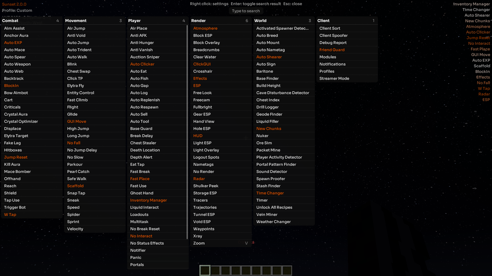
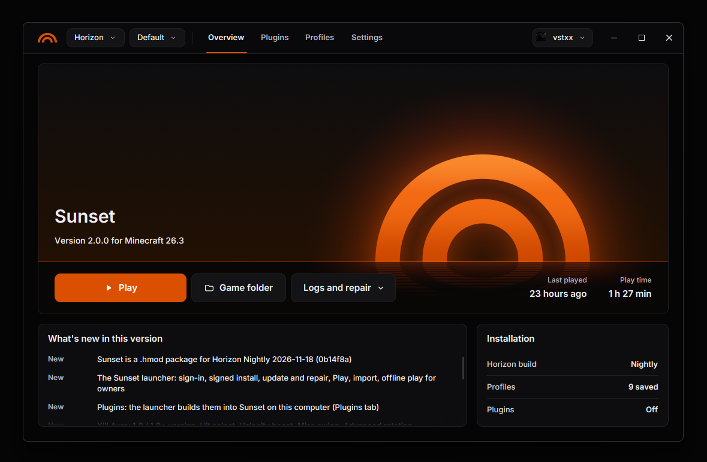

<p align="center">
  <picture>
    <source media="(prefers-color-scheme: light)" srcset="docs/images/logo-light.png">
    
  </picture>
</p>

<p align="center">A native utility client for <a href="https://github.com/horizon-rust/horizon">Horizon</a> on Minecraft 26.3.</p>
<p align="center"><a href="https://sunset-client.pages.dev">Website</a> · <a href="https://github.com/PointOfPressure/sunset-client/releases/latest">Latest release</a> · <a href="#install">Install</a> · <a href="#features">Features</a> · <a href="https://discord.gg/fhD2frFdzm">Discord</a> · <a href="CONTRIBUTING.md">Contribute</a></p>

Sunset adds over 160 modules to Horizon: combat, movement, building, ESP and world tools. Everything is set from
a click menu or chat commands, can be bound to a key, and can be saved as a profile. It is written in Rust and
compiled into the game.

**Current version:** Sunset 2.0.0, for Horizon Nightly 2026-11-18 (`0b14f8a`).



> Sunset is not made by or affiliated with the Horizon project. Many servers ban clients like this one: only use it
> where it's allowed.

## Install

Sunset 2.0 installs with the Sunset launcher, for Windows 10 (1903 or later) and Linux (x86_64).

1. Download the launcher for your system from the [latest release](https://github.com/PointOfPressure/sunset-client/releases/latest)
   and start it.
2. Sign in with your Microsoft account: the launcher shows a link and a code to enter there.
3. Click **Install**. The launcher downloads Sunset already built, checks its signature, and sets up Minecraft 26.3
   and the Horizon Nightly Sunset was built for. Nothing is compiled on your computer.
4. Click **Play**.



The launcher keeps the game, its `sunset` instance and your settings in its own folder:
`~/.local/share/sunset-launcher` on Linux, `%APPDATA%\sunset-launcher` on Windows. It does not use or change the
Horizon launcher's accounts and instances. If you used Sunset 1.x, Settings > Import copies its settings and
profiles once.

On Linux the launcher needs these libraries:

```sh
sudo apt install libxkbcommon0 libxkbcommon-x11-0 libxcb1     # Debian, Ubuntu
sudo dnf install libxkbcommon libxkbcommon-x11 libxcb         # Fedora
sudo pacman -S libxkbcommon libxkbcommon-x11 libxcb           # Arch
```

**Offline play:** once a Microsoft account that owns Minecraft: Java Edition has signed in, the account menu can add
offline names for offline-mode servers.

**Baritone** is part of Sunset; there is nothing extra to install. Its licence and how to replace its engine:
[client/docs/baritone.md](client/docs/baritone.md).

<details>
<summary>Horizon version of each release</summary>

The launcher installs only the Nightly its Sunset was built for, even after Horizon has removed that Nightly from its
releases.

| Sunset | Horizon |
| --- | --- |
| **2.0.0** (current) | Nightly 2026-11-18, `0b14f8a` |
| 1.2.1 | Nightly 2026-11-13, `9f42064` |
| 1.2.0 | Nightly 2026-11-13, `9f42064` |
| 1.1.0 | Nightly 2026-11-08, `fdc87ae` |
| 1.0.0 | Nightly 2026-11-05, `66f3981` |

</details>

<details>
<summary>macOS, and Sunset 1.2.1 and earlier</summary>

There is no 2.0 build for macOS. Sunset 1.x is a `.hnmod` mod that the Horizon launcher builds into the game;
Horizon launchers from 0.2.70 on no longer build `.hnmod` mods. To install 1.2.1, download `install.sh` and
`sunset-1.2.1.hnmod` from its [release page](https://github.com/PointOfPressure/sunset-client/releases/tag/v1.2.1),
then run `sh install.sh sunset-1.2.1.hnmod` (on Windows, `install.ps1` from the same page). The first build takes
10 to 30 minutes. Play the **Native mods** instance.

**Update:** run the script again; settings and profiles stay. **Remove:** delete `sunset.hnmod` from
`horizon-native-mods` in Horizon's game folder (`%APPDATA%\horizon`, `~/.local/share/horizon` or
`~/Library/Application Support/horizon`) and in `instances/native-mods`.

| Problem | Fix |
| --- | --- |
| "I couldn't find the Horizon launcher" | Install it from [playhorizon.dev](https://playhorizon.dev), open it once, run the script again. |
| The command does nothing on Windows | Run it in PowerShell, not Command Prompt. |
| Linux build fails mentioning `alsa` or `libudev` | Install `libasound2-dev libudev-dev pkg-config` or your system's equivalents. |
| "These mods were made for different Horizon revisions" | Another native mod was made for a different Horizon version. Turn it off on the launcher's Mods page or delete its `.hnmod`. |
| Windows: `windres: preprocessing failed` | Your Windows user name contains a space. Set `HORIZON_LAUNCHER_HOME` to a folder without spaces. |

</details>

## Getting started

Press <kbd>`</kbd> (under <kbd>Esc</kbd>) or <kbd>Right Shift</kbd> in game to open the menu. Both keys can be
changed in Options > Mods > Sunset. Changes are saved as you make them.

### In the menu

| Do this | To |
| --- | --- |
| Left click a module | turn it on or off |
| Right click a module | open its settings and key bind |
| Type | search names, initials (`ka`), typos, settings and descriptions; best match first |
| <kbd>Enter</kbd> | turn the best search result on or off |
| <kbd>Esc</kbd> | clear the search, then close the menu |
| Click a slider's number | type an exact value |
| Drag a panel's title | move the panel |
| Right click a panel's title | fold the panel |

*ClickGUI > Style* switches between three menus. Dropdown and Dashboard list each category's modules A to Z.
- **Dropdown**: one panel per category, as in the picture above. Settings open inside the panel, or in their own
  window with *Settings: Window*.
- **Dashboard**: one window with the categories on the left, the module list in the middle and the chosen module's
  settings on the right.
- **Sidebar**: one window with tabs down its left (Rage, Legit, ESP, Visuals...), each tab's modules split into groups,
  and each module a card showing its main settings while it is on, with a link to a page of all of them.

*ClickGUI > Theme* is **OLED** (true black, the default) or **Grey** (the colours before 2.0). Large modules such as
Kill Aura and Scaffold group their settings into sections, and settings that don't apply to the chosen mode are hidden.

### Binds, profiles and Panic

- **Key binds:** use a module's *Bind* row and press a key or mouse button (<kbd>Backspace</kbd> clears it). Drawing
  modules such as ESP, Tracers and Zoom also offer *Bind mode: Hold*.
- **Profiles:** a profile saves every module's state, settings and binds under a name. Use the **Profiles** module
  or `.profile`. The HUD shows the active profile under the watermark. The **Default** preset puts back Sunset's
  default settings.
- **Hiding modules:** the **Modules** module has a switch for each module. A hidden module is left out of the menu,
  but its bind and `.t` still work. A few rarely used modules, such as Slippy, Jesus and Step, start hidden.
- **Panic:** the **Panic** module or `.panic` turns Sunset off until you restart the game. Every module stops and the
  menu, HUD and commands disappear; you stay on the server.

### Chat commands

Commands start with `.` and are never sent to the server. Type `..hi` to send `.hi` as a normal message. For module
and setting names, the start of the name is enough.

| Command | What it does |
| --- | --- |
| `.help` | list all commands |
| `.t <module>` | turn a module on or off: `.t killaura` |
| `.set <module> <setting> <value>` | change a setting: `.set killaura range 4` |
| `.settings <module>` | show a module's settings |
| `.bind <module> <key>` | bind a key or mouse button: `.bind zoom mouse4`, `.bind zoom none` |
| `.reset <module>` | put a module back to its defaults |
| `.modules`, `.binds` | list modules, list binds |
| `.friend <add/remove/list>` | friends are never targeted by combat modules |
| `.waypoint <add/remove/list>` | save places for the Waypoints module to show |
| `.profile <action> <name>` | save, load, delete, list, export or import profiles; `.profile load before-load` undoes a load |
| `.preset [name]` | show the presets and what one changes; add `apply` to apply it |
| `.seed` | the world seed Ore Sim uses: `.seed <seed>` sets it, `.seed auto` finds it (see Ore Sim) |
| `.goto <x> <y> <z>` | walk somewhere up to 128 blocks away; `.goto stop` or a movement key stops it |
| `.vclip <n>`, `.hclip <n>` | move n blocks up (negative: down) or forward |
| `.plugins` | list loaded plugins with their modules and commands |
| `.relog [seconds]` | leave and rejoin this server (default 1 second) |
| `.pages` | Sunset Presence's settings (see [Privacy](#privacy)) |
| `.debug` | save a debug report and copy it to the clipboard |
| `.menu [text]` | open the menu with a search already typed |
| `.panic` | turn Sunset off until the game restarts |

**Debug reports:** `.debug` or the **Debug Report** module saves a `.md` report and copies it: your versions and
server, the input and packets sent tick by tick, the modules you have on, anticheat alerts, setbacks, kicks and recent
chat. Attach it to bug reports.

## Features

A few highlights:

- **Kill Aura** with 1.8-style CPS clicking or 1.9+ cooldown timing (Auto picks per server), several rotation modes
  including a server-side-only Silent aura, target strafing, AutoBlock and bot filtering.
- **Scaffold** with Normal, Legit, Godbridge and Telly modes, Speedbridge and Blatant presets, and a tower.
- **Crystal Aura, Anchor Aura and PvP Bot** for crystal PvP, with damage limits so they never blow you up.
- **Inventory Manager** keeps your hotbar laid out, drops junk and worse duplicates, sorts your inventory and wears
  your best armour.
- **Gear ESP** shows what nearby players are wearing and holding, and what they are known to carry.
- **Base hunting**: Base Finder, New Chunks, Stash Finder, Ore Sim and other detectors.

Modules marked *experimental* below are new strategies that haven't been proven against anticheats.

<details>
<summary><b>Combat</b> (32 modules)</summary>

- **Kill Aura**: attacks nearby entities.
  - Combat version: *Legacy (1.8)* clicks between Min and Max CPS; *Modern (1.9+)* waits for the attack cooldown, a
    set delay or Hit select; *Auto* picks per server.
  - Single, Switch or Multi targets; Silent aura, Snap, Normal, Smooth, Custom, Adaptive or Advanced rotations;
    Movement correction; Ray cast.
  - Hit select, Velocity boost, Miss swing, Knockback aim and Cooldown jitter. *Projectiles* hits ghast fireballs,
    shulker bullets and wind charges away.
  - Target strafe circles your target while avoiding walls, drops and lava. AutoBlock (Legacy is experimental).
- **Trigger Bot**: attacks what you aim at, timing crits and the cooldown, with its own 1.8 or 1.9+ hit order; can miss on purpose.
- **Aim Assist**: helps your aim. *Simple* turns you toward the target while you hold attack; *Duelkit* only adds to
  your own mouse movement. Silent aim and Hit flick.
- **Criticals**, **Reach**, **Hitboxes**: crits on every hit, longer reach, bigger boxes to aim at.
- **Hit Through Walls**: your clicks hit the entity behind the block under the crosshair, with Kill Aura's
  entity filters (Horizon, vanilla, Paper and Grim do not check line of sight; other anticheats may).
- **Shield**: keeps your shield up while an enemy can hit you, lowers it for an axe or your own crit; Block hit.
- **W Tap**, **Jump Reset**: sprint resets between hits (Adaptive S Tap with spacing) and less knockback.
- **Fake Lag**: delays what you send, in order (Delay, Pulse, Dynamic, Knockback; Repel holds a hit on a target that
  is still red until it can be hurt again; Hold is what Blink was: your moves stay back until you turn it off or Max
  ticks pass, with Breadcrumbs of the way you went and, Bi-directional, what the server sends held too). **Backtrack**: holds the server's
  updates while the player you hit moves away.
- **Auto Weapon**: picks the weapon for each hit (sword, axe on shields, or both). **Auto Spear**: lunges, jabs and
  reach with the spear. **Auto Mace**: takes the mace while you fall, with Stun slam and Breach checks.
- **Mace Bomber**: launches you with a wind charge, takes the mace on the way down (Breach or Density by the target's
  armour) and smashes in reach. **Displace**: holds a hit back a tick so its knockback goes toward a hazard, a side
  or back.
- **Elytra Target**: while you glide, steers your view at a player for Kill Aura's hits (prediction, Ideal distance,
  capped turns, Safe climb) and fires rockets from the hotbar or offhand when they get away.
- **Crystal Aura**, **Anchor Aura**: place and set off crystals or anchors on enemies, or on your right click
  (Macro). Never more self damage than *Max self damage*; Anticheat Grim keeps each place and break out of the
  tick its look went in. **Crystal Optimizer** breaks hit crystals at once.
- **PvP Bot**: fights the nearest player by itself, with a sword or with crystals and anchors.
- **Cart**: TNT minecart PvP (break, place, set off and cover carts).
- **Offhand**: totem or another item in your offhand; Double hand, Totem on low health.
- **Tap Use**: pearls, short pearls and wind charges on keys or their hotbar keys (the slot you held comes back);
  Pot and Debuff keys for splash potions; Crossbow key; Pearl follow.
- **BlockIn** (blocks round your feet; was Surround), **Self Trap**, **Auto Trap**, **Self Web**, **Auto Web**: block and web placement for crystal PvP.
- **Anvil** (block anvils over you, drop them on players), **Auto EXP** (repair with XP bottles), **Quiver**
  (tipped arrows at yourself), **Bow Aimbot**.

</details>

<details>
<summary><b>Movement</b> (34 modules)</summary>

- **Flight**: Abilities or Velocity, plus experimental NCP Hover, NCP Burst, NCP Bounce and Old NCP. Holds still after a
  server setback. *Damage fly* only flies after you get hurt, starting from the hit's knockback; it can wait for a
  hit or deal you fall damage first (Burst: one tick of packets; Spread: one move a tick). Experimental.
- **Speed**: Vanilla, Strafe, Smooth, Low Hop, Custom and Bhop; experimental NCP, NCP Hop and Watchdog modes.
- **Scaffold**: places blocks under you. *Normal* places from a silent look, *Legit* sneaks at edges, *Godbridge*
  bridges backwards, *Telly* sprint-jumps across. Speedbridge and Blatant presets, Keep Y, tower, block counter.
- **Velocity**: scale, blend or delay knockback. **No Slow**: no slowdown while using items. **No Fall**.
- **GUI Move**: walk with a menu open (GrimAC mode waits to click until you stand still).
- **Sprint**, **Sneak**, **Auto Walk**, **Auto Jump**, **Safe Walk**, **Parkour**, **Snap Tap** (of two opposite
  keys, the last pressed wins).
- **Step**, **Spider**, **High Jump**, **Long Jump**, **Air Jump**, **No Jump Delay**, **Fast Climb**, **Glide**,
  **Anti Void** (with a Blink mode), **Click TP**. (Blink is now Fake Lag's Hold mode, under Combat.)
- **Elytra Fly** (Control: fly freely; Boost: speeds up your glide, optionally only while a firework boosts you;
  Bounce, Glide cycle and Pitch 40 for long trips; Elytra Boost's settings carry over), **Chest Swap** (swap chestplate and elytra; Take off launches you with a rocket).
- **Wind Jump**, **Pearl Catch**, **Trident Boost**, **Entity Control** (drive and fly boats), **Jesus**, **Slippy**.

</details>

<details>
<summary><b>Player</b> (37 modules)</summary>

- **Inventory Manager**: keeps your inventory in order.
  - Nine slot settings plan your hotbar (best sword, pickaxe, blocks, golden apples, crystals...).
  - Drops junk and worse duplicates after working out what must stay; never protected, named or unknown items.
  - Sorts and merges stacks with clicks that never leave an item stuck on the cursor.
  - Includes **Auto Armor** with its own switch: always, with your inventory open, or on a key; armour set
    switching.
  - PvP, Building, Mining and Survival presets; a Loot key drops spare totems and pearls.
  - Delay between clicks: 0 to 150 ms.
- **Chest Stealer**: empties containers you open, keeping to Inventory Manager's rules, with a 0 to 150 ms Delay. **Auto Replenish**: refills hotbar stacks. **Loadouts**: saved
  inventory layouts on K.
- **Auto Tool**, **Fast Break** (was Speed Mine), **Fast Place** (Anticheat Grim: no repeated turn between places), **Fast Use**, **Break Delay**, **No Break Reset**, **Air Place**,
  **Ghost Hand** (use containers through blocks, or through a sign, banner or item frame on one).
- **Auto Eat**, **Auto Gap** (also potions and soup), **Eat Tap** (hold a key to eat the best food,
  Switch back), **Auto Fish**, **Auto Clicker** (fixed delay
  or random CPS, separate right-click settings), **Multitask** (hit while eating).
- **Auto Log**, **Auto Respawn**, **Death Location**, **Anti AFK**, **Anti Hunger**, **Notifier** (also players the locator bar shows coming within 332
  blocks), **Spam**.
- **Rotations** (keep or lock your look), **No Status Effects**, **Portals** (menus in portals), **Liquid
  Interact**, **No Interact**, **Mine Through Mobs**, **Middle Click Extra**, **RF Click**.
- **Server Scan** (the server's software, plugins, channels and anticheat, read from its ping ids), **Anti Vanish** (tab list, /msg completions,
  spectators, invisible and unlisted players; Staff check: a knockback nothing explains; a HorizonSMP mode), **Fake Player** (single player),
  **Panic**.

</details>

<details>
<summary><b>Render</b> (31 modules)</summary>

- **ESP**: boxes or 2D frames with health bars and shield colours; Murderer finder for Murder Mystery; villager
  filters (employed, librarians, master level, babies), profession colours and level labels.
- **Tracers**, **Nametags** (health colours, totem pops), **Storage ESP**, **Block ESP**, **Hole ESP**,
  **Tunnel ESP**, **Void ESP**, **Light Overlay**, **Logout Spots**.
- **Light ESP**: light the server sends underground (torches of bases dug into the deepslate), or only the light no
  block it shows gives (a light source hidden by anti-xray).
- **Gear ESP**: what nearby players wear and hold, and what they are known to carry, above their name; mobs
  wearing what players have lost.
- **Xray**, **Clear Water**, **Fullbright**, **Freecam**, **Free Look**, **Zoom**.
- **Trajectories** (crossbows, wind charges, pearls in flight), **Breadcrumbs**, **Waypoints**, **Radar** (with
  Locator marks for players beyond entity range),
  **Shulker Peek**.
- **Target HUD** (who Kill Aura is hitting: name, distance and health by the crosshair). **HUD**: module list, Armor HUD, coordinates, compass, item durability, food preview, spectators and
  creative players tagged in the tab list and more. Open the chat (or the menu) and every element is framed and drags
  to anywhere on screen — the watermark, the module list, the Target HUD, coordinates, FPS, speed, facing and totems
  (each on its own), the compass, the Armor HUD, Shield status, the server's own scoreboard, Scaffold's block counter,
  the Murderer list, Auto Spear's damage indicator, Radar and Horizon's own HUD widgets (FPS, CPS, ping and the rest) —
  each with a Default/Custom position of its own; a right click sends one back to its Default place. Its settings come in
  sections (General, Watermark, Module list, Info, Combat, Armor HUD, Items and food, Other). Text case
  (lowercase, UPPERCASE) and Text shadow apply to all of the HUD; Theme and Second color, with Static, Fade,
  Breathe and Rainbow modes, colour the module list and the watermark. The module list slides rows in and out,
  shows module details (gray, in brackets, after a dash, or none), can leave out Render or unbound modules, and has
  a background, a bar, spacing and sorting of its own. The watermark's text can be your own. The watermark, the
  module list and the coordinates go in any corner or anywhere you drag them (kept in proportion when the window is
  resized, and saved in profiles); Low health warning tints or flashes the screen's edges below a health you set.
- **ClickGUI** (the menu's look), **No Render** (fog, overlays, hurt cam and more), **Effects** (jump circles,
  trails, hit sparks, landing ripples, explosion shockwaves and weather;
  kill effects, crit sparks, break bursts and a target aura; hidden behind blocks), **Hand View** (1.9+ and 1.8 swing and sword block animations), **Crosshair**,
  **Block Overlay**, **Atmosphere** (custom skies).

</details>

<details>
<summary><b>World</b> (29 modules)</summary>

- **Base Finder**, **New Chunks**, **Stash Finder**, **Player Activity Detector**, **Cave Disturbance Detector**,
  **Portal Pattern Finder**, **Activated Spawner Detector**, **Spawner Alerts**: find bases and where players have
  been. Base Finder also reads what time near a place leaves: hidden light sources, kelp and vines grown long, bee
  nests full of honey, and Grown amethyst (geodes ripened all round where someone stayed; on DonutSMP from the
  palettes its DonutFolia leaves). *Hidden bases* scores chunks below a set height by light that isn't natural, sounds
  and entities underground.
- **Geode Finder**: geodes the server hides, from their palettes, their buds' light or the light edges a hiding plugin
  leaves.
- **Sound Detector**: what players nearby are doing (chests, doors, building, mining, crafting, eating, explosions,
  withers spawned anywhere), with where and often who; labels, beams and a colour per kind on its markers, a Max Y,
  and Ignore near players.
- **Depth Alert** (a line when you cross a height), **Staff List** (staff online by name or tab rank), **Base Guard**
  (a line, or leaving, when an unknown player comes near), **Chest Index** (what was in the containers you opened,
  per world, boxed when it matches a search), **Drill Logger** (which blocks round your pickaxe swing the server
  removed, as JSON lines), **Auto Trident** (lets go of a charged Riptide trident).
- **Auto Sell** (through a server's /shop menu or /ah sell) and **Auction Sniper** (buys /ah listings under a price,
  within a budget): for servers with those commands; without them each stops itself with a line.
- **Ore Sim**: shows ores worked out from the world seed, for servers that hide them.
  - **Seed source** defaults to *Manual*. Enter a signed number (including `0`) or a text seed in **Seed**, with
    `.seed <seed text>` or `.set oresim seed <seed text>`. A nonempty Seed always overrides automatic discovery,
    even with *Auto-crack* selected, and stops automatic work.
  - `.seed auto` clears the manual text and selects *Auto-crack*. It uses an authoritative local seed when
    available, or collects visible structures and verifies a full world seed against the server's seed hash.
    While waiting, Ore Sim stays on and shows progress beside its name; it draws ores once a verified seed is
    available. Up to 64 hash-verified automatic seeds are kept in process memory and reused when the server's
    hash matches after death, dimension changes or reconnecting. Observations reset at each boundary; seeds
    are never saved into Seed, profiles or a disk cache. Manual seeds never enter this cache.
  - `.seed` or `.seed status` shows the effective seed, observations, bits, and separate 48-bit structure and full
    world candidate counts. `.seed clear` clears only the manual text; `.seed restart` clears automatic observations
    and current results while preserving manual text and the verified memory cache. These commands leave the
    module's on/off switch as it is. Use `.set oresim seed <text>` for literal text seeds named `auto`, `status`,
    `clear` or `restart`.
  - With *Auto-crack* selected, **Cracker threads** defaults to 2 and is capped at 8 and the available CPU budget.
    **Database fetch** defaults to off. Turning it on permits one read-only seed-database request per eligible
    world/run; only a result matching the current seed hash can be used. There are no seed submissions or account
    authentication. Manual input, switching the module off and Panic cancel automatic work.
  - Discovery needs enough intact observations and compatible generation. Searches can be expensive; a server
    that hides structures or changes feature salts, seed hashes or world generation can prevent recovery. The
    discovery tables come from SeedCrackerX's 1.21.3. Checked against 26.3's data: the structure grids and salts match
    (villages are 34 chunks apart, as since 1.18) and so do the dungeon salts; the off-by-default Desert Well, Emerald
    Ore and End Gateway finders still use pre-1.18 salts.
    General biome/lattice recovery and anti-xray bypasses are not implemented. Even with the right seed, custom
    world generation, obfuscated blocks or edited terrain can reduce Ore Sim's replay accuracy. Manual seeds
    remain available in single player and on vanilla, Paper and Horizon servers.
  - Diagnostic runs can set **`SUNSET_SEEDCRACKER_FORCE_CRACK=1`** before launching Horizon. It defaults to off,
    is read once per process and bypasses both local-save seed shortcuts and verified-cache reuse. With
    Database fetch off and Auto-crack enabled, a local world then exercises the same chunk snapshot, finder,
    solver, hash-verification and Ore Sim path as a remote world. The optional diagnostic-only
    **`SUNSET_SEEDCRACKER_START_DELAY`** is a collection window in seconds (default 0, capped at 300; ignored
    unless FORCE_CRACK is on). For `client/tools/verify.py CTL_PATH "Ore Sim seed crack"`, launch the fresh normal-terrain
    world with both FORCE_CRACK=1 and START_DELAY=240, using the full variable names above. The check collects
    natural pyramids and monuments, checks the recovered seed and compares the drawn ore overlay on/off.
    No diagnostic value is saved in profiles; the delay does not change the engine or its search space.
- **Baritone**: the supplied full horizon-baritone runtime, with `#help`, `#set list`, building, farming, following,
  exploration, Elytra, parkour, waypoints, selections and its native settings UI. `.b goto <x> <y> <z>` starts a
  route; `.b mine iron,diamond` mines visible ores; `.b mine oresim [ore,ore...]` mines Ore Sim's current-world
  predictions, including cover that reveals an ore after approach. Ore Sim must be on, with a manual seed or
  SeedCracker's verified current-world seed. `.b targets [limit]` inspects predictions, `.b status` shows counters,
  `.b stop` releases the job's input, and `.b off` also disables the module. `.baritone` is the long alias.
  - Defaults: diamond, absolute Y -64..319, radius 128 from the job's fixed start, 64 attempted targets. Its
    filters and mining cap are independent of Ore Sim's display settings. Final ore must be exposed and verified;
    local predicted air alone is not a successful mine. Wrong-seed/unrevealed targets have bounded retries.
  - Path, goal and target overlays use Sunset's palette, contextual block boxes, Lines/Sides/Both, fill opacity,
    line width and a separate render cap. Movement is shared with Auto Walk and `.goto`; explicit handoff,
    manual input, stop, disable, world changes and Panic cancel jobs. Profiles save preferences without paths.
  - The engine ships for Linux and Windows (x86_64). Full runtime commands use the original `#` prefix; the
    bounded Ore Sim controller keeps the `.b` commands above. See [commands, installation, source and DLL replacement](client/docs/baritone.md).
- **Nuker**, **Packet Mine** (Anticheat Grim: the vanilla dig, with the full break time and a swing every tick),
  **Vein Miner** (the ore touching an ore you break), **Liquid Filler** (also drains an
  enemy's water or lava), **Spawn Proofer**, **Build Height**.
- **Bed Breaker** (BedWars): breaks the nearest bed in reach that is not yours, and what covers it first (or digs the
  bed through its cover); the bed beside you when it comes on is left alone.
- **Auto Sign**: writes signs without the editor ever showing, with text from its settings (front and back) or the
  first sign you write; both sides (a server opens the side you stand on, so the other side is written once you're on
  it); Aura clicks the signs in reach around you, with an Anticheat mode: Grim (one click a tick, the look in that
  tick's move packet and the next) or Horizon (many signs a tick). Rewrite changed writes a sign again when
  someone changes it from your text. Every side still needs a real click on the sign:
  servers take a sign's text only from the player they opened it for.
- **Auto Shearer**, **Auto Nametag**, **Auto Breed**, **Auto Mount**, **Flamethrower**, **Enderman Look**.
- **Timer**, **Time Changer**, **Weather Changer**, **Unlock All Recipes**.

</details>

<details>
<summary><b>Client</b> (9 modules)</summary>

- **Profiles**: saved and ready-made settings.
- **Modules**: show or hide each module in the menu.
- **Friend Guard**: no hits on your friends.
- **Client Sort**: Sort, Fill Stacks and Restock buttons in inventories.
- **Client Spoofer**: tells servers you use another client (Lunar Client, LabyMod); Fake resource packs accepts a
  server's resource pack without downloading it.
- **Packet Order** (on by default): actions made after the tick's move packet go out at the start of the next tick, as vanilla orders them (Grim's Post check).
- **Streamer Mode**: hides your name and other players' names on screen.
- **Debug Report**: see [Debug reports](#chat-commands).
- **Gooning**: a joke. Times your session in chat (on your screen only) and nags every few minutes.

</details>

## Privacy

Sunset Presence has two switches, both on by default. Find it in Options > Mods > Sunset > Client, or with `.pages`.
Turning the module off sends nothing.

- **Anonymous analytics:** every 10 minutes in a world, the Sunset version, your OS family, and whether this is your
  first launch today, this week, this month and ever. No ID, account, name, server, IP-derived data, hardware or
  settings.
- **Share in-game presence:** while you are on a server, your player UUID and a SHA-256 of the server's address, so a
  Sunset developer on the same server sees a sun by your name in their tab list. It is deleted when you leave.

Both go over HTTPS to a Cloudflare Worker run by Sunset's maintainer, which logs no requests and uses your IP only to
rate limit. No chat, coordinates, files or movement are sent. Details:
[presence-backend/README.md](presence-backend/README.md).

## Updating and removing

The launcher installs a newer Sunset when it starts and keeps your settings and profiles. **Repair** on its Overview
page checks the installed files and unpacks them again. To remove Sunset, delete the launcher and its folder (see
[Install](#install)).

## Troubleshooting

| Problem | Fix |
| --- | --- |
| The launcher doesn't open on Linux | Install the libraries listed under [Install](#install). |
| The game doesn't start after Install | Run `sunset-launcher deps`, install what it lists, then click Repair. |
| No Sunset in game | You started Horizon from the Horizon launcher. Use Play in the Sunset launcher. |
| A module misbehaves or a server flags you | Type `.debug` right away and attach the report. |
| Still stuck | Open a ticket on [Discord](https://discord.gg/fhD2frFdzm) or an [issue](https://github.com/PointOfPressure/sunset-client/issues) with the launcher's log (Logs on Overview), your OS and the Sunset version. |

## Plugins

Plugins add modules, commands, HUD and world drawing, packet handlers and timers, and can run unattended (AFK) play.
A plugin is a single Rust file. In 2.0 it is built as an `.hmod` package, Horizon's current native mod format; 1.x
used the older `.hnmod`. The API reference, a template and two example plugins (Hello and AFK Fisher) are in
[sunset-plugins](https://github.com/PointOfPressure/sunset-plugins) (MIT).

To use plugins, turn on the switch in the launcher's **Plugins** tab and add them. The launcher downloads the
release's plugin kit, builds Sunset with your plugins on your computer and plays that build. With the switch off, it
plays the signed build again.

A plugin is native code compiled into the game, not sandboxed: it can do anything on your computer. Install only
plugins you wrote, read or trust. What plugins must do on Panic: [docs/hard-panic.md](docs/hard-panic.md).

## Building from source

The repository is a cargo workspace:
- `client/`: Sunset (the mod in `client/mixins/`, the Baritone engine, `tools/`, `horizon-native.json` and the
  Horizon patch series). The plugin API is `client/mixins/sunset/api.rs`.
- `launcher/`: the Sunset launcher.
- `plugins/`: the plugin API's test plugin and release smoke test.

The 1.x `.hnmod` line is the `hnmod` branch.

- `client/scripts/build-prebuilt.sh` builds the prebuilt client (Linux x86_64, or Windows x64 in Git Bash) on the Horizon
  [fork](https://github.com/PointOfPressure/horizon) (patches in `client/horizon-patches`), then packages and signs
  it with its source, relink kit and licence files.
- `python3 client/tools/pack.py` writes the 1.x package, `dist/sunset-<version>.hnmod`.
- `client/tools/verify.py` runs modules in a test arena in a headless game and exits non-zero on a failed check, an
  unknown test name or a run with no checks.
- `python3 plugins/plugsmoke.py` is the plugin release gate: it builds Sunset with the example and test plugins and
  runs verify.py's `Plugin API:` checks. Options are at the top of the script.

To compile-check against the pinned Nightly, stage the mod with
[horizon-mixins](https://github.com/horizon-rust/horizon-mixins) and check the stage:

```sh
horizon-mixins apply --workspace <horizon at the pinned commit> --mods client/mixins --out stage
cd stage && cargo check -p horizon-client
```

The launcher installs the signed release (`manifest.json` and its `.minisig` from the newest `client-v*` release,
checked against `launcher/sunset.pub`) and runs the stock `horizon-launcher` CLI for sign-in, the Nightly and Play.

```sh
cargo build --release -p sunset-launcher                                                  # Linux
cargo build --profile release-cross --target x86_64-pc-windows-gnu -p sunset-launcher     # Windows, from Linux
```

From a terminal: `sunset-launcher check | install | repair | deps | sign-in | play | import | offline NICK`.
`SUNSET_MANIFEST` (`https://`, `http://` or `file://`) and `SUNSET_LAUNCHER_HOME` point it at a test release and
data folder.

What's planned: [feature roadmap](docs/feature-roadmap.md).

## Credits

Made by [PointOfPressure](https://github.com/PointOfPressure) and vs. ([vstxx](https://github.com/vstxx)) ([pull requests](https://github.com/PointOfPressure/sunset-client/pulls?q=is%3Apr+author%3Avstxx)).
Core contributor: the developer Rust ([zackmsa777-a11y](https://github.com/zackmsa777-a11y)).

<details>
<summary>Contributors</summary>

**Rust** ([zackmsa777-a11y](https://github.com/zackmsa777-a11y)): Radar, profile files, Spawner Alerts, Item ESP
names and filter, Anti Vanish, the roadmap, Crosshair, Block Overlay, Target ESP, Atmosphere skies, Crystal Aura,
Anchor Aura, Crystal Macro and Anchor Macro (their Macro sections), Shield Breaker, Mace and Spear Swap (Auto Weapon's
Axe on shields, Auto Spear's Lunge key, Reach poke and Spear reach, and the smash fall count Auto Mace goes by), W Tap,
Jump Reset, Friend Guard, Auto Inventory Totem (Offhand's old Refill) and Hover Totem (Offhand's Hover), FastXP (Fast
Use's Throwables), Key Throw, world labels sharing the menu's glyph scale, faster Atmosphere skies, .goto, Knockback
Delay in Velocity, PvP Bot's Sword mode and the rival history store its Crystal mode keeps, Ore Sim's automatic seed (SeedCrackerX) and the Baritone/Ore Sim integration, the plugin release gate (verify.py's exit status, strict plugin results) and Trajectories' full Multishot crossbow fan. ([pull requests](https://github.com/PointOfPressure/sunset-client/pulls?q=is%3Apr+author%3Azackmsa777-a11y))

**compkrx** ([compkrx](https://github.com/compkrx)): Vein Miner, Effects refinements, the Relog command, Auto Sell,
Auction Sniper, Chest Index, Drill Logger, Auto Trident, Depth Alert, Staff List, Base Guard, ESP's villager filters
and Sound Detector's labels and beams. ([pull requests](https://github.com/PointOfPressure/sunset-client/pulls?q=is%3Apr+author%3Acompkrx))

**pxdns** ([pxdns](https://github.com/pxdns)): HUD placement (corners and Custom places for the watermark, module list
and coordinates) and Low health warning. ([pull requests](https://github.com/PointOfPressure/sunset-client/pulls?q=is%3Apr+author%3Apxdns))

**Ace** ([Ace00018](https://github.com/Ace00018)): the Sidebar ClickGUI style. ([pull requests](https://github.com/PointOfPressure/sunset-client/pulls?q=is%3Apr+author%3AAce00018))

</details>

Elytra Target was asked for by muhalo1545 on the Sunset Discord. Crystal Aura's Grim report and flag capture: vs.
The Windows x64 prebuilt and its build (`build-prebuilt.sh` on Windows): vs.

These features follow the behaviour of other clients and mods. Each was written fresh for Sunset; no code was taken.
- Elytra Target: LiquidBounce's ElytraTarget (GPL-3.0).
- Anti Vanish's Staff check: Blackout's Staff Check (GPL-3.0).
- The Anticheat Grim settings of Packet Mine, Fast Place and Crystal Aura: GrimAC's FastBreak, NoSwingBreak,
  DuplicateRotPlace, PacketOrderO and Post checks (GPL-3.0).
- Radar's and Notifier's Locator, Server Scan's ping ids, Ghost Hand's Click through, Kill Aura's Projectiles:
  Combatant's Visual Range, AntiCheat Detect, Click Through and Projectile Puncher (GPL-3.0).
- Kill Aura's Advanced rotation, Hit select, Velocity boost and Miss swing, Anti Void's Blink mode, Chest Stealer's
  Delay and rules: Rise 6's KillAura, Anti Void and Stealer.
- Displace: Echo's and Celeste's Displace. Mace Bomber: Sky's Mace Bomber and Echo's Dive Bomb. Base Finder's Hidden
  bases: Sky's Hidden Bases.
- Elytra Fly's Bounce, Glide cycle and Pitch 40: ThunderHack's Elytra Recast (GPL-3.0), Dimasik's Elytra Bounce,
  Ballshack's infinite glide, and Lemon's (GPL-3.0) and BepHax's Pitch 40.

Speed's Grim collide mode follows the behaviour of Andromeda's Collide Boost and BepHax's Grim Entity Boost; Base
Finder's Reasons that of the base hints in Zorin, Radium, Sky, Odin, BepHax (Rotation Detector, Cave Air ESP) and
Combatant; Villager Roller that of Lemon's Villager Roller (GPL-3.0); Sign Historian that of Path-Seeker's Sign Historian
(a Meteor addon, GPL-3.0); Use Tracker that of Nuclear's Use Tracker, Arc's Pearl and Potion Prediction and Sky's Pearl
Trajectory. All written fresh for Sunset with no code taken.

Ore Sim's automatic seed discovery uses [horizon-seedcrackerx](https://github.com/luhnox/horizon-seedcrackerx) by
[luhnox](https://github.com/luhnox), a Rust port of [SeedCrackerX](https://github.com/19MisterX98/SeedcrackerX),
originally by KaptainWutax and maintained by 19MisterX98 and contributors, with the SeedFinding libraries. The reused
code is MIT licensed; its [licence](client/mixins/sunset/seedcracker.LICENSE) and
[notices](client/mixins/sunset/seedcracker.NOTICE.md) ship in Sunset's package, together with the exact upstream revision,
[file mapping and local changes](client/mixins/sunset/seedcracker.UPSTREAM.md).

Baritone uses [horizon-baritone](https://github.com/luhnox/horizon-baritone) by [luhnox](https://github.com/luhnox),
a Rust port of [Baritone](https://github.com/cabaletta/baritone) 1.21.4 by leijurv and contributors, brought into Sunset by Rust (zackmsa777-a11y).
Its source ([client/mixins/baritone/upstream](client/mixins/baritone/upstream/README.md)) builds both the in-game runtime and the
replaceable Ore Sim mining engine ([baritone-engine](client/baritone-engine/NOTICE.md)); both stay under its LGPL-3.0; their
licence texts and notices ship unchanged in Sunset's package. See [source and replacement](client/docs/baritone.md).

The Sunset launcher is built on [GPUI](https://github.com/zed-industries/zed) ([gpui-fast](https://github.com/longbridge/gpui-fast),
Apache-2.0). It also uses MIT and Apache-2.0 crates (ureq and rustls, minisign-verify, ruzstd, tar, sha2 and png) and
draws its text in Inter (OFL).

The Sidebar menu's icons are from [Lucide](https://lucide.dev) (ISC, [licence](client/sunset/assets/sunset/licenses/isc-lucide.txt)).

## Licence

Sunset 0.8.1 and later is under the [PolyForm Strict License 1.0.0](LICENSE): you can use it for yourself (not commercially) and read the source; you can't change it or share copies. Plugins are fine, and the plugin docs and example in [sunset-plugins](https://github.com/PointOfPressure/sunset-plugins) are MIT. Versions up to 0.8.0 stay under the MIT licence they were released with.

The Baritone parts above are LGPL-3.0 and their MIT loader keeps its own licence; Sunset's licence does not replace
theirs. Your rights to change, rebuild and replace them are in [client/docs/baritone.md](client/docs/baritone.md#source-and-licences).

### Licences of the prebuilt client and the launcher

- The prebuilt client contains [Horizon](https://github.com/horizon-rust/horizon) (LGPL-3.0-or-later), modified by
  Sunset's patches in [client/horizon-patches](client/horizon-patches), which are LGPL-3.0-or-later too.
- Its terms are in [client/release/PREBUILT-TERMS.md](client/release/PREBUILT-TERMS.md): Sunset's code stays under its
  licence, and you may modify the Horizon part and reverse engineer the build to debug that.
- Each release carries the Horizon notice, the LGPL and GPL texts, Horizon's exact source (a tarball and a git bundle
  of the [fork](https://github.com/PointOfPressure/horizon) branch), the relink kit and a `THIRD-PARTY-LICENSES` file
  per binary, made by [client/release/third-party.sh](client/release/third-party.sh). The game folder has the same in
  `licences/`.
- The launcher shows its own under Settings > About, or with `sunset-launcher licences`.

<details>
<summary>Font credits</summary>

The menu and HUD fonts are [Sora](https://github.com/sora-xor/sora-font), [Inter](https://rsms.me/inter/), [Poppins](https://github.com/itfoundry/Poppins), [Outfit](https://github.com/Outfitio/Outfit-Fonts), [Manrope](https://github.com/googlefonts/manrope), [Geist](https://github.com/vercel/geist-font), [Montserrat](https://github.com/JulietaUla/Montserrat), [Plus Jakarta Sans](https://github.com/tokotype/PlusJakartaSans), [Lexend](https://github.com/googlefonts/lexend), [Rubik](https://github.com/googlefonts/rubik), [Space Grotesk](https://github.com/floriankarsten/space-grotesk), [Red Hat Display](https://github.com/RedHatOfficial/RedHatFont), [Comfortaa](https://github.com/alexeiva/comfortaa), [Quicksand](https://github.com/andrew-paglinawan/QuicksandFamily), [Nunito](https://github.com/googlefonts/nunito) and [JetBrains Mono](https://www.jetbrains.com/lp/mono/) (all SIL Open Font License 1.1, the licences are in `assets/licenses/`), cut down to the characters Sunset draws (`assets/*.ttf`, made by `tools/font.py`). Sora is the default; choose with **HUD > Font** (*Minecraft* is the game's own).

</details>
