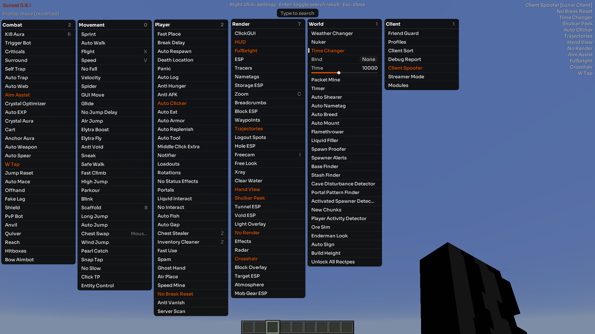

<p align="center">
  <picture>
    <source media="(prefers-color-scheme: light)" srcset="docs/images/logo-light.png">
    
  </picture>
</p>

<h1 align="center">Sunset</h1>

<p align="center">A native utility client for <a href="https://github.com/horizon-rust/horizon">Horizon</a> on Minecraft 26.3.</p>
<p align="center"><a href="https://sunset-client.pages.dev">Website</a> · <a href="https://github.com/PointOfPressure/sunset-client/releases/latest">Latest release</a> · <a href="#install">Install</a> · <a href="#features">Features</a> · <a href="https://discord.gg/fhD2frFdzm">Discord</a> · <a href="CONTRIBUTING.md">Contribute</a></p>

Sunset adds over 160 modules to Horizon: combat, movement, building, ESP and world tools. Everything is set from
a click menu or chat commands, can be bound to a key, and can be saved as a profile. It is written in Rust and
compiled into the game, so it runs as part of Horizon rather than on top of it.

> **Current version: Sunset 1.1.0, for Horizon Nightly 2026-11-08 (`fdc87ae`)**, listed in the launcher as
> `nightly-2026-11-08-fdc87ae`. You don't have to install that Nightly yourself: the installer builds Sunset on it.



> Sunset is not made by or affiliated with the Horizon project. Many servers ban clients like this one: only use it
> where it's allowed.

## Install

You need the [Horizon launcher](https://playhorizon.dev), opened at least once. Then run one command:

**Windows** (PowerShell, not Command Prompt)

```powershell
irm https://github.com/PointOfPressure/sunset-client/releases/latest/download/install.ps1 | iex
```

**Linux and macOS** (terminal)

```sh
curl -fsSL https://github.com/PointOfPressure/sunset-client/releases/latest/download/install.sh | sh
```

The command downloads Sunset, builds it into Horizon and starts the game. The first build compiles the whole game
and takes **10 to 30 minutes**; later updates are quicker. On Linux it may ask for your password once, to install
two system libraries the build needs.

After that, start the **Native mods** instance from the launcher whenever you want to play with Sunset.

**Which Horizon version?** Each Sunset release is built for one Horizon version, and the Native mods instance runs on
that version:

| Sunset | Horizon |
| --- | --- |
| **1.1.0** (current) | Nightly 2026-11-08, `fdc87ae` |
| 1.0.0 | Nightly 2026-11-05, `66f3981` |

The build fetches the right Horizon source on its own, even if that Nightly is no longer on the launcher's Versions
page. Other native mods you use must be made for the same Horizon version (see
[Troubleshooting](#troubleshooting)).

## Getting started

Press the **`** key (under Esc) or **Right Shift** in game to open the menu. Both keys can be changed in
Options > Mods > Sunset.

**In the menu**

| Do this | To |
| --- | --- |
| Left click a module | turn it on or off |
| Right click a module | open its settings and key bind |
| Start typing | search modules (`esp` shows everything with ESP in the name) |
| Enter | turn the first search result on or off |
| Esc | clear the search, then close the menu |
| Click a slider's number | type an exact value |
| Drag a panel's title / right click it | move the panel / fold it |

Changes are saved as you make them.

**Two menu styles.** *ClickGUI > Style* switches between:
- **Dropdown**: one panel per category, as in the picture above. Settings open inside the panel, or in their own
  window with *Settings: Window*.
- **Dashboard**: one window with a header and search, the categories on the left, the module list in the middle and
  the chosen module's settings on the right.

Large modules like Kill Aura and Scaffold group their settings into sections (General, Targeting, Rotations,
Timing...). Settings that don't apply to the mode you picked stay hidden.

**Key binds.** Use a module's *Bind* row and press a key or mouse button (Backspace clears it). Drawing modules such
as ESP, Tracers and Zoom also offer *Bind mode: Hold*, which keeps them on only while the key is held.

**Profiles and presets.** A profile stores every module's on/off state, settings and binds under a name. Save and
load them from the **Profiles** module (Client) or with `.profile`. Presets are ready-made profiles: PvP (crystal,
sword and mace, mace, carts), Anarchy and base hunting, Building, Legit (Grim-safe) and Survival QoL. Each one lists
what it turns on and off before you apply it. The HUD shows the active profile under the watermark, with
"(modified)" once you change something.

**Hiding modules.** The **Modules** module (Client) has a switch for every module. A hidden module is left out of
the menu and search, but its bind and `.t` still work. These start hidden: Slippy, Self Web, Jesus, Trident Boost, Step,
Wind Jump, Mine Through Mobs, RF Click and Fake Player.

**Panic.** The **Panic** module (or `.panic`) shuts Sunset down until you restart the game: every module turns off,
the menu, HUD and commands disappear, and Sunset leaves Options > Mods. You stay connected to the server. Panic does
not save settings. How it works and what plugins must do: [docs/hard-panic.md](docs/hard-panic.md).

### Chat commands

Commands start with `.` and are never sent to the server. Type `..hi` to send `.hi` as a normal message. For module
and setting names, the start of the name is enough.

| Command | What it does |
| --- | --- |
| `.help` | list all commands |
| `.t <module>` | turn a module on or off: `.t killaura` |
| `.set <module> <setting> <value>` | change a setting: `.set killaura range 4`, or a list: `.set xray blocks diamond_ore,ancient_debris` |
| `.settings <module>` | show a module's settings |
| `.bind <module> <key>` | bind a key or mouse button: `.bind flight r`, `.bind zoom mouse4`, `.bind zoom none` |
| `.reset <module>` | put a module back to its defaults |
| `.modules`, `.binds` | list modules, list binds |
| `.friend add\|remove\|list <name>` | friends are never targeted by Kill Aura, Aim Assist and other combat modules |
| `.waypoint add\|remove\|list <name>` | save places for the Waypoints module to show |
| `.profile save\|load\|delete\|list <name>` | manage profiles; `.profile load before-load` undoes the last load |
| `.profile export\|import <name>` | share a profile through the mod's `exports` and `imports` folders |
| `.preset [name] [apply]` | show the presets, see what one changes, or apply it |
| `.goto <x> <y> <z>`, `.goto stop` | walk somewhere through loaded terrain (up to 128 blocks); any movement key stops it |
| `.vclip <n>`, `.hclip <n>` | move up or down, or forward |
| `.plugins` | list loaded plugins with their modules and commands |
| `.debug [lines]` | copy a debug report to the clipboard (see below) |
| `.menu [text]` | open the menu with a search already typed |
| `.panic` | shut Sunset down until the game restarts |

**Debug reports.** `.debug`, or the **Debug Report** module, copies a report to your clipboard and saves it as a
`.md` file. It contains your versions and server, your state, the input and packets sent tick by tick, the modules
you have on with their changed settings, anticheat alerts seen in chat, setbacks, kicks and recent chat. Paste it
into a bug report. *Save folder* changes where the files go.

## Features

A few highlights:

- **Kill Aura** with 1.8-style CPS clicking or 1.9+ cooldown timing (Auto picks per server), several rotation modes
  including a server-side-only Silent aura, target strafing, AutoBlock and bot filtering.
- **Scaffold** with Normal, Legit, Godbridge and Telly modes, Speedbridge and Blatant presets, and a tower.
- **Crystal Aura, Anchor Aura and PvP Bot** for crystal PvP, with damage limits so they never blow you up.
- **Inventory Manager** keeps your hotbar laid out, drops junk and worse duplicates, sorts your inventory and wears
  your best armour.
- **Gear ESP** shows what nearby players are wearing and holding, and what they are known to carry.
- **Base hunting**: Base Finder, New Chunks, Stash Finder, Ore Sim and other detectors.
- **Plugins** can add their own modules, commands and HUD (see [Plugins](#plugins)).

Modules marked *experimental* below are new strategies that haven't been proven against anticheats.

<details>
<summary><b>Combat</b> (29 modules)</summary>

- **Kill Aura**: attacks nearby entities.
  - Combat version: *Legacy (1.8)* clicks between Min and Max CPS; *Modern (1.9+)* waits for the attack cooldown, a
    set delay or Hit select; *Auto* picks per server.
  - Single, Switch or Multi targets; Silent aura, Snap, Normal, Smooth, Custom or Adaptive rotations; Ray cast.
  - Target strafe circles your target while avoiding walls, drops and lava. AutoBlock (Legacy is experimental).
- **Trigger Bot**: attacks what you aim at, timing crits and the cooldown; can miss on purpose.
- **Aim Assist**: helps your aim. *Simple* turns you toward the target while you hold attack; *Duelkit* only adds to
  your own mouse movement. Silent aim and Hit flick.
- **Criticals**, **Reach**, **Hitboxes**: crits on every hit, longer reach, bigger boxes to aim at.
- **Shield**: keeps your shield up while an enemy can hit you, lowers it for an axe or your own crit; Block hit.
- **W Tap**, **Jump Reset**: sprint resets between hits (Adaptive S Tap with spacing) and less knockback.
- **Fake Lag**: delays what you send, in order (Delay, Pulse, Dynamic, Knockback). **Backtrack**: holds the server's
  updates while the player you hit moves away.
- **Auto Weapon**: picks the weapon for each hit (sword, axe on shields, or both). **Auto Spear**: lunges, jabs and
  reach with the spear. **Auto Mace**: takes the mace while you fall, with Stun slam and Breach checks.
- **Crystal Aura**, **Anchor Aura**: place and set off crystals or anchors on enemies, or on your right click
  (Macro). Never more self damage than *Max self damage*. **Crystal Optimizer** breaks hit crystals at once.
- **PvP Bot**: fights the nearest player by itself, with a sword or with crystals and anchors.
- **Cart**: TNT minecart PvP (break, place, set off and cover carts).
- **Offhand**: totem or another item in your offhand; Double hand, Totem on low health.
- **Surround**, **Self Trap**, **Auto Trap**, **Self Web**, **Auto Web**: block and web placement for crystal PvP.
- **Anvil** (block anvils over you, drop them on players), **Auto EXP** (repair with XP bottles), **Quiver**
  (tipped arrows at yourself), **Bow Aimbot**.

</details>

<details>
<summary><b>Movement</b> (34 modules)</summary>

- **Flight**: Abilities or Velocity, plus experimental NCP Hover, NCP Burst, NCP Bounce and Old NCP. Holds still after a
  server setback. *Damage fly* only flies after you get hurt, starting from the hit's knockback; it can wait for a
  hit or deal you fall damage first (Burst: one tick of packets; Spread: one move a tick). Experimental.
- **Speed**: Vanilla, Strafe, Smooth, Low Hop, Custom and Bhop; experimental NCP, NCP Hop and Watchdog modes.
- **Scaffold**: places blocks under you. *Normal* places from a silent look, *Legit* sneaks at edges, *Godbridge*
  bridges backwards, *Telly* sprint-jumps across. Speedbridge and Blatant presets, Keep Y, tower, block counter.
- **Velocity**: scale, blend or delay knockback. **No Slow**: no slowdown while using items. **No Fall**.
- **GUI Move**: walk with a menu open (GrimAC mode waits to click until you stand still).
- **Sprint**, **Sneak**, **Auto Walk**, **Auto Jump**, **Safe Walk**, **Parkour**, **Snap Tap** (of two opposite
  keys, the last pressed wins).
- **Step**, **Spider**, **High Jump**, **Long Jump**, **Air Jump**, **No Jump Delay**, **Fast Climb**, **Glide**,
  **Anti Void**, **Blink**, **Click TP**.
- **Elytra Boost**, **Elytra Fly**, **Chest Swap** (swap chestplate and elytra; Take off launches you with a rocket).
- **Wind Jump**, **Pearl Catch**, **Trident Boost**, **Entity Control** (drive and fly boats), **Jesus**, **Slippy**.

</details>

<details>
<summary><b>Player</b> (36 modules)</summary>

- **Inventory Manager**: keeps your inventory in order.
  - Nine slot settings plan your hotbar (best sword, pickaxe, blocks, golden apples, crystals...).
  - Drops junk and worse duplicates after working out what must stay; never protected, named or unknown items.
  - Sorts and merges stacks with clicks that never leave an item stuck on the cursor.
  - Includes **Auto Armor** with its own switch: always, with your inventory open, or on a key; armour set
    switching.
  - PvP, Building, Mining and Survival presets; a Loot key drops spare totems and pearls.
- **Chest Stealer**: empties containers you open. **Auto Replenish**: refills hotbar stacks. **Loadouts**: saved
  inventory layouts on K.
- **Auto Tool**, **Speed Mine**, **Fast Place**, **Fast Use**, **Break Delay**, **No Break Reset**, **Air Place**,
  **Ghost Hand** (use containers through blocks).
- **Auto Eat**, **Auto Gap** (also potions and soup), **Auto Fish**, **Auto Clicker** (fixed delay
  or random CPS, separate right-click settings), **Multitask** (hit while eating).
- **Auto Log**, **Auto Respawn**, **Death Location**, **Anti AFK**, **Anti Hunger**, **Notifier**, **Spam**.
- **Rotations** (keep or lock your look), **No Status Effects**, **Portals** (menus in portals), **Liquid
  Interact**, **No Interact**, **Mine Through Mobs**, **Middle Click Extra**, **RF Click**.
- **Server Scan** (the server's software, plugins and channels), **Anti Vanish**, **Fake Player** (single player),
  **Panic**.

</details>

<details>
<summary><b>Render</b> (30 modules)</summary>

- **ESP**: boxes or 2D frames with health bars and shield colours; Murderer finder for Murder Mystery.
- **Tracers**, **Nametags** (health colours, totem pops), **Storage ESP**, **Block ESP**, **Hole ESP**,
  **Tunnel ESP**, **Void ESP**, **Light Overlay**, **Logout Spots**.
- **Gear ESP**: what nearby players wear and hold, and what they are known to carry, above their name; mobs
  wearing what players have lost.
- **Xray**, **Clear Water**, **Fullbright**, **Freecam**, **Free Look**, **Zoom**.
- **Trajectories** (crossbows, wind charges, pearls in flight), **Breadcrumbs**, **Waypoints**, **Radar**,
  **Shulker Peek**.
- **HUD**: module list, Target HUD, Armor HUD, coordinates, compass, item durability, food preview and more; drag
  elements while the chat is open.
- **ClickGUI** (the menu's look), **No Render** (fog, overlays, hurt cam and more), **Effects** (jump circles,
  trails, hit sparks, weather), **Hand View** (1.9+ and 1.8 swing and sword block animations), **Crosshair**,
  **Block Overlay**, **Atmosphere** (custom skies).

</details>

<details>
<summary><b>World</b> (25 modules)</summary>

- **Base Finder**, **New Chunks**, **Stash Finder**, **Player Activity Detector**, **Cave Disturbance Detector**,
  **Portal Pattern Finder**, **Activated Spawner Detector**, **Spawner Alerts**: find bases and where players have
  been.
- **Ore Sim**: shows ores worked out from the world seed, for servers that hide them.
- **Nuker**, **Packet Mine**, **Liquid Filler** (also drains an enemy's water or lava), **Spawn Proofer**,
  **Build Height**, **Auto Sign**.
- **Auto Shearer**, **Auto Nametag**, **Auto Breed**, **Auto Mount**, **Flamethrower**, **Enderman Look**.
- **Timer**, **Time Changer**, **Weather Changer**, **Unlock All Recipes**.

</details>

<details>
<summary><b>Client</b> (7 modules)</summary>

- **Profiles**: saved and ready-made settings.
- **Modules**: show or hide each module in the menu.
- **Friend Guard**: no hits on your friends.
- **Client Sort**: Sort, Fill Stacks and Restock buttons in inventories.
- **Client Spoofer**: tells servers you use another client (Lunar Client, LabyMod).
- **Streamer Mode**: hides your name and other players' names on screen.
- **Debug Report**: see [Debug reports](#chat-commands).

</details>

## Updating and removing

**Update:** run the install command again. It replaces the old version and keeps your settings and profiles.
(Sunset was called Solstice before 0.8.1; the installer removes `solstice.hnmod` and Sunset takes over its settings.)

**Remove:** delete `sunset.hnmod` from the `horizon-native-mods` folder in Horizon's game folder, and from the same
folder inside `instances/native-mods`. Then play the plain **Horizon** instance.

| System | Horizon's game folder |
| --- | --- |
| Windows | `%APPDATA%\horizon` |
| Linux | `~/.local/share/horizon` |
| macOS | `~/Library/Application Support/horizon` |

Each Sunset release is built for one Horizon version (the release notes name it). The Native mods instance stays on
that version until you update Sunset.

## Troubleshooting

| Problem | Fix |
| --- | --- |
| "I couldn't find the Horizon launcher" | Install it from [playhorizon.dev](https://playhorizon.dev), open it once, run the command again. |
| The command does nothing on Windows | Run it in PowerShell, not Command Prompt. |
| No Sunset in game | You started the plain Horizon instance. Pick **Native mods**. |
| The first build is slow | That's normal: it compiles the whole game once. |
| Linux build fails mentioning `alsa` or `libudev` | Install `libasound2-dev libudev-dev pkg-config` (Debian/Ubuntu) or your system's equivalents, then run the command again. |
| "These mods were made for different Horizon revisions" | Another native mod (for example `mousetricks`) was made for a different Horizon version. Turn it off on the launcher's Mods page or delete its `.hnmod` from `horizon-native-mods`, then run the command again. You don't need to install the Nightly named in the release notes yourself. |
| Windows: `windres: preprocessing failed` with a path cut off at a space | Your Windows user name contains a space, which Horizon's build can't handle. The current installer moves the launcher to `C:\horizon-launcher` for you (you sign in again), or set `HORIZON_LAUNCHER_HOME` to a folder without spaces. |
| A module misbehaves or a server flags you | Type `.debug` right away and attach the report to your ticket. |
| Still stuck | Open a ticket on [Discord](https://discord.gg/fhD2frFdzm) or an [issue](https://github.com/PointOfPressure/sunset-client/issues) with the installer output, your OS and Horizon version. |

## Plugins

Other native mods can extend Sunset with modules, commands, HUD and world drawing, packet handlers and timers. A
plugin is a single Rust file. Plugin API 2 can do anything a built-in module can, including unattended (AFK) play
with events for hurts, deaths and disconnects, a safe stop, and Horizon's auto-reconnect.

The API reference, a template, build scripts and two example plugins (Hello and AFK Fisher) are in
[sunset-plugins](https://github.com/PointOfPressure/sunset-plugins) (MIT).

## Building from source

- `python3 tools/pack.py` writes `dist/sunset-<version>.hnmod`.
- To compile-check against the Horizon Nightly pinned in `horizon-native.json`: stage the mod with
  [horizon-mixins](https://github.com/horizon-rust/horizon-mixins)
  (`horizon-mixins apply --workspace <horizon at that commit> --mods mixins --out stage`), then run
  `cargo check -p horizon-client` in the stage.
- `tools/verify.py` runs modules in a test arena in a headless game.

What's planned and what a contribution needs: [feature roadmap](docs/feature-roadmap.md) and
[CONTRIBUTING.md](CONTRIBUTING.md).

## Credits

Made by [PointOfPressure](https://github.com/PointOfPressure) and [vstxx](https://github.com/vstxx).

<details>
<summary>Contributors</summary>

**Rust** ([zackmsa777-a11y](https://github.com/zackmsa777-a11y)): Radar, profile files, Spawner Alerts, Item ESP
names and filter, Anti Vanish, the roadmap, Crosshair, Block Overlay, Target ESP, Atmosphere skies, Crystal Aura,
Anchor Aura, Crystal Macro and Anchor Macro (their Macro sections), Shield Breaker, Mace and Spear Swap (Auto Weapon's
Axe on shields, Auto Spear's Lunge key, Reach poke and Spear reach, and the smash fall count Auto Mace goes by), W Tap,
Jump Reset, Friend Guard, Auto Inventory Totem (Offhand's old Refill) and Hover Totem (Offhand's Hover), FastXP (Fast
Use's Throwables), Key Throw, world labels sharing the menu's glyph scale, faster Atmosphere skies, .goto, Knockback
Delay in Velocity, PvP Bot's Sword mode and the rival history store its Crystal mode keeps.

</details>

Want to help? See [CONTRIBUTING.md](CONTRIBUTING.md).

## Licence

Sunset 0.8.1 and later is under the [PolyForm Strict License 1.0.0](LICENSE): you can use it for yourself (not commercially) and read the source; you can't change it or share copies. Plugins are fine, and the plugin docs and example in [sunset-plugins](https://github.com/PointOfPressure/sunset-plugins) are MIT. Versions up to 0.8.0 stay under the MIT licence they were released with. To contribute, see [CONTRIBUTING.md](CONTRIBUTING.md).

<details>
<summary>Font credits</summary>

The menu and HUD fonts are [Sora](https://github.com/sora-xor/sora-font), [Inter](https://rsms.me/inter/), [Poppins](https://github.com/itfoundry/Poppins), [Outfit](https://github.com/Outfitio/Outfit-Fonts), [Manrope](https://github.com/googlefonts/manrope), [Geist](https://github.com/vercel/geist-font), [Montserrat](https://github.com/JulietaUla/Montserrat), [Plus Jakarta Sans](https://github.com/tokotype/PlusJakartaSans), [Lexend](https://github.com/googlefonts/lexend), [Rubik](https://github.com/googlefonts/rubik), [Space Grotesk](https://github.com/floriankarsten/space-grotesk), [Red Hat Display](https://github.com/RedHatOfficial/RedHatFont), [Comfortaa](https://github.com/alexeiva/comfortaa), [Quicksand](https://github.com/andrew-paglinawan/QuicksandFamily), [Nunito](https://github.com/googlefonts/nunito) and [JetBrains Mono](https://www.jetbrains.com/lp/mono/) (all SIL Open Font License 1.1, the licences are in `assets/licenses/`), cut down to the characters Sunset draws (`assets/*.ttf`, made by `tools/font.py`). Sora is the default; choose with **HUD > Font** (*Minecraft* is the game's own).

</details>
