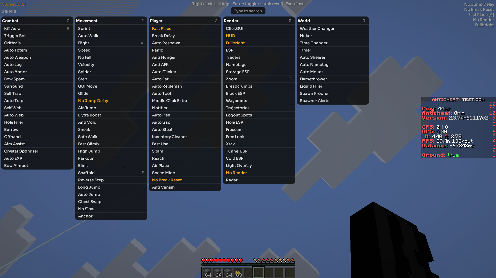

<p align="center">
  <picture>
    <source media="(prefers-color-scheme: light)" srcset="docs/images/logo-light.png">
    
  </picture>
</p>

<h1 align="center">Sunset</h1>

<p align="center">A native utility client for <a href="https://github.com/horizon-rust/horizon">Horizon</a> on Minecraft 26.3.</p>
<p align="center"><a href="https://github.com/PointOfPressure/sunset-client/releases/latest">Latest release</a> · <a href="#install">Install</a> · <a href="#features">Features</a> · <a href="CONTRIBUTING.md">Contribute</a></p>

Sunset brings 100+ modules for combat, movement, building and rendering to Horizon, with a configurable ClickGUI,
key binds, chat commands and saved profiles. It takes inspiration from
[Meteor Client](https://github.com/MeteorDevelopment/meteor-client) and is written in Rust for Horizon.



*Sunset 0.8.1 in game: Combat, Movement, Player, Render and World panels.*

> Not made by, or affiliated with, the Horizon or Meteor projects. Use it where it's allowed: many servers ban
> modules like these.

## Install

You need the [Horizon launcher](https://playhorizon.dev) installed and opened once. Then one command does
everything (installs Sunset, builds it into the game, starts it):

**Windows** (PowerShell)

```powershell
irm https://github.com/PointOfPressure/sunset-client/releases/latest/download/install.ps1 | iex
```

**Linux and macOS** (terminal)

```sh
curl -fsSL https://github.com/PointOfPressure/sunset-client/releases/latest/download/install.sh | sh
```

The first run builds Horizon with Sunset and can take **10 to 30 minutes**. When it finishes, Horizon starts with
Sunset installed. Later, open the launcher and choose the **Native mods** instance. Press the **backtick/grave** key
(usually below Esc) or **Right Shift** to open the ClickGUI.

On Linux the installer may ask for your password once, to install two small system libraries the build needs.

## Quick start

The ClickGUI groups modules into five panels: Combat, Movement, Player, Render and World.

- **Left click** a module to turn it on or off. **Right click** it for its settings and key bind, in a window of its own
  (drag it by its title; Esc closes it), or in the panel with ClickGUI *Settings: Inline*. Click a slider's number to
  type one.
- **Just type** to search: `esp` shows the modules with ESP in the name. **Enter** turns on the first match (Enter again turns it off). **Ctrl+A** selects the search text, **Esc** clears it, then closes the menu.
- The dark dim and the blur the game puts behind the inventory, chests and the Esc menu are off; **ClickGUI > Menu dim** brings them back.
- **Drag** a panel's header to move it, **right click** a header to fold it, **scroll** a long panel.
- **ClickGUI** sets the menu's look: **GUI scale** makes it bigger, **Panel radius** and **Control radius** round its corners.
- Change a **bind** with the *Bind* row: press a key or a mouse button (right, middle or a side button; Backspace clears
  it). Drawing modules (ESP, Tracers, Zoom, HUD...) have **Bind mode** *Hold*: on only while the bind is held. Both menu
  keys can be rebound under Options > Mods > Sunset.

Everything is saved as you change it.

### Chat commands

They start with `.` and are never sent to the server (type `..hi` to say `.hi`).

| Command | Does |
| --- | --- |
| `.help` | list the commands |
| `.t <module>` | turn a module on or off (`.t killaura`) |
| `.set <module> <setting> <value>` | change a setting: `.set killaura range 4`. The start of a name is enough, and a value can be several words |
| `.settings <module>` | show a module's settings |
| `.bind <module> <key>` | bind a key or mouse button: `.bind flight r`, `.bind zoom mouse4`, or `none` |
| `.reset <module>` | put a module back to its defaults |
| `.modules`, `.binds` | list the modules, the binds |
| `.friend add\|remove\|list <name>` | friends are left alone by Kill Aura, Aim Assist and the other targeting modules |
| `.waypoint add\|remove\|list <name>` | places the Waypoints module shows on screen |
| `.vclip <n>`, `.hclip <n>` | move up or down, forward |
| `.profile save\|load\|delete <name>`, `.profile list` | keep every module's on/off, settings and keys under a name and bring them back (a PvP set-up, a building one); `.profile load before-load` undoes the last load |
| `.profile export\|import <name>` | share a profile: export copies it to the mod's `exports` folder, import takes `<name>.profile` from its `imports` folder |
| `.panic` | turn every module off and hide Sunset until `.panic` again or restart (or bind the **Panic** module to a key) |
| `.menu [text]` | open the menu, already searching for the text |

List settings (the blocks Xray shows, the mobs Kill Aura attacks) are set the same way:
`.set xray blocks diamond_ore,ancient_debris`.

## Features

Speed has Vanilla, Strafe, Smooth, Low Hop and Custom modes. Velocity can scale or blend knockback; Scaffold has
Legit and Custom placement modes; Fast Place has five speed levels. ClickGUI settings cover scale, spacing, colors
and panel shape. Advanced controls appear only for relevant modes.

<details>
<summary>Browse the built-in modules</summary>

| Category | Modules |
| --- | --- |
| **Combat** | Kill Aura, Trigger Bot, Aim Assist, Criticals, Crystal Optimizer, Auto Totem, Auto Weapon, Auto Armor, Offhand, Auto EXP, Auto Log, Bow Spam, Bow Aimbot, Surround, Self Trap, Auto Trap, Self Web, Auto Web, Hole Filler, Burrow |
| **Movement** | Flight, Speed, Sprint, Sneak, Auto Walk, Auto Jump, Step, Spider, High Jump, Long Jump, Air Jump, Parkour, Reverse Step, Fast Climb, Safe Walk, Anchor, Anti Void, Elytra Boost, Chest Swap, Blink, Scaffold, No Fall, No Slow, Velocity, Glide, No Jump Delay, GUI Move (walk with the inventory or another menu open) |
| **Player** | Fast Place (speed 1 to 5), Break Delay, Speed Mine, No Break Reset, Fast Use, Air Place, Reach, Auto Eat, Auto Gap, Auto Fish, Auto Tool, Auto Replenish, Auto Clicker, Auto Respawn, Anti AFK, Anti Hunger, Middle Click Extra, Notifier, Spam, Auto Steal, Inventory Cleaner, Anti Vanish, Panic |
| **Render** | ClickGUI, HUD, Radar, ESP, Tracers, Nametags, Storage ESP, Block ESP, Xray, Freecam, Free Look, Zoom, Fullbright, Trajectories, Waypoints, Breadcrumbs, Logout Spots, Hole ESP, Tunnel ESP, Void ESP, Light Overlay, No Render (no fog, water fog, darkness, blindness, fire or other overlays) |
| **World** | Nuker, Timer, Time Changer, Weather Changer, Liquid Filler, Spawn Proofer, Flamethrower, Auto Shearer, Auto Nametag, Auto Mount, Spawner Alerts |

</details>

Kill Aura, Trigger Bot and Aim Assist can skip bots (**Anti bot**: players the server's player list doesn't show) and
players on your own team (**Ignore teams**). **HUD > Target HUD** shows who Kill Aura is hitting: name, distance and health.

Not here (no clean way to do it in Horizon yet): Crystal Aura, Jesus, Click TP, and the Baritone-based
Highway Builder and Infinity Miner.

## Updating and removing

**Update:** run the same command again. Sunset was called Solstice before 0.8.1: the command removes the old
`solstice.hnmod` and Sunset takes your saved settings over on its first start.

**Remove:** delete `sunset.hnmod` from the `horizon-native-mods` folder in Horizon's game folder (Windows:
`%APPDATA%\horizon`, Linux: `~/.local/share/horizon`, macOS: `~/Library/Application Support/horizon`, and the same
folder inside `instances\native-mods`), then play the plain **Horizon** instance.

Each Sunset release is built for one Horizon release. The **Native mods** instance stays on that revision until you
update Sunset with the installer again.

## If something goes wrong

- **"I couldn't find the Horizon launcher"**: install it from [playhorizon.dev](https://playhorizon.dev), open it once, run the command again.
- **The build fails on Linux** with a message about `alsa` or `libudev`: install `libasound2-dev libudev-dev pkg-config` (Debian, Ubuntu), or your system's equivalents, and run the command again.
- **The launcher says "These mods were made for different Horizon revisions and can't be built together"**: you have another native mod (for example `mousetricks`) made for a different Horizon version than Sunset's. Native mods are built into the game together, so all of them must match. Turn the other one off on the launcher's Mods page (or delete its `.hnmod` from `horizon-native-mods`), then run the command again. You don't need to install the Nightly named in the release notes: the build downloads its source itself, so it's fine that it isn't on the Versions page.
- **Windows: "Compiling the game failed" with `windres: preprocessing failed` and a path cut off at a space**: your Windows user name has a space in it, and Horizon's own build can't handle that. The installer now moves the launcher's files to `C:\horizon-launcher` for you (you sign in again); older copies of the installer don't, so run the current command. You can also set the `HORIZON_LAUNCHER_HOME` environment variable to a folder without spaces yourself.
- **The command did nothing on Windows**: run it in *PowerShell*, not Command Prompt.
- **No Sunset in game**: you played the plain **Horizon** instance. Pick **Native mods**.
- **The first build is slow**: yes. It compiles the whole game once.
- **Installer or launch still fails**: open an [issue](https://github.com/PointOfPressure/sunset-client/issues)
  with the installer output, your OS and the Horizon version.

## Plugins

Other native mods can add modules to Sunset: see [docs/plugin-api.md](docs/plugin-api.md) and
[examples/hello-plugin](examples/hello-plugin).

## Building from source

`python3 tools/pack.py` writes `dist/sunset-<version>.hnmod`. To compile-check it against the Horizon Nightly it
pins, stage it with [horizon-mixins](https://github.com/horizon-rust/horizon-mixins)
(`horizon-mixins apply --workspace <horizon at that commit> --mods mixins --out stage`) and run
`cargo check -p horizon-client` in the stage. `tools/verify.py` runs the modules in a test arena in a headless
game; `tools/audit.py` lists which of Meteor's settings are still missing.

## Feature planning

See the [feature roadmap](docs/feature-roadmap.md) for what has landed, what is next and what each contribution needs.

## Credits

Made by [PointOfPressure](https://github.com/PointOfPressure). Contributors: vs. ([vstxx](https://github.com/vstxx): movement modes, Velocity, Scaffold controls, Time and Weather Changer fixes, this README), Rust ([zackmsa777-a11y](https://github.com/zackmsa777-a11y): Radar, profile files, Spawner Alerts, Item ESP names and filter, Anti Vanish, the roadmap, Crosshair, Block Overlay, Target ESP). Want to help? See [CONTRIBUTING.md](CONTRIBUTING.md).

## Licence

Sunset 0.8.1 and later is under the [PolyForm Strict License 1.0.0](LICENSE): you can use it for yourself (not commercially) and read the source; you can't change it or share copies. Plugins are fine: the plugin docs and `examples/` may be copied to make them. Versions up to 0.8.0 stay under the MIT licence they were released with. Many modules follow the behaviour and settings of [Meteor Client](https://github.com/MeteorDevelopment/meteor-client) (GPL-3.0), written again in Rust for Horizon. To contribute, see [CONTRIBUTING.md](CONTRIBUTING.md).

<details>
<summary>Font credits</summary>

The menu and HUD fonts are [Sora](https://github.com/sora-xor/sora-font), [Inter](https://rsms.me/inter/), [Poppins](https://github.com/itfoundry/Poppins), [Outfit](https://github.com/Outfitio/Outfit-Fonts), [Manrope](https://github.com/googlefonts/manrope), [Geist](https://github.com/vercel/geist-font), [Montserrat](https://github.com/JulietaUla/Montserrat), [Plus Jakarta Sans](https://github.com/tokotype/PlusJakartaSans), [Lexend](https://github.com/googlefonts/lexend), [Rubik](https://github.com/googlefonts/rubik), [Space Grotesk](https://github.com/floriankarsten/space-grotesk), [Red Hat Display](https://github.com/RedHatOfficial/RedHatFont), [Comfortaa](https://github.com/alexeiva/comfortaa), [Quicksand](https://github.com/andrew-paglinawan/QuicksandFamily), [Nunito](https://github.com/googlefonts/nunito) and [JetBrains Mono](https://www.jetbrains.com/lp/mono/) (all SIL Open Font License 1.1, the licences are in `assets/licenses/`), cut down to the characters Sunset draws (`assets/*.ttf`, made by `tools/font.py`). Sora is the default; choose with **HUD > Font** (*Minecraft* is the game's own).

</details>
