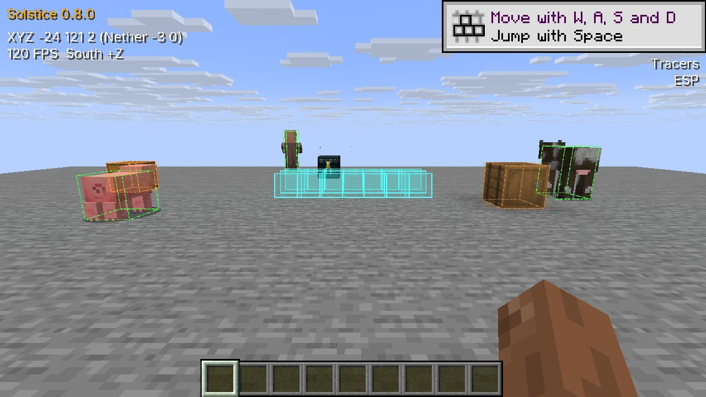
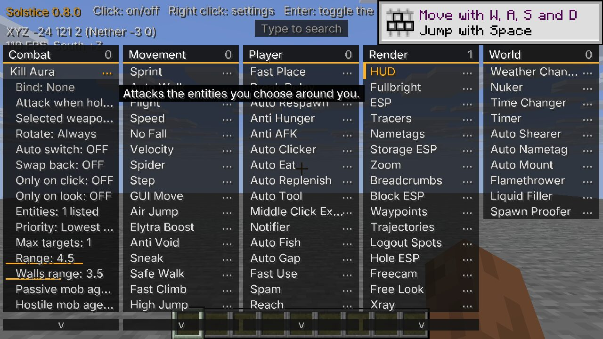
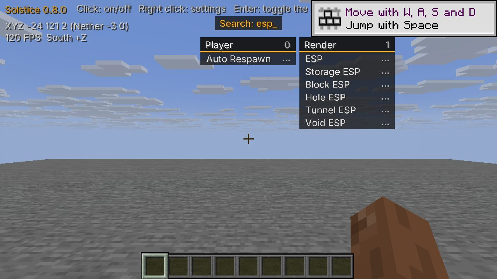
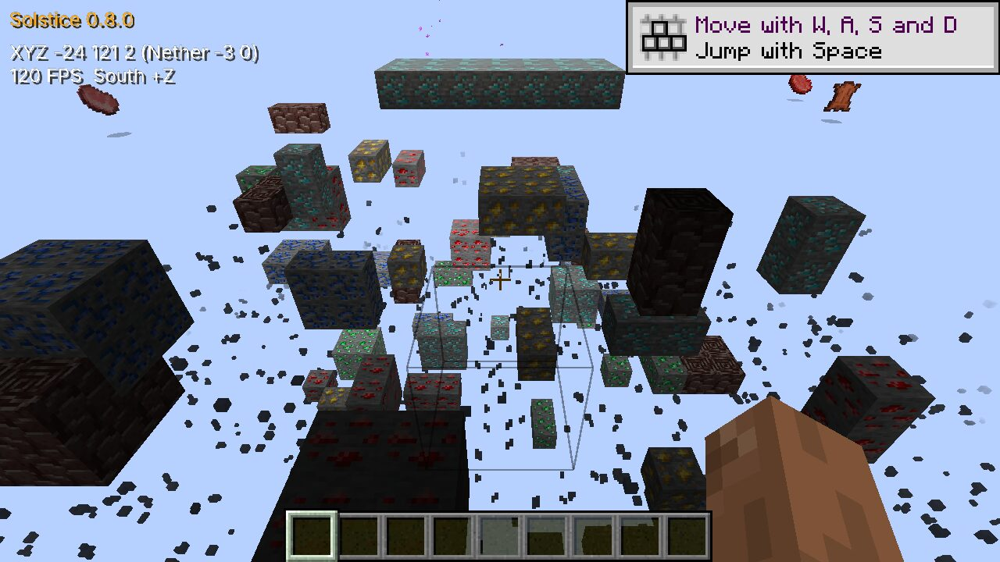
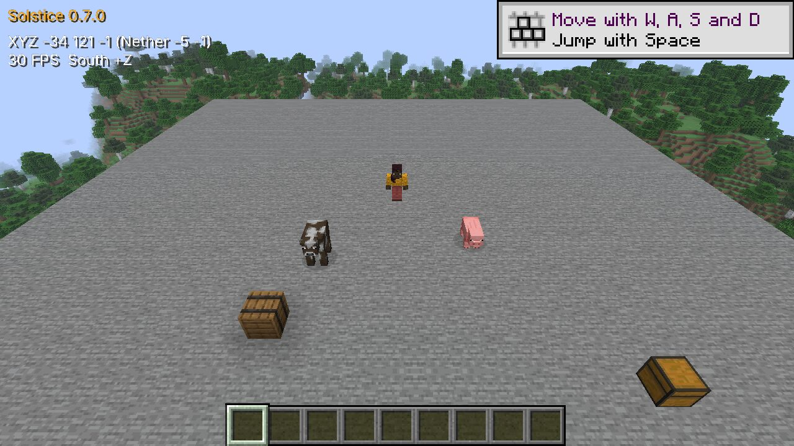

# Solstice

A utility client for [Horizon](https://github.com/horizon-rust/horizon) (Minecraft 26.3, rewritten in Rust),
in the style of [Meteor Client](https://github.com/MeteorDevelopment/meteor-client): about 90 modules for combat,
movement, building and seeing through walls, a click menu, key binds and chat commands.



> Not made by, or affiliated with, the Horizon or Meteor projects. Use it where it's allowed: many servers ban
> modules like these.

## Get it running

You need the [Horizon launcher](https://playhorizon.dev) installed and opened once. Then one command does
everything (installs Solstice, builds it into the game, starts it):

**Windows** (PowerShell)

```powershell
irm https://github.com/PointOfPressure/solstice-client/releases/latest/download/install.ps1 | iex
```

**Linux and macOS** (terminal)

```sh
curl -fsSL https://github.com/PointOfPressure/solstice-client/releases/latest/download/install.sh | sh
```

The first run takes **10 to 30 minutes** (it compiles the game with Solstice inside) and shows progress. Later
runs take a few minutes. When it finishes, Horizon starts with Solstice in it. **In the game, press `** (the key
under Esc).

Next time, start Horizon from the launcher and pick the **Native mods** instance.

On Linux the installer may ask for your password once, to install two small system libraries the build needs.

## Using it





Press **`** (or **Right Shift**) for the menu. Every category is a panel.

- **Left click** a module to turn it on or off. Click the **...** at its right (or right click it) for its settings and key bind.
- **Just type** to search: `esp` shows the modules with ESP in the name. **Enter** turns on the first match (Enter again turns it off). **Ctrl+A** selects the search text, **Esc** clears it, then closes the menu.
- **Drag** a panel's header to move it, **right click** a header to fold it, **scroll** a long panel.
- Change a **key bind** with the *Bind* row (press a key; Backspace clears it). Both menu keys can be rebound under
  Options > Mods > Solstice.

Everything is saved as you change it.

### Chat commands

They start with `.` and are never sent to the server (type `..hi` to say `.hi`).

| Command | Does |
| --- | --- |
| `.help` | list the commands |
| `.t <module>` | turn a module on or off (`.t killaura`) |
| `.set <module> <setting> <value>` | change a setting: `.set killaura range 4`. The start of a name is enough, and a value can be several words |
| `.settings <module>` | show a module's settings |
| `.bind <module> <key>` | bind a key: `.bind flight r`, or `none` |
| `.reset <module>` | put a module back to its defaults |
| `.modules`, `.binds` | list the modules, the binds |
| `.friend add\|remove\|list <name>` | friends are left alone by Kill Aura, Aim Assist and the other targeting modules |
| `.waypoint add\|remove\|list <name>` | places the Waypoints module shows on screen |
| `.vclip <n>`, `.hclip <n>` | move up or down, forward |
| `.profile save\|load\|delete <name>`, `.profile list` | keep every module's on/off, settings and keys under a name and bring them back (a PvP set-up, a building one) |
| `.panic` | turn every module off (or bind the **Panic** module to a key) |
| `.menu [text]` | open the menu, already searching for the text |

List settings (the blocks Xray shows, the mobs Kill Aura attacks) are set the same way:
`.set xray blocks diamond_ore,ancient_debris`.

## What's in it

| | |
| --- | --- |
| **Combat** | Kill Aura, Trigger Bot, Aim Assist, Criticals, Crystal Optimizer, Auto Totem, Auto Weapon, Auto Armor, Offhand, Auto EXP, Auto Log, Bow Spam, Bow Aimbot, Surround, Self Trap, Auto Trap, Self Web, Auto Web, Hole Filler, Burrow |
| **Movement** | Flight, Speed, Sprint, Sneak, Auto Walk, Auto Jump, Step, Spider, High Jump, Long Jump, Air Jump, Parkour, Reverse Step, Fast Climb, Safe Walk, Anchor, Anti Void, Elytra Boost, Chest Swap, Blink, Scaffold, No Fall, No Slow, Velocity, Glide, No Jump Delay, GUI Move (walk with the inventory open) |
| **Player** | Fast Place, Break Delay, Fast Use, Air Place, Reach, Auto Eat, Auto Gap, Auto Fish, Auto Tool, Auto Replenish, Auto Clicker, Auto Respawn, Anti AFK, Anti Hunger, Middle Click Extra, Notifier, Spam, Auto Steal, Inventory Cleaner, Panic |
| **Render** | ESP, Tracers, Nametags, Storage ESP, Block ESP, Xray, Freecam, Free Look, Zoom, Fullbright, Trajectories, Waypoints, Breadcrumbs, Logout Spots, Hole ESP, Tunnel ESP, Void ESP, Light Overlay, No Render (no fog, water fog, darkness, blindness, fire or other overlays), HUD |
| **World** | Nuker, Timer, Time Changer, Weather Changer, Liquid Filler, Spawn Proofer, Flamethrower, Auto Shearer, Auto Nametag, Auto Mount |





Not here (no clean way to do it in Horizon yet): Crystal Aura, Jesus, Click TP, and the Baritone-based
Highway Builder and Infinity Miner.

## Updating and removing

**Update:** run the same command again.

**Remove:** delete `solstice.hnmod` from the `horizon-native-mods` folder in Horizon's game folder (Windows:
`%APPDATA%\horizon`, Linux: `~/.local/share/horizon`, macOS: `~/Library/Application Support/horizon`, and the same
folder inside `instances\native-mods`), then play the plain **Horizon** instance.

Each Solstice version is built for one Horizon Nightly, so Solstice keeps working when Horizon updates, but the
**Native mods** instance plays the Nightly it was built on until you run the command again.

## If something goes wrong

- **"I couldn't find the Horizon launcher"**: install it from [playhorizon.dev](https://playhorizon.dev), open it once, run the command again.
- **The build fails on Linux** with a message about `alsa` or `libudev`: install `libasound2-dev libudev-dev pkg-config` (Debian, Ubuntu), or your system's equivalents, and run the command again.
- **The launcher says "These mods were made for different Horizon revisions and can't be built together"**: you have another native mod (for example `mousetricks`) made for a different Horizon version than Solstice's. Native mods are built into the game together, so all of them must match. Turn the other one off on the launcher's Mods page (or delete its `.hnmod` from `horizon-native-mods`), then run the command again. You don't need to install the Nightly named in the release notes: the build downloads its source itself, so it's fine that it isn't on the Versions page.
- **Windows: "Compiling the game failed" with `windres: preprocessing failed` and a path cut off at a space**: your Windows user name has a space in it, and Horizon's own build can't handle that. The installer now moves the launcher's files to `C:\horizon-launcher` for you (you sign in again); older copies of the installer don't, so run the current command. You can also set the `HORIZON_LAUNCHER_HOME` environment variable to a folder without spaces yourself.
- **The command did nothing on Windows**: run it in *PowerShell*, not Command Prompt.
- **No Solstice in game**: you played the plain **Horizon** instance. Pick **Native mods**.
- **The first build is slow**: yes. It compiles the whole game once.
- The Windows and macOS installers could only be tested on Linux so far. If one doesn't work, open an
  [issue](https://github.com/PointOfPressure/solstice-client/issues) with what it printed.

## Plugins

Other native mods can add modules to Solstice: see [docs/plugin-api.md](docs/plugin-api.md) and
[examples/hello-plugin](examples/hello-plugin).

## Building from source

`python3 tools/pack.py` writes `dist/solstice-<version>.hnmod`. To compile-check it against the Horizon Nightly it
pins, stage it with [horizon-mixins](https://github.com/horizon-rust/horizon-mixins)
(`horizon-mixins apply --workspace <horizon at that commit> --mods mixins --out stage`) and run
`cargo check -p horizon-client` in the stage. `tools/verify.py` runs the modules in a test arena in a headless
game; `tools/audit.py` lists which of Meteor's settings are still missing.

## Licence

Solstice 0.8.1 and later: all rights reserved, see [LICENSE](LICENSE). You can use it, read it and write plugins for it; you can't copy, fork or redistribute it. Versions up to 0.8.0 stay under the MIT licence they were released with. Many modules follow the behaviour and settings of [Meteor Client](https://github.com/MeteorDevelopment/meteor-client) (GPL-3.0), written again in Rust for Horizon.

The menu and HUD font is [Inter](https://rsms.me/inter/) (SIL Open Font License 1.1), cut down to the characters Solstice draws (`assets/ui.ttf`, made by `tools/font.py`). Set **HUD > Font** to *Minecraft* to use the game's own.
