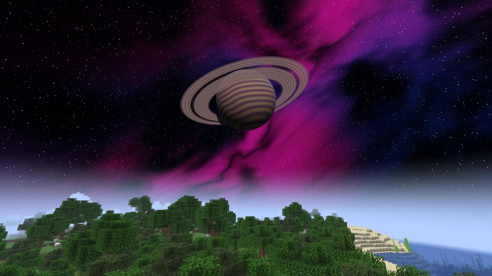
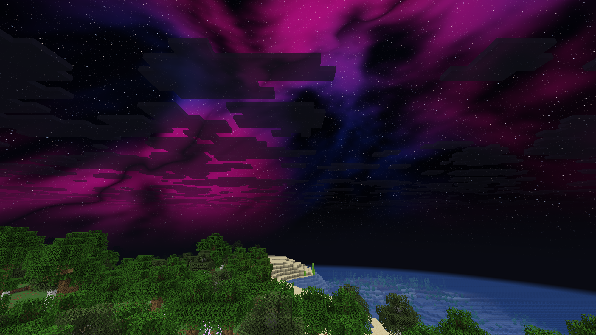
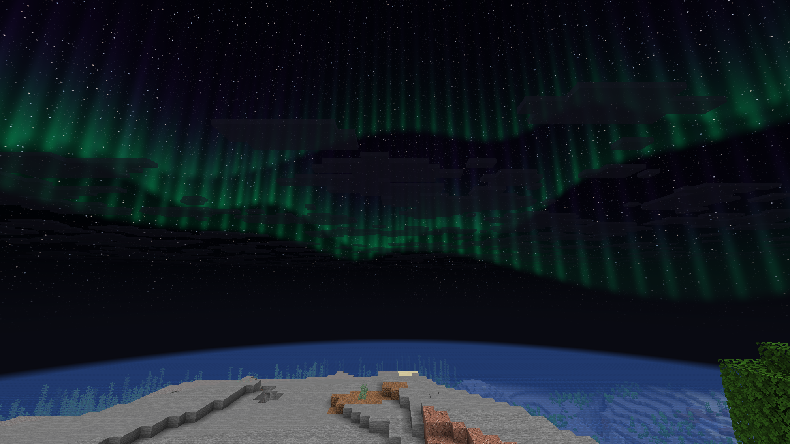

# Native atmosphere validation

This is the historical `cb8ae36` Atmosphere baseline record. For the current
optimized branch, use [performance validation](performance.md) and its evidence
JSON. The full-frame observations below are not the shader-only GPU benchmark.

Validated 2026-10-31 on code `cb8ae36`, based on Sunset `fa174f3`.
Horizon `ba6344a`, Mixins `0d6b103` and Rust 1.99.1 are pinned. Official plan,
apply, compile check and linked client/control build passed with no compiler
warnings. The exact source package and immutable client were fingerprinted.

## Tests and actual game evidence

All **11 shader/config tests** pass. One shader test validates and translates
18 mode/quality/boundary specializations through Naga 30 and its HLSL backend;
these are cases within that test, not eighteen extra test functions. Tests also
cover solar dusk continuity, celestial ray intersections and ordering, bounded
work, seam continuity and malformed specialization inputs.

To reproduce, set `SUNSET_TERRAIN_WGSL` to the pinned Horizon checkout's
`crates/horizon-client-render/src/terrain.wgsl`, then run
`cargo test --locked --manifest-path tools/atmosphere-tests/Cargo.toml`.

The complete isolated offscreen suite passed **59 automatic checks**, including:

- Native day/night restoration, stable camera rotation/return and the three modes.
- Opaque wall/cave occlusion, water exclusion and Nether/End fallback.
- Daytime strength zero, intensity/quality controls, persistent-rain sky,
  animation, F1 and the native settings menu.
- Loading a real generated native shader pack, verifying its green sky pixels,
  preserving that output with Atmosphere on/off, and recovering after deselection.
- Two clean native process exits, settings persistence and a new aspect ratio.

The original framebuffer PNGs are **2000أ—1125** at observed display scale 1.25.
The restart creates a **1600أ—1200** framebuffer from logical 1280أ—960, exercising
an aspect-ratio change. Images are copied without editing or resizing.

## GPU observations

On a GTX 1650 Ti using Vulkan/driver 581.80 at 2000أ—1125, three-second warm
samples at the same camera recorded total GPU averages of **0.739 ms** native,
**2.731 ms** Balanced Space, **2.504 ms** Balanced Aurora, **3.018 ms** Balanced
Ringed Planet, and **0.738 ms** restored native. Performance Space averaged
2.701 ms; its mean improvement over Balanced was small in this fixture.

These are local observations, not an isolated shader timer or portable FPS
promise. The effect increases fragment work even though it adds no pass or
draw call. Exact averages, percentiles and camera values are in
[atmosphere-checks.json](atmosphere-checks.json).

## Shutdown regression

The first prototype exposed late destruction of cached GPU handles after the
renderer, causing a native shutdown crash. A focused GTX test reproduced the
invalid TLS teardown order. Cleanup now runs from supported `Game::finish_perf`
HEAD (the normal exit callback calls it before dropping Renderer), as well as
surface release. The completed game suite verifies both exits return zero.

Earlier pixel checks also caught the host's startup vignette and intentional
menu dim affecting comparisons. The fresh completed fixture explicitly turns
both off; their earlier observations are not added to its check count. Solar
height replaced weather-attenuated star brightness as the day/night classifier.

## Coverage limits

Title/no-player gating is source-reviewed; this in-world suite does not claim
direct runtime coverage of that transition. Native shader-pack compatibility is
tested; the classic Java-pack exclusion is source-reviewed. There is no raw
physical keyboard, external multiplayer or live-window-resize claim. Restarting
at another resolution is the actual resize-related evidence.

Only fresh generated data and private resource copies were used. No real saved
worlds, accounts or servers were involved. Source-reference credit is in
[the research notes](atmosphere-source-notes.md).

## Natural-world screenshots

A separate fresh seed-1 world uses unmodified forest and coastline. The exact
same frozen build exits cleanly after capture. These original 2000×1125 PNGs
use Balanced quality, Speed zero and Daytime strength one. The planet view is
daylight with Fullbright off and native clouds disabled. Space and Aurora are
night captures with the existing Fullbright module enabled to show terrain.
Their hashes and capture settings are recorded in the checks JSON.

