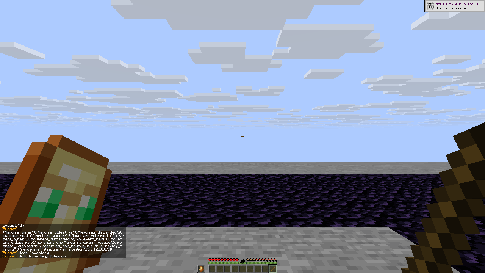
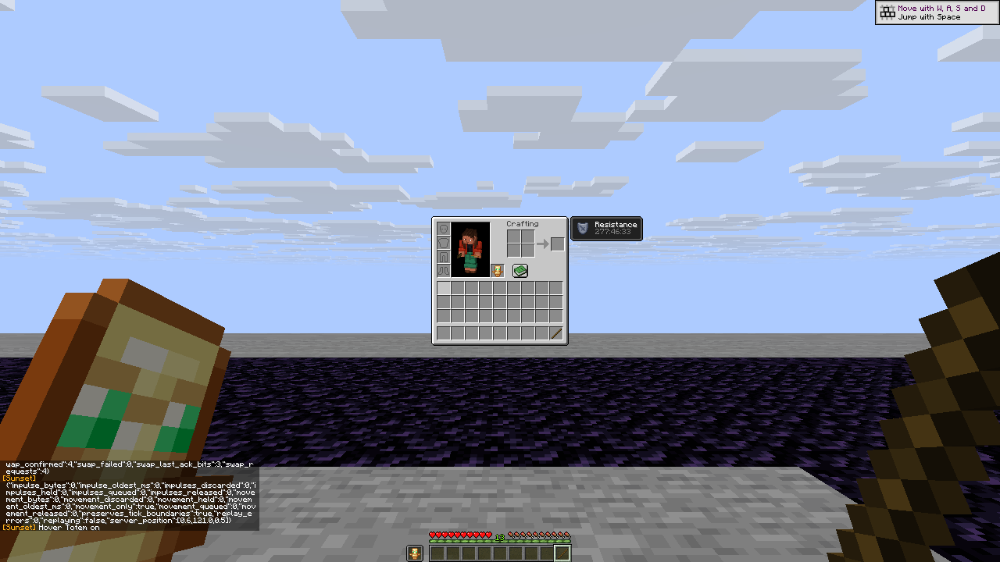
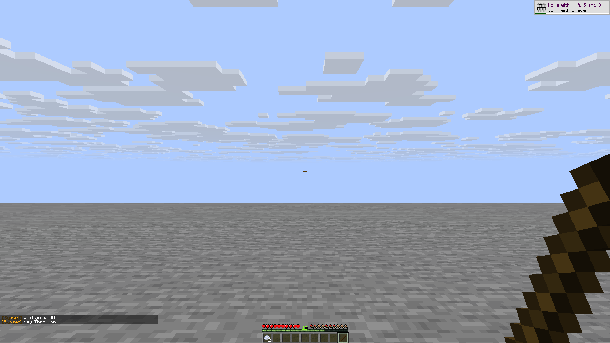
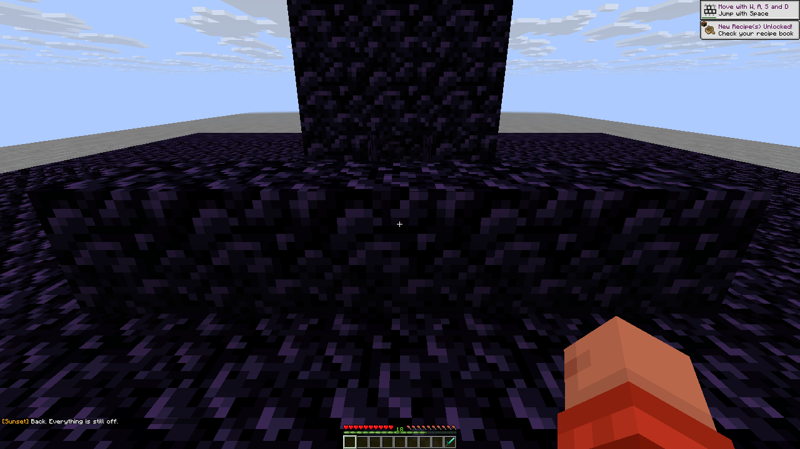
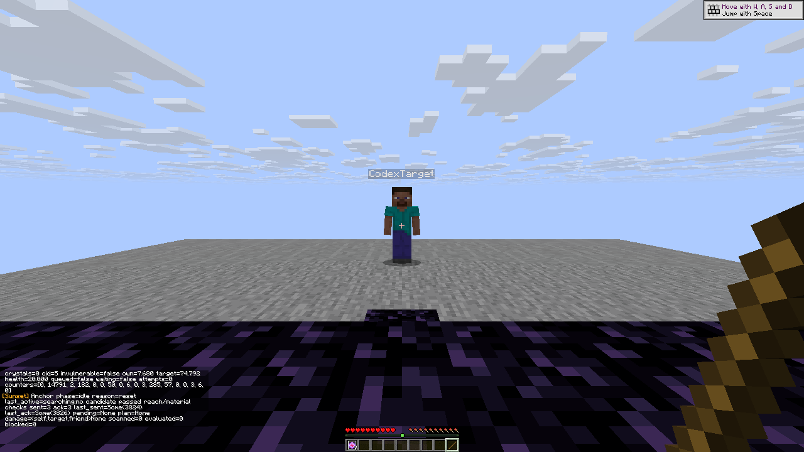
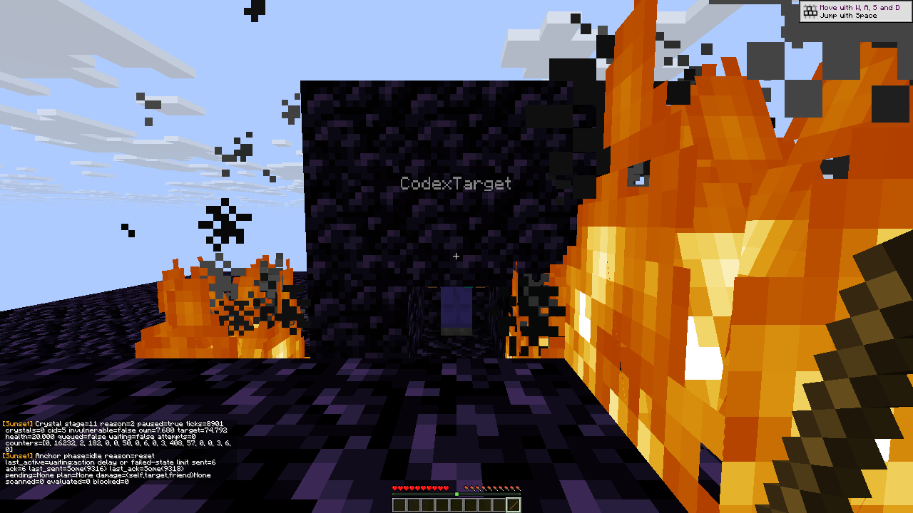
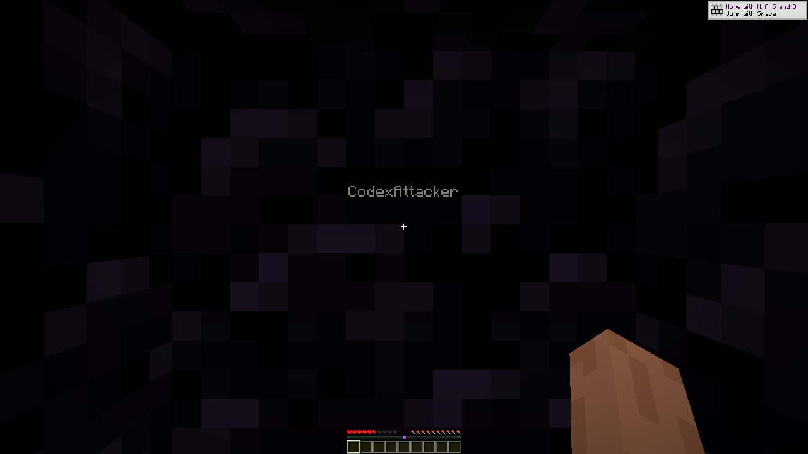
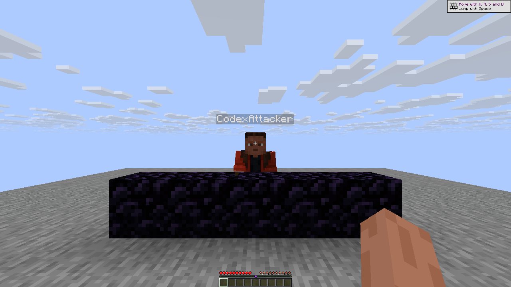

# Combat validation

This feature branch targets Horizon `ba6344a59cb9e755b730dcf02285fc0d33b97d3c`.
It remains a normal native mod, built by official Horizon Mixins from pristine
host source. The incoming packet hook requires the newer official Mixins
`cb1ad23022392d88f006cf94cbf6552a73f5df12`; the earlier `0d6b103` planner rejects
opaque macros in that native handler. No Horizon source patch is required.

Latest build: **R12**, with **204 focused checks** (200 compiled/native-adapter
checks and four source-wiring checks), official native compile check and
optimized build passing. The [R12 checkpoint](evidence/combat/checkpoint-r12.json)
and [exact source fingerprints](evidence/combat/source-r12.json) identify that
binary. Its fresh paired GUI and optional setup checks are pending. Earlier
native evidence below retains its original checkpoint identity.

R12 makes the open overlay modal on Horizon's control-socket keyboard route.
That route calls `key_pressed` directly after delivering the editor event,
whereas physical window events already pass through the existing `mapped_key`
filter. The new hook suppresses base-game actions without editing the field
twice. Native widget proof is recorded separately from compile success.

R11 additionally passes 204 focused checks (200 compiled/native-adapter and
four source-wiring), official native check and optimized build for optional
Aura obsidian setup. Its [checkpoint](evidence/combat/checkpoint-r11.json) and
[source fingerprints](evidence/combat/source-r11.json) identify client
`cea1d258a07c498e7d46d805eeaa2f16d10738fe7f8d5b560e7fac478388ea4e`.
There are 63 support modules, 51 injections and one unused-helper warning.
All 19 isolated native explosive cases pass on R11, with exit0 and unchanged
frozen inputs, while Auto obsidian remains at its default off. Optional live
setup checks are pending; those regression cases do not test setup.

## Confirmed R4 player outcomes

[Recorded outcomes, binary hash and screenshot hashes](evidence/combat/player-proof-r4.json)
cover two actual native clients, `CodexAttacker` and `CodexTarget`, connected
to a fresh stock Java 26.3 world on loopback. Protocol is 777; the official
server JAR SHA-1 is `33680f5f2ac32864d6d7cf5e56a705fdb3e05f4c`.

- Crystal Aura placed an observed crystal, attacked that actual ID and removed
  it. Target health changed from 20 to **5.041667938232422**, with knockback.
- Anchor Aura produced observed charge states **0 → 1 → air**. Target health
  changed from 20 to **10.263781547546388**, with knockback.
- Both transactions restored the attacker's selected slot. Adding the target
  as a friend prevented a new attack in the corresponding negative control.
- The target had ordinary maximum health 20 and Resistance IV to survive one
  blast. The attacker had Resistance 255 as a separate fixture fail-safe.
  Both modules explicitly used Unmitigated self cap16, Anti suicide and minimum
  remaining health4. Fire damage and natural regeneration were disabled.

These are stationary, controlled fixtures. They establish actual player blast
damage and observed ordering, not moving-target performance or anticheat results.

The user's Horizon dedicated server was backed up before testing. Its explosion
path skipped damage to other connected players during a guest action. Crystal
removal without damage and an earlier fire-only Anchor health change were
retained as failures, not counted as player explosion proof. The private stock
Java backend avoids changing that host implementation.

## Equipment check correction

A durable plain-netherite fixture with no resistance rejected self cap2. Later
diagnostics measured the eligible canonical blast at **2.008**, above that cap.
That rejection is expected. A separate placement-only comparison at cap6
blocked Unmitigated placement and allowed Observed equipment placement; it
consumed one real crystal and restored the selected slot. No explosion was
performed in this comparison. The module's safety limits were not weakened.

The old failed fixture remains separate from the corrected test recipe.

## Renderer-free checks

The R7 foundation, ownership, macro, melee, inventory, packet and controller
helpers have **155 passing renderer-free checks**. These include actual pinned
engine damage, menu SWAP, protocol encoding/decoding, mining and outline-ray routines, not only simplified test models. They
do not prove native linking, incoming server acknowledgement or rendering.
Native build and runtime results for later waves must be recorded separately.

## R5c build checkpoint

The combined branch passed official Mixins planning/staging (52 support modules,
50 injections), the pinned native compile check, and an optimized playable
build. The client SHA-256 is
`18863f8fa988a194266a8a2ffe3bc32dc9cb3d039d41c9c301670480dad065f4`.
Five unused-code warnings remain in this checkpoint. All **19 isolated native
explosive cases passed**, with graceful exit0 and unchanged frozen inputs:
[outcomes](evidence/combat/runtime-r5c.json),
[source fingerprints](evidence/combat/source-r5c.json).
Its new melee, manual, inventory, packet and controller paths are entering
separate runtime testing; the explosive evidence must not be presented as
proof for all of them.

The immutable R5c test bundle still labelled its builder as `0d6b103`; build
provenance records the actual verified `cb1ad23` tool. The public package
manifest was corrected in `12f0c4a`. Frozen files and reports were preserved.

## R5c melee player outcomes

[Twelve passing server/input scenarios](evidence/combat/melee-r5c.json) cover
real hits, native reach, trigger critical conditions, direct and piercing
friend protection, spear Lunge, shield behavior, Mace, W Tap, Jump Reset and
recent-input/idle aim behavior.

- Real falling Mace damage was 31.690 versus grounded sword damage7.
- W Tap reduced early horizontal speed from approximately0.153 to0.084,
  0.046 and0.025 while forward/sprint input remained held.
- Actual-knockback jump height increased from0.965 to1.252 blocks.
- The same mouse input gained3.675 degrees toward the enemy with Aim Assist;
  after idle input, camera yaw stayed unchanged while the target moved.
- A raised shield blocked the sword control. After automatic axe use the
  server's use flag cleared and the subsequent charged sword dealt7.

The original target-UI shield assertion failed because its own native use
animation remained stale, despite authoritative server lowering. The initial
Mace fixture also missed due to integer-teleport centering. Both failed traces
are retained; neither is relabelled as a passing run. An initial Mace image
label was reused during correction, so that old image is not presented as
independent immutable failure evidence.

## R6c build checkpoint

The expanded implementation passed137 renderer-free checks, official Mixins
plan/stage (58 modules,51 injections), native compile check and optimized
playable build. Client SHA-256:
`c0a28e274eccb8f6827d19c13fa4960bdaefd0a6fd672bdcdce2b2bfd5418754`.
One unused-helper warning remains. The frozen package correctly pins Mixins
`cb1ad23`. City/Trap, visual Optimizer, controller persistence and the inventory
fixes require their own native outcomes; their build is not runtime proof.

All 19 isolated explosive cases also passed on this checkpoint. That does not
establish the new City/Trap, controller or packet behavior.

## R7 build checkpoint

The next checkpoint passed all 155 focused checks, official Mixins plan/stage
(58 support modules, 51 injections), native compile check and optimized build.
Client SHA-256:
`f856c2fe3f634aefac465517d4ca7ebb8d4e620340421499e174f488939ba696`.
One unused-helper warning remains. All **19 isolated native explosive cases
passed** again, with native exit0 and unchanged frozen inputs. See the compact
[R7 build and runtime record](evidence/combat/checkpoint-r7.json) and
[source fingerprints](evidence/combat/source-r7.json).

R7 addresses failures found with the earlier real-player fixtures:

- Original movement packets retain their original ClientTickEnd boundaries.
  Delaying positions while forwarding their boundaries made the stock server
  reject a later batch as multiple positions in one tick. Correction and
  same-connection respawn discard old coordinates while retaining only the
  original required boundaries; they do not invent new game ticks.
- Inventory swaps use a valid native SWAP click without local prediction, then
  require both actual server slot updates. The server silently accepts a
  correctly predicted click, so waiting for two echoes after prediction was
  an invalid acknowledgement assumption. Official Java bytecode and actual
  Horizon protocol round trips verify this distinction.
- A short Anchor Macro press survives until the next native tick. Held
  Single/Double controls, including Delay20, already completed real observed
  cycles; the quick-click path is tested separately.
- Shared cleanup retains only an existing ticket in the same live scene so
  master disable can restore a borrowed slot. Scene changes invalidate it
  before cleanup. Bots preserve user baselines in configuration and yield to
  explicit edits, including edits to the same temporarily applied value.

The manual and inventory player outcomes below are separate from those 19
explosive cases. Packet and controller suites require their own records; no
all-module aggregate pass is implied. Earlier failures remain recorded
separately from corrected recipes and later results.

## R7 manual and inventory player outcomes

[Compact outcomes, exact binary, report/raw-control hashes and screenshot hashes](evidence/combat/manual-inventory-r7.json)
record **23 distinct controller scenarios with passing outcomes**. There were
24 completed check attempts: 23 passed and one initial Wind fixture failed.
A separate menu-harness error recorded no completed checks. These counts do not
replace the R7 build's 155 focused checks or its 19 explosive runtime cases.

- Actual held Crystal use placed and removed an observed crystal after the
  camera aimed onto its hitbox. Release, user slot changes, self-damage and
  friend controls stopped the corresponding action. Quick-click Anchor
  Single and Double completed observed charge/removal sequences; Double also
  completed twice with Delay set to 20 ticks. Unguarded Cancel kept the anchor uncharged.
- Five positive inventory scenarios each added one real request and one
  confirmed transaction, with both incoming slot acknowledgment bits set
  to 3 and matching authoritative Java inventory/equipment NBT. Auto Inventory
  closed its inventory in 10 ticks; Hotbar Swap restored its slot in 8.
  Occupied-offhand, toggle-precedence and actual-pointer Hover controls passed.
- FastXP consumed 6 bottles in 21 native ticks while off, versus 20 in 20 ticks
  while on. Pearl and basic Wind Throw consumed one item during a held key
  with repeat, then one more after a fresh press, and restored slot 9.
- The enabled Wind Jump consumed one real charge. From floorY121, an ordinary
  native jump peaked at 122.25220334025371; Wind Jump reached 126.47455524863838.
  Both traces observed actual upward airborne movement; no velocity was injected.

The initial Wind attempt was contaminated by earlier test pearls teleporting
their owner outside the arena. That failed trace remains unchanged. The
corrected recipe removes old test projectiles, tests basic Wind with Wind Jump
off, and tests enabled Wind Jump separately. The first menu harness also used
a playing-only mouse command on an inventory screen; replacing it with the
official release command produced three passing UI controls.

Menu, module-off and master-off paths kept a placed crystal from resuming its
pending attack. Module-off uses chat and master-off uses the real Mods UI;
those screens already cancel pending work. This is **not** an isolated claim
that master disable alone canceled a live lease. These stationary private
stock-server fixtures also do not establish latency or anticheat compatibility.

The following images retain their original 1280×720 framebuffer bytes. The
inventory record contains the actual confirmation counters and server NBT.





The Wind image is a postcase frame; its height comparison comes from the
retained native motion trace.



The clear Anchor-area image is supplementary: it was captured after actual
water extinguishing and fire cleanup, not at a placement/charge/detonation phase.
The original phase images remain unchanged.



## R7 packet, City, Trap and Optimizer outcomes

[Recorded results and original native images](evidence/combat/packet-city-r7.md)
cover 7/8 packet cases, 11/13 City/Trap/Optimizer cases and a separate passing
hotbar-cancel case. Actual sword damage preceded delayed upward knockback by
approximately 814 ms with an 800 ms setting. Optimizer's four original frames
show geometry present, masked, restored after timeout, and still visible on
a repeat hit, while the same authoritative crystal survives throughout.

Three R7 failures remain explicit: a one-second movement delay flushed too
early; a quick mouse press escaped City's level-only polling; and a near Trap
column occluded farther faces after four placements. R9 addresses those
specific causes. Focused checks and compilation do not establish that the
live fixes pass; those reruns are recorded separately when complete.

[The R10 rerun](evidence/combat/packet-city-r10.md) now has passing outcomes
for all eight packet scenarios and 13/13 City/Trap/Optimizer cases. It verifies
the one-second case, real quick-click City cancellation and actual ten-block
Trap roof completion with native airborne motion and slot return. The initial
R10 500 ms attempt remains a sampling failure, separate from its warm rerun.

## R7 controllers, melee and cleanup

[The full player proof index](evidence/combat/controllers-melee-r7.md) records
17 controller, 13 melee and six cleanup behaviors with passing outcomes.
There were 41 attempts, with five retained fixture failures and corrected
passing runs. Both controllers prove actual damage, friend/input/ledge controls,
food use, file persistence and explicit same-value ownership. Slot-menu,
Panic and module-disable cleanup restores before ordinary expiry; manual
override remains selected. Master UI proof covers suppression/reactivation,
with the live-slot limitation stated in the index.

## R8 and R9 build checkpoints

R8 passed 159 focused checks and official native check/build. Its source delta
captures the user's desired GUI value before releasing a controller lease,
then commits outside the runtime mutex. This covers same-value input as well
as normal buttons, sliders, pickers and editors. Its client SHA-256 is
`8c35d30e4bd6ffe7472aee2e97193f68bf7e95c32a0ed23edec8087bf6c7b095`;
[checkpoint](evidence/combat/checkpoint-r8.json).

R9 passed **166 focused checks**, including actual pinned native outline rays
with the production Trap face/support/order routines, and official native
plan/stage, compile check and optimized build (58 support modules, 51 injections).
Client SHA-256:
`d1504324992f73c885db6b4104997ec04deba3e3e4acb0c6a5ab9cfd81a4aef9`.
One unused-helper warning remains. Native packet/City/Trap retests and GUI
widget intent checks are pending; R7 results must not be presented as R9 runs.

Run the renderer-free checks with:

```sh
python tools/combat_tests.py /path/to/horizon-ba6344a --out combat-tests.json
```

## R10 recent-death guard source checks

The new guard integration passes **185 focused checks**: 181 existing/compiled/native-adapter checks and
four explicit source-wiring checks. The 19 additions are seven production policy
tests, six real pinned-protocol/identity-adapter tests, two compiled production
press-observer tests and four source-wiring checks. The latter check hook/gate ordering; they do not
establish live transaction behavior. [Evidence](evidence/combat/loot-focused-r10.json).

Tests cover the 30-second TTL and clear operation, radius plus drop margin,
capacity/unknown-position refusal, bounded dimensions, exact EntityEvent bytes,
player identity versus egg/snowball event 3, connection replacement, guard-only
quick clicks that cannot replay as macro starts, and
same-dimension respawn retention. They also verify early protected-anchor click
consumption and active/deferred macro cleanup wiring. The native maps and
session-counters handle are checked against the pinned host source.

Official R10 plan/stage, native compile check and optimized build now pass
(61 support modules, 51 injections). Client SHA-256:
`6b3c97809e5bb82699c217d48a1aaa2f6912dc8cced8b56f5654d8e574984f51`.
One unused-helper warning remains. All **19 isolated native explosive cases
pass**, with native exit0 and unchanged frozen inputs; their report hash is in
the checkpoint record. The private two-client player-death, fresh-input,
expiry and per-owner bypass checks remain pending.
Earlier screenshots and R7–R9 results remain evidence for those checkpoints.

## R10 GUI history

[Four GUI behaviors with passing outcomes](evidence/combat/gui-intent-r10.md)
cover a native Options checkbox, overlay numeric reset, mouse picker and
numeric Enter ownership. The original strict-save attempt remains a failure:
the final desired value persisted after normal disable, while the assertion
expected an immediate file save before closing the overlay. The successful
R10 rerun used an explicit unrelated save and is labelled accordingly.

Control-socket digit/Enter events also reached native hotbar/chat actions on
R10. This is the capture defect addressed by R12; the historical GUI ownership
results do not establish the later fix. One generic failure postframe was
overwritten during that old runner attempt. Four original failure captures
remain verified; the missing frame is disclosed rather than substituted.

## Native screenshots

These files are unmodified native framebuffer captures. The private pair used
a 1024×576 logical window at 1.25 scaling, producing **1280×720** captures.
There is no cropping, resizing, compositing or generated imagery.








