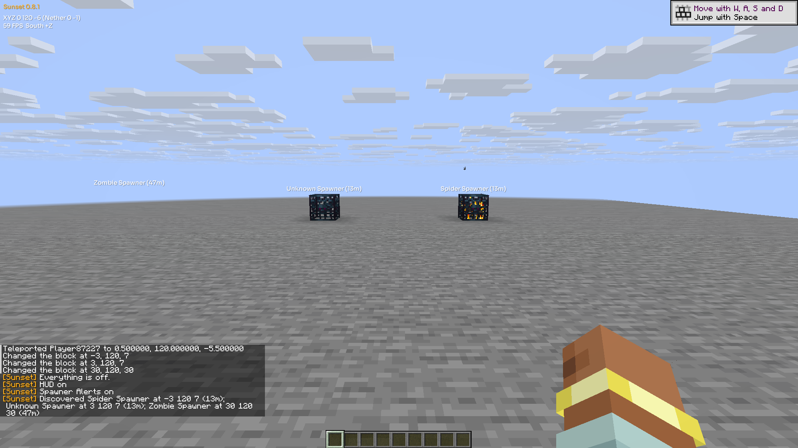
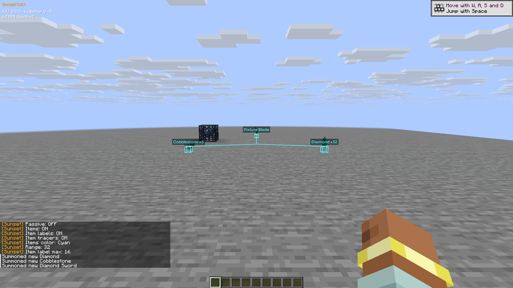
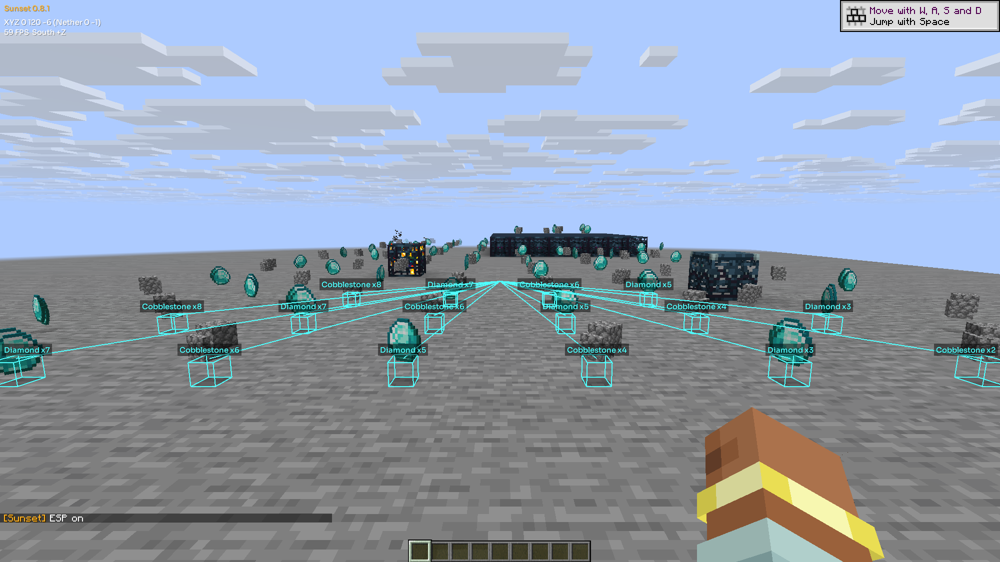

# Spawner and item overlay checks

The native implementation at `37ace57` passed **26 distinct offline tests**, the
official Mixins plan/apply, a native compile check, and a linked client build.
Windows runtime checks used offscreen `horizon-ctl` sessions with freshly generated
singleplayer homes and worlds. [Machine-readable results](discovery-checks.json)
record the revisions, frozen input hashes, observations and limitations.

The spawner adapter suite includes its seven core tests; they are counted once.
The 16 item tests include two visibility-cap regressions and 2,160 comparisons
between box eligibility and the actual box renderer. Native compilation used
Rust 1.99.1, Horizon `ba6344a59cb9e755b730dcf02285fc0d33b97d3c`, and Mixins 0.5.0
at `0d6b103c70633d8fd9443d8d0acd3aadaacedb06`, with no build warnings.

## Live observations

- Spawner notices included coordinates, distance, supplied mob types and an
  Unknown fallback. Normal and trial spawners were exercised. Range changes,
  disable/re-enable, removed blocks and replacement metadata behaved as documented.
- A 64-block fixture produced three detailed discoveries and a `+61` summary.
  The configured one-label limit was respected. Scanning maintains its
  256-candidate tick budget independently of the loaded chest/entity count.
- Item labels showed localized names, a custom `Fixture Blade` name, and stack
  counts. Diamond Include/Exclude filters, the nearest-one limit and switching
  to the next drop after removal were checked visually.
- The larger item fixture used 128 summon commands. One native-client readback
  contained 111 item entities; a later server cleanup removed 127. These counts
  were taken at different times and are not a claim of 128 simultaneous client
  entities. The selected result limit was 16. Behind-camera and removed-item
  captures had no item markers. Range input below the existing minimum was
  correctly clamped to eight blocks.
- Dimension travel cleared old markers. A spawner at the same coordinates in
  the Nether was discovered independently. Returning preserved Overworld
  discovery history; disconnecting and reopening reset connection history.
  Item settings survived save/reopen. The final lifecycle run finished with
  normal input ownership, saved, and exited with code zero.

Three-second offscreen frame samples remained around 59 FPS with a 60 FPS limit.
Raw CPU/GPU phase samples are in the JSON. They describe this machine and fixture;
they do not establish general frame-time cost or zero overhead.

The first controller run stopped on an unsupported `rshift` alias after the core
and stress observations. A companion stopped on a tick wait while paused. Both
games saved and exited normally. The separate lifecycle run completed without a
driver error. Filtered menu rendering and close/resume were observed; popup
controls and physical keyboard delivery were not independently validated. The
full upstream `tools/verify.py` requires Unix `SIGALRM` and was not run on Windows;
the scoped native checks above were used instead. No external server, real
account or existing world was used.

## Metadata delivery limit

Types describe metadata received by the native client. In this pinned Horizon,
same-state `/data merge` can change server NBT without emitting a block update
and `BlockEntityData`. The client then retains its earlier metadata. Replacing
the block with air and recreating it delivered the new type and refreshed the
label without a duplicate discovery. The mod does not infer a type from nearby
mobs or repair the host's packet synchronization.

## Native framebuffer captures

These PNGs are unaltered **2000 × 1125** captures. The requested 1600 × 900 window
uses Windows' 125% display scaling; overlays draw into the resulting native
framebuffer. No resizing or compositing was applied.

Behavioral reference: the supplied Anubis footage, from Anubis by Horus and
4ldenz. No reference-client Java files or assets are bundled with this change.
