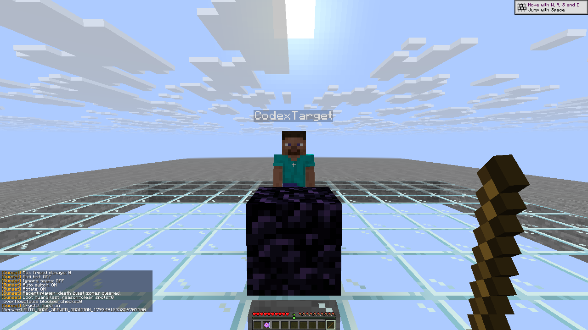
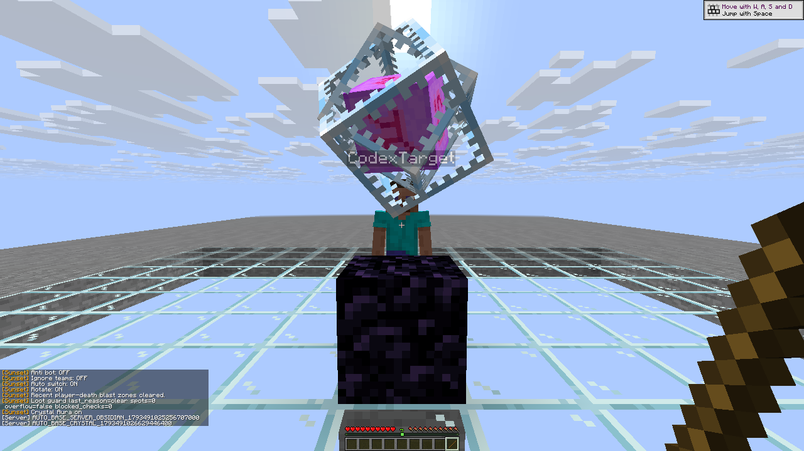
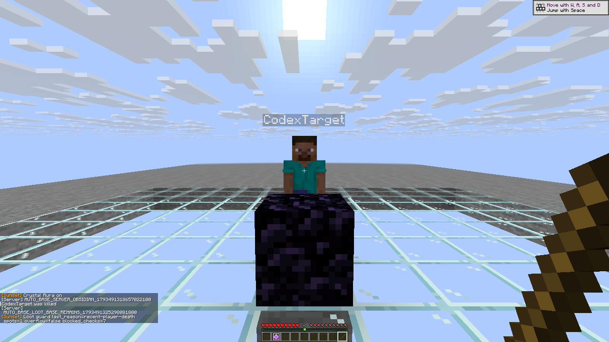
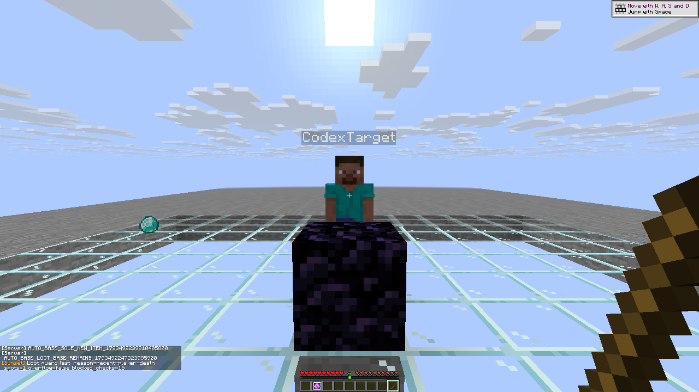

# R14 native Auto Obsidian outcomes

[Sanitized observations, report hashes and original image hashes](auto-base-r14.json)
use the exact [R14 client checkpoint](checkpoint-r14.json).

All **nine primary scenarios pass**: option off, staged full cycle, actual
offhand cycle, uninterrupted automatic cycle, missing materials, unsupported
setup, fresh target-damage threshold, fresh friend and module disable after
the base ACK. The material case contains separate missing-obsidian and
missing-crystal controls; those arms are not counted as extra scenarios.

The fixture has a glass floor and exactly one permitted inert stone support.
A complete native scan census contains no earlier obsidian or bedrock base.
Setup places obsidian at `(3, 121, 0)`, then the real crystal at `(3.5, 122, 0.5)`. Exactly one
obsidian and one crystal are consumed and slot 9 is restored. Staged cycles
capture real entity IDs before enabling Break. The separate uninterrupted
cycle keeps Break enabled throughout and uses no actor chat/settings/GUI
between start and outcome. Its narrow ID window was missed and is not claimed
as captured; actual server base, inventory consumption, health loss and slot
return establish completion. Target 20 HP with Resistance IV falls to16.1763 HP;
actor 20 HP/Resistance 255 is an explicit fixture fail-safe.

Minimum target damage 1 is deliberate: the new pedestal occludes lower target
rays. Anti suicide and self limits remain enabled. Fresh target/friend option
changes can also cancel work through chat; those cases do not isolate a
sub-tick accepted-deed race. The native support helper deliberately accepts a
small inert-block whitelist; the unsupported case has no such support.

The bounded ledger retains at most 64 distinct setup cells until explicit
module/context reset, with no eviction. New cells fail closed at capacity.
Three-refusal retry/ACK boundaries are covered by compiled production policy
tests, not a forged or refused-packet native fixture. This is not unlimited
full-world setup coverage.

The optional post-ACK loot integration has **one clean native pass in a
distinct third attempt**. Its two earlier attempts remain recorded as harness
failures. The first contains an actual
target death, diamond drop and native respawn/reposition after the base ACK.
The base remains, crystal stays unspent, both post-respawn players remain 20 HP,
and the current native diagnostic reports one death zone and seven blocked
checks. An explicit Protect loot=false control places real crystal ID 336 on
that same base with Break disabled. Its parser nevertheless selected an older
cleared-zone entry from the newest-first history and recorded failure.

A parser-order regression was added. The one corrected native rerun then
stopped at an earlier prerequisite: its immediate server diamond-drop query
found no item. It did not reach the loot-veto verdict. Neither raw report is
rewritten or relabeled as a pass. The actual death is intentional; unchanged
HP refers only to the post-respawn observation interval.

The final fixture verifies authoritative target position/inventory and an
empty item census before death, then requires exactly one new item entity,
tags it and verifies actual diamond NBT globally. Its moving drop is at
7.1223,121,-4.2113, outside the earlier feet-centered radius 3. After real death
and respawn, one recent-player-death zone produces 15 blocked checks: the real
base remains, crystal stays unspent and both players remain 20 HP. An explicit
Protect loot=false control then places actual server crystal ID 348 with Break
disabled. This third outcome is a separate passing report; the earlier two
reports and their original capture remain unchanged.

These are unmodified 1280×720 native captures. Final cleanup restores both
players to Survival20 HP, empty inventories/effects, all modules and inputs off;
control streams close before the explicit pair handoff.
