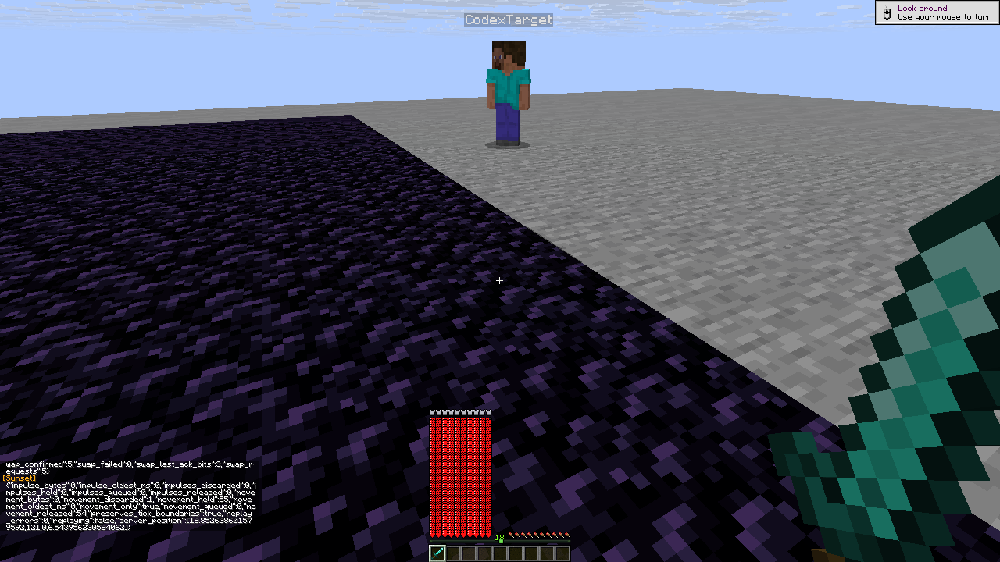
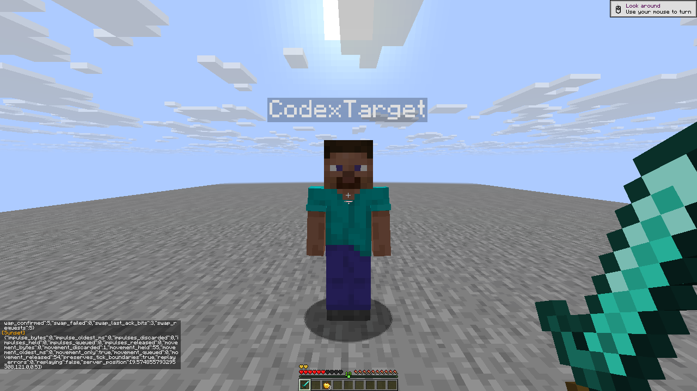
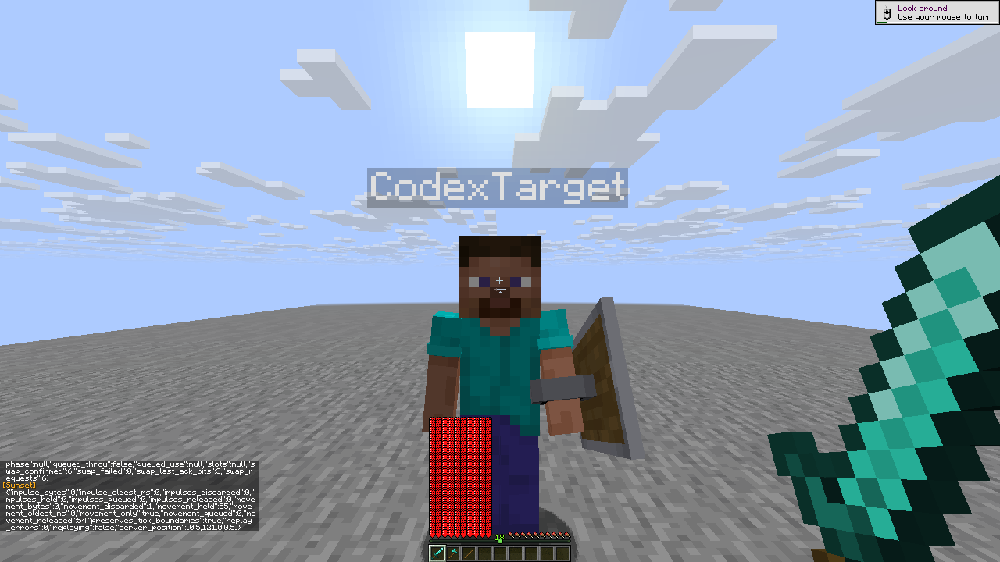

# R7 controller, melee and cleanup player outcomes

[Compact outcomes, exact report/control hashes and screenshot hashes](controllers-melee-r7.json)
refer to the [R7 checkpoint](checkpoint-r7.json), with two actual native clients
against the private stock Java26.3 server. Client SHA-256:
`f856c2fe3f634aefac465517d4ca7ebb8d4e620340421499e174f488939ba696`.
These results belong to R7, independently of later builds.

**36 distinct behavior cases have passing outcomes:** 17 controller, 13 melee
and six cleanup cases. There were **41 recorded check attempts: 36 passed and
five fixture failures remain retained**. Corrected runs provide the missing
passing outcomes; they do not change the original failed records. The R7
155 focused checks and 19 isolated explosive cases are separate suites.

## Actual outcomes

- Sword and Crystal controllers chased the real second player and caused
  damage. Target HP changed from 999 to 964 with Sword and from 999 to 799.4011
  with Crystal. Friend, native-key manual yield, trench refusal, mutual
  controller yield, food consumption and slot restoration controls passed.
  Crystal also equipped an actual offhand totem during its food fixture.
- Both controllers kept temporary settings out of config/profile/export files.
  Ordinary disable restored the live baseline. Explicit edits, including
  writes equal to a temporary value, survived repeated chat resumes and
  later disable. Off/on rearmed the controller; profile load created a fresh
  context rather than restoring an earlier baseline.
- Melee covered real Aura/Trigger hits, native reach, grounded critical
  restrictions, direct/piercing friend guards and enchanted spear Lunge.
  Falling Mace damage was 31.690 versus a grounded sword's 7. W Tap reduced
  early horizontal speed from about 0.153 to 0.084, 0.046 and 0.025. Actual-hit
  jump excursion increased from 0.9648 to 1.2522 blocks. Equal recent native
  mouse motion gained 3.675 degrees toward the enemy with Aim Assist; idle
  yaw stayed unchanged while the target moved.
- Automatic and passive/manual Shield Breaker paths both passed: a held
  shield first blocked a real sword hit, exact-player observer metadata
  cleared after axe use, then the restored charged sword caused real HP loss.
  Defender-local use animation is diagnostic because it can remain stale.
- Inventory-menu, bound Panic and bound module-disable cases restored an
  observed borrowed axe slot **before its ordinary two-tick expiry**. A
  manual slot override remained selected. After a real sprint hit, Panic
  canceled pending S Tap while physical-key-backed W/Ctrl stayed held;
  forward movement continued and key release stopped it cleanly.

## Retained fixture failures

The first Jump Reset enabled arm received no sword damage or upward knockback,
so it could not establish that behavior. The corrected fixture required the
defender's actual native ray to contact the attacker within 2.7 blocks. Both
arms then received 7HP hits and produced the height comparison above.

Three cleanup attempts used F8/F9, which the official control parser rejected
before native hooks. Supported J/K binds replaced them, with unrelated
conflicting bindings cleared and later restored. One further pending-input
attempt read `sprinting` from `status`, although that field belongs to `state`.
The corrected read passed. All five failures retain their report and original
screenshot hashes in the JSON index.

## Fixture limits

Most fixtures requested maxhealth 1000 and used observed HP. Food used actual
max 20/8HP. Resistance 255 was a separate attacker fail-safe, omitted in the
real-knockback comparison. Crystal positives additionally used durable plain
netherite and the explicit Observed equipment damage model. Both controllers
used Strafe off; Sword used Jump crits off and Crystal used Use anchors off.
This record does not prove those disabled controller branches.

These are controlled loopback fixtures, without latency, anticheat, moving
enemy or general pathfinding claims. The native master UI case proves attack
suppression and reactivation. Opening Options can already cancel transient
work, so it **does not isolate live-lease master-off restoration**. These
controller intent cases use chat commands; later native GUI intent changes
require their own runtime evidence.

## Unchanged native frames

All four images are byte-identical 1280×720 framebuffer copies, without crop,
resize, annotation or compositing. They are postcase frames; measurements
come from the corresponding native health, inventory and motion traces.

The handoff independently verified both players in Survival with 20HP, empty
effects/inventory/carried items and released keys, every module off, native
master on, daytime and clear weather. Raw reports remain private; this index
publishes selected observations and exact hashes without local account paths
or authentication data.
