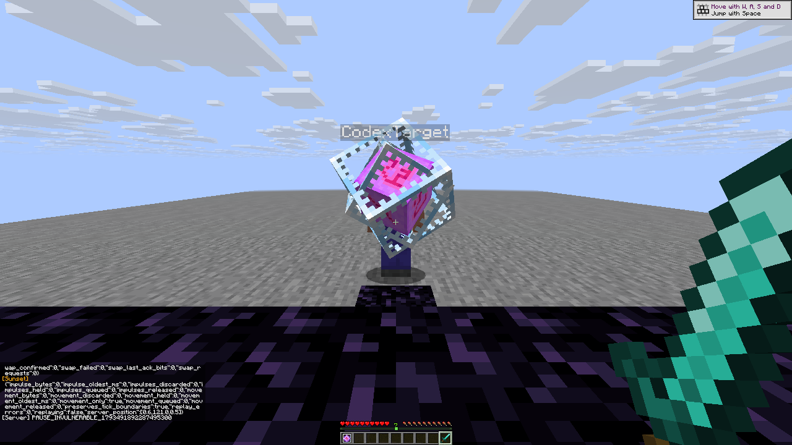
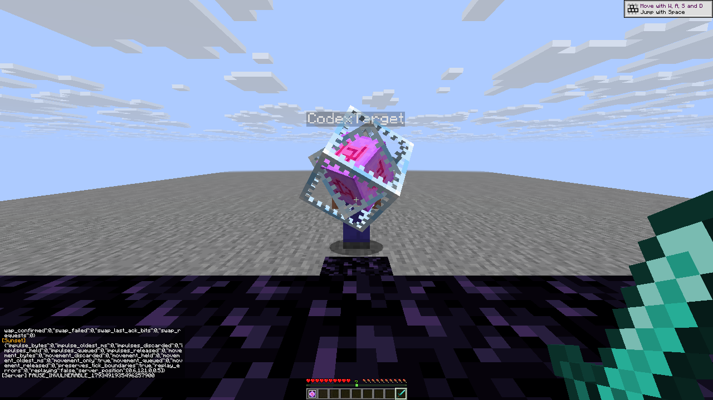

# R14 Crystal pause regression

Two core scenarios passed on native client `7ec29509ed88ea6126a25f56147ea40c91a5823a3d3ef2671ead3affd2ebd0c1` using the private
stock Java26.3/protocol777 pair. The optional delay arm remains inconclusive:
**three attempt records: two pass, one inconclusive**, with no native failure
inferred. [Sanitized facts and original report hashes](crystal-pause-r14.json).

With one real server-invulnerable crystal, the native sender counter rose
**4→7**, then stayed at 7 after the last 30-tick pending wait had expired and
through four inventory/chat pauses. The module stayed enabled. The same native
ID 341 and tagged server UUID survived. An independent explicit off/on control
reached counter 10, then its first post-reset observation reached 11 for unchanged
ID 342. Later bounded retries in that fresh context are allowed.

These counters observe the native sender path; they are not server ACKs,
wire packet counts or exact send timestamps. The optional 30-tick delay check
had first-send bounds21392–21411 and sampled at 21445, past even the upper
possible deadline 21441. It therefore cannot establish early-send behavior;
its original unsuccessful driver report is retained.

Final handoff verified both players at20 HP in Survival/Playing, empty inventories
and cursors, no effects/use/mining, accepted input releases, attacker modules
off/master on, target master off, and no arena test-item residue. Streams and
fixture lock were closed before explicit release. No native source was edited.

Both images are byte-identical 1280×720 native captures. Numerical evidence is
in the paired JSON and raw reports, not inferred from a single still image.
