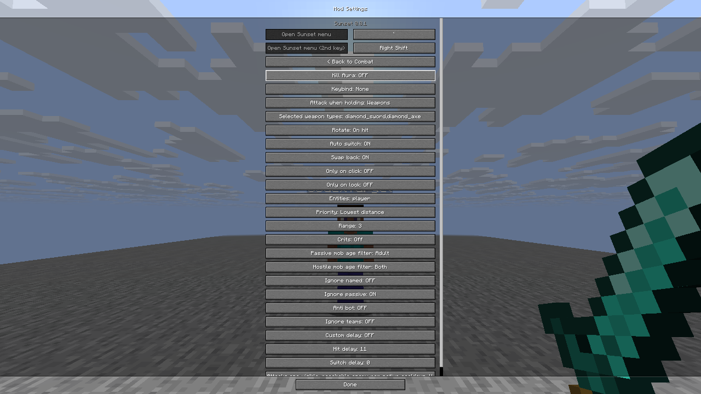
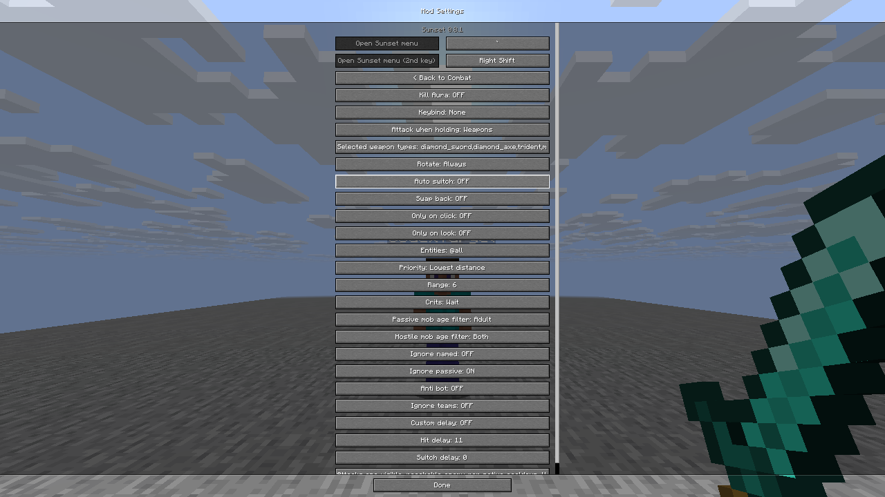
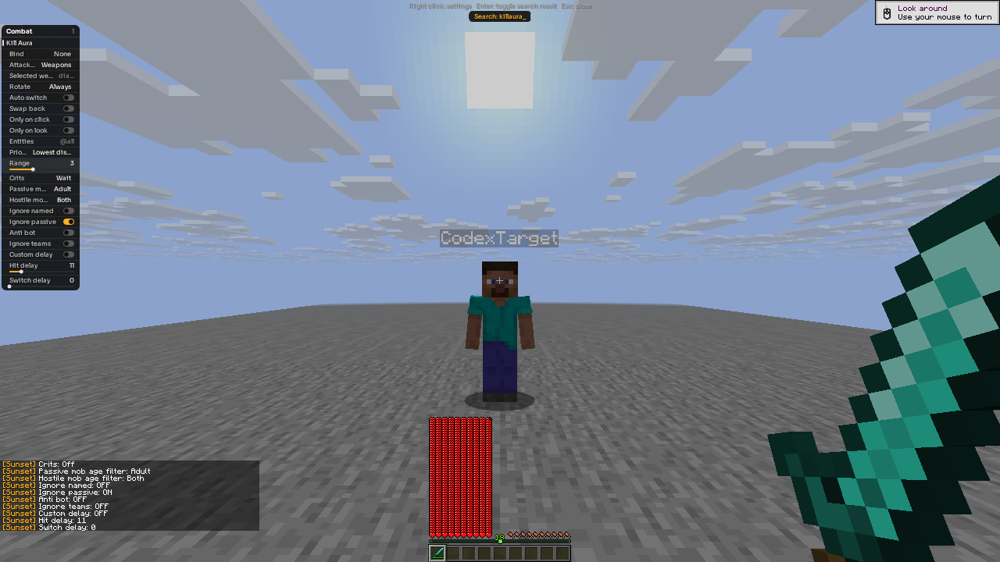
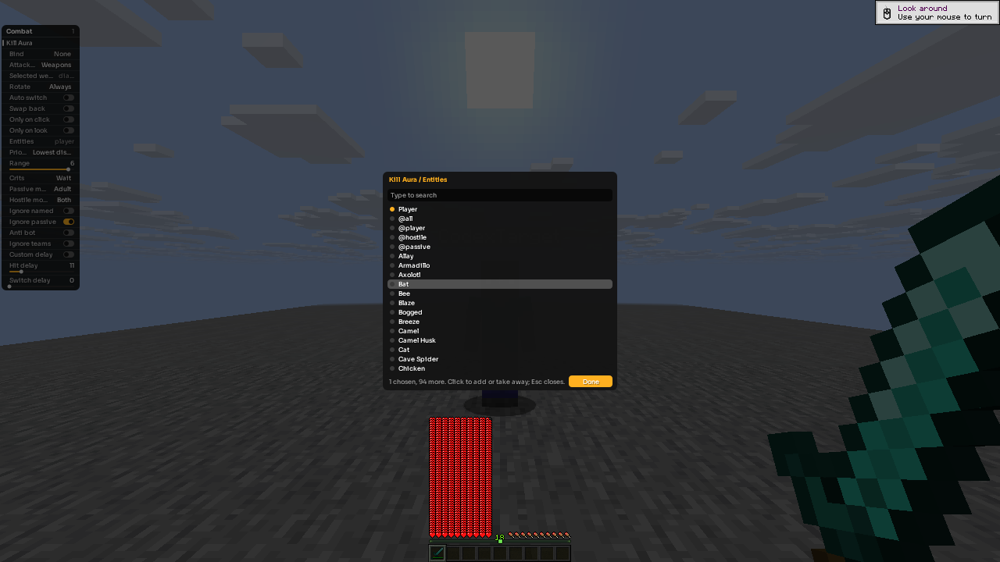
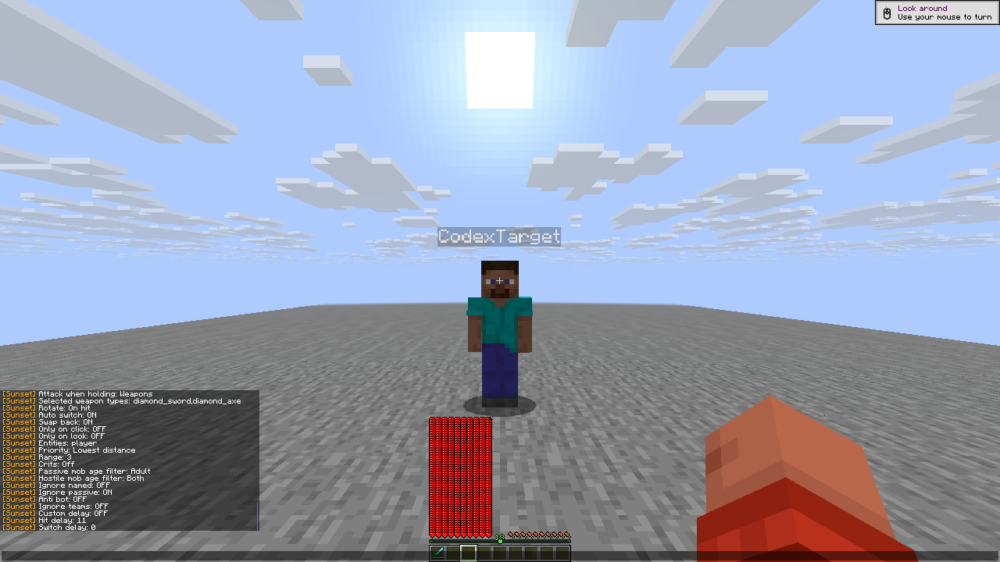

# R10 GUI intent and retention history

[Recorded outcomes, raw hashes, verified layout and image hashes](gui-intent-r10.json)
refer to the [R10 checkpoint](checkpoint-r10.json), client SHA-256
`6b3c97809e5bb82699c217d48a1aaa2f6912dc8cced8b56f5654d8e574984f51`.
Two actual native clients used the private stock Java26.3 loopback server.
All interactions used official native widget/window/control routes, without
game-memory access or internal game-function calls.

Four GUI intent cases have passing outcomes across five recorded attempts:

- Native Options displayed the bot's temporary Auto switch **ON**. Clicking
  it produced **OFF**, which remained false in configuration after bot disable.
- The overlay's mouse-only number reset selected default Range3 while the
  saved baseline was 6. The intended 3 persisted while the bot remained enabled
  and after ordinary disable.
- The actual picker removed Player, scrolled the native registry list,
  selected the visually verified Player row and clicked Done. The final
  `player` setting survived ordinary bot disable. No keyboard search was used.
- The corrected number-entry case entered 3 and pressed Enter, then used an
  explicit unrelated native `.set wtap Hold 2` save. Configuration changed
  from 6 before that save to 3 afterward and stayed 3 after bot disable.

## Original failed attempt and input limitation

The original number-entry check failed because it required the active config
file to contain 3 before a later save. The observed file still contained 6 there,
but normal bot disable saved 3. That failed record remains unchanged; the later
explicit-save result does not relabel it as a pass or claim immediate saving
while the editor stays open.

The official R10 control key route also exposed an input-capture limitation:
digit 3 selected hotbar 3, and the post-Enter frame shows native chat. The control
route reaches `Game::key_pressed` directly, bypassing the older mapped-key
guard. These R10 outcomes prove selected setting intent and persistence;
they **do not prove keyboard capture**. The subsequent R12 capture change
requires its own native test record.

## Screenshot retention correction

Repeating NumberEnter within one interactive proof reused one generic final
screenshot label. The corrected attempt overwrote that generic failed-attempt
frame. Its original hash remains in the raw failed record, but that generic
file must not be presented as retained failure evidence.

The original failure's four distinct collapsed, expanded, draft and after-Enter
captures remain byte-verified. The gallery uses the authentic after-Enter
capture rather than the overwritten generic frame. The private retention
addendum's exact hash is in the JSON index. Screenshot names now include both
a proof-run timestamp and per-capture sequence so same-case repeats differ.

## Unchanged native frames

These are byte-for-byte 1280×720 framebuffer copies, without crop, resize,
annotation or compositing. The configuration outcomes come from the recorded
native files and subsequent normal-disable checks.

The handoff verified both players in Survival with 20HP, empty effects,
inventory/carried items and keys, every module off, native master on, and the
playing screen with its pointer captured. The raw reports and addendum remain
private and are identified by exact hash in the public record.
