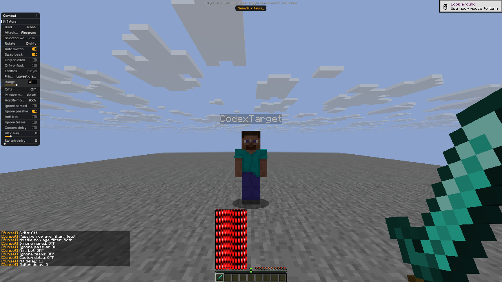
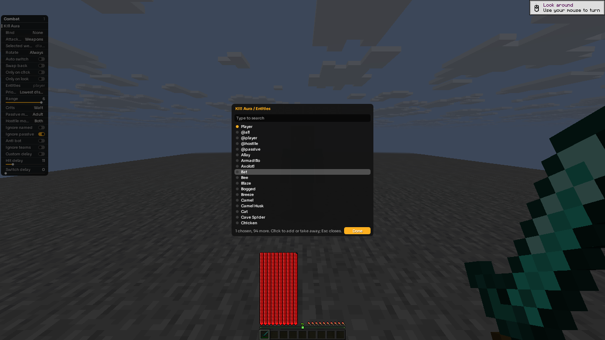
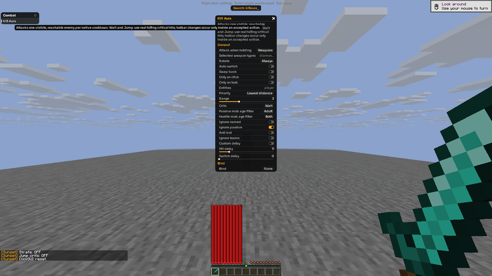

# R13 native GUI intent and F1 lifecycle

[Sanitized outcomes, verified layout, raw hashes and image hashes](gui-intent-r13.json)
identify the exact [R13 checkpoint](checkpoint-r13.json), client SHA-256
`2568f4720bb603d045f2752145ab808fb1c1c748bb95c580aea0ef1217e3f346`.
Five recorded native checks passed, with zero failed checks, on two disposable
native clients against the private stock Java26.3 loopback server.

## Confirmed outcomes

- Native Options displayed temporary Auto switch ON. The user click produced
  OFF, which persisted while the controller stayed enabled and after disable.
- The number editor entered the same temporary Range 3 over a configured
  baseline 6. Digit 3 and Enter both kept selected sword slot 1 and the playing
  screen; neither opened chat. The overlay kept its pointer released while
  open. Bounded Escape closure recaptured it and saved 3, which normal bot
  disable retained. **No unrelated save command was used.**
- Mouse-only number reset likewise preserved intended 3 over baseline 6 at
  actual overlay closure and after normal controller disable.
- The real registry picker removed Player, scrolled the native list,
  reselected the visually verified Player row and clicked Done. `player`
  persisted at overlay closure and after normal disable.
- With the actual floating right-click settings window open, one official
  ctl F1 tap left the same native client alive, playing and showing the window.
  Escape closed it and recaptured the pointer; the settings window reopened
  and closed normally afterward.

The F1 result uses original full-frame visual inspection, monotonic native
tick/uptime and unchanged own-entity observations, plus a verified settings
region comparison. Its mean absolute RGB channel difference was 0.00460 after
F1 and 0.00964 after reopening, on the 0–255 channel scale. These bounded image
checks supplement the visible settings frames; they are not a universal UI
detector. Tick/uptime samples include screenshot waits and are not latency
measurements.

## Unchanged native frames

All 28 referenced original PNG hashes were checked without conflicting path
reuse. The three published images are byte-identical 1280×720 native framebuffer
copies. Region comparisons only read pixels in memory; no crop, resize,
annotation or composite was saved.

## Scope and handoff

The tested input route is the official native ctl/widget/window route.
This is **not a claim about OS physical keyboard events**. The controller GUI
fixtures requested maxhealth 1000 and used Resistance 255 as a separate attacker
fail-safe. They do not establish default combat safety or general latency,
anticheat, stress or arbitrary UI-state compatibility.

Both players were restored and independently verified in Survival with 20HP,
empty inventory/carried items, effects and input, every module off, native
master on, and the playing screen with its pointer captured.

The [historical R10 results](gui-intent-r10.md) retain their strict-save failure,
ctl input leakage and one overwritten generic failure-frame disclosure.
These R13 results do not relabel those earlier attempts or recreate missing
historical bytes. Raw reports remain private and are identified by exact
hash in the public record.
