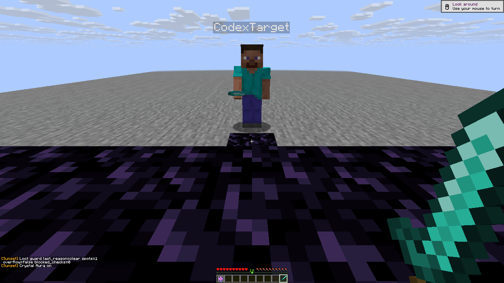
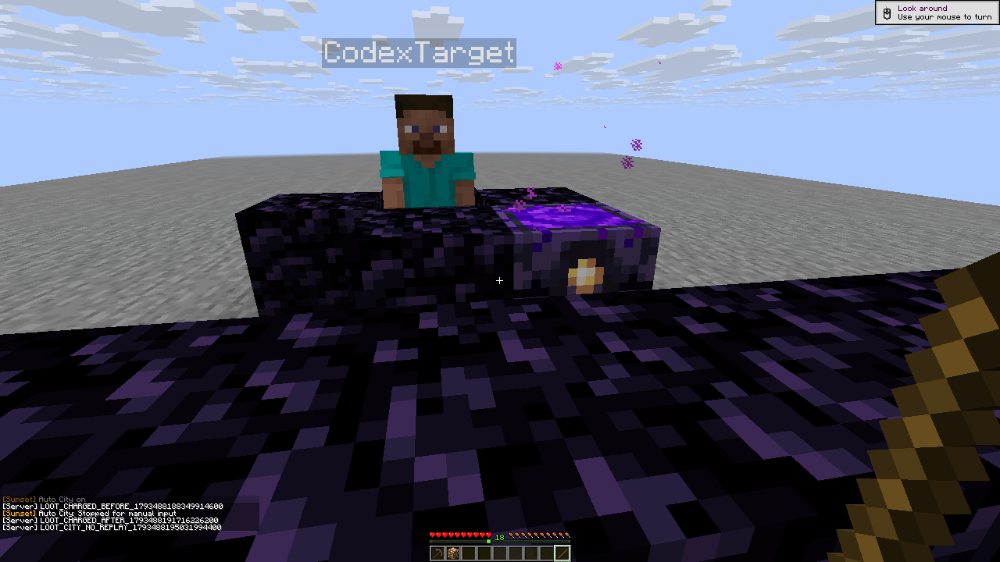
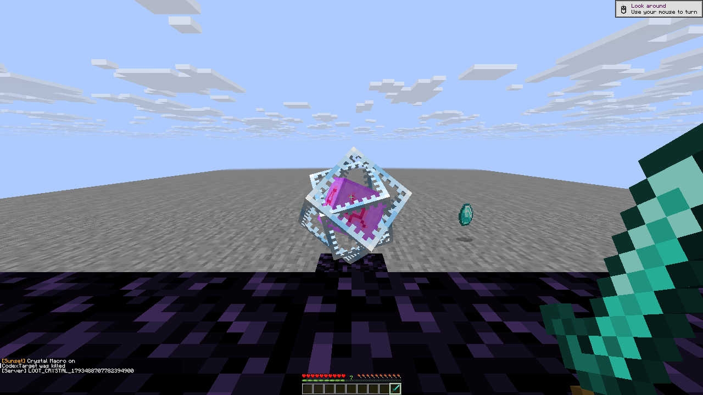

# R10 recent-death protection: native player checks

All **16 canonical scenarios and four positive owner controls** have passing
outcomes on the frozen R10 native client `6b3c97809e5bb82699c217d48a1aaa2f6912dc8cced8b56f5654d8e574984f51`. The private backend was
official stock Java26.3/protocol777; two actual native survival clients were
used. These are R10 results, not a claim about a later binary.

The retained attempts contain **36 completed records**:
24 passed and 12 retained fixture/runner failures.
Repeated controls are not additional unique scenarios. Original reports, raw
control traces and failed screenshots remain unchanged; their hashes and exact
classifications are in [the sanitized evidence](loot-player-r10.json).

Each owner's refusal followed a passing real-action control, an observed player
death, actual diamond-drop NBT and a fresh respawned eligible target. Both Auras
and both manual macros then preserved items/world/target health. Fully charged
anchors remained intact under quick/held unsupported-hand and offhand-glowstone
clicks, including a guard-only press during an actual Auto City tool lease.

The active cancellation case witnessed slot9→borrowed slot1→slot1 immediately
before kill→restored slot9, with the same crystal retained before any chat/debug.
The deferred sub-tick queue race was not isolated. Expiry, Anchor Macro checkbox
bypass, explicit clear, same-dimension respawn retention, dimension reset, and
real egg/snowball negative controls passed. The final handoff verified both
clients alive at20HP, survival/playing, empty inventories/cursors, no using or
mining, all modules off, accepted input releases and no arena test-item residue.

This is recent-death-location protection, not tracked-item pickup/motion
protection, a global manual-action filter, or an item-survival guarantee.

All three images are unchanged1280×720 native framebuffer captures. Their exact
hashes are recorded beside the underlying world, inventory and server facts.
Captures precede final diagnostics, so HUD text can show an earlier setup query;
current decisions are established by the paired numerical facts, not stale chat.
