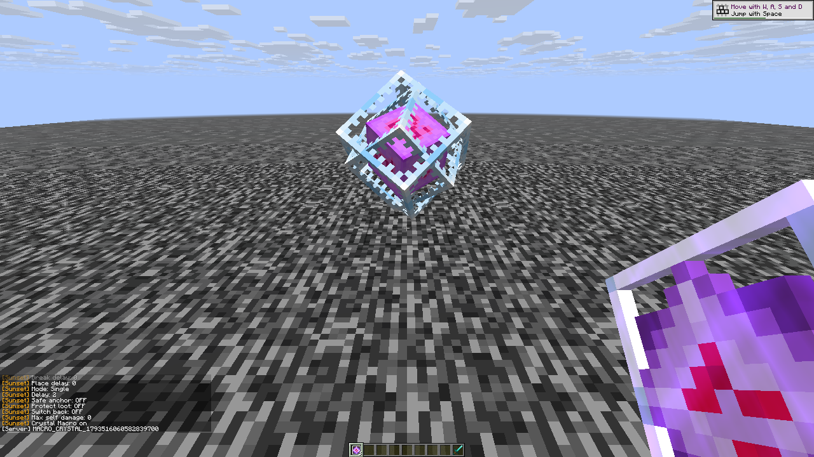
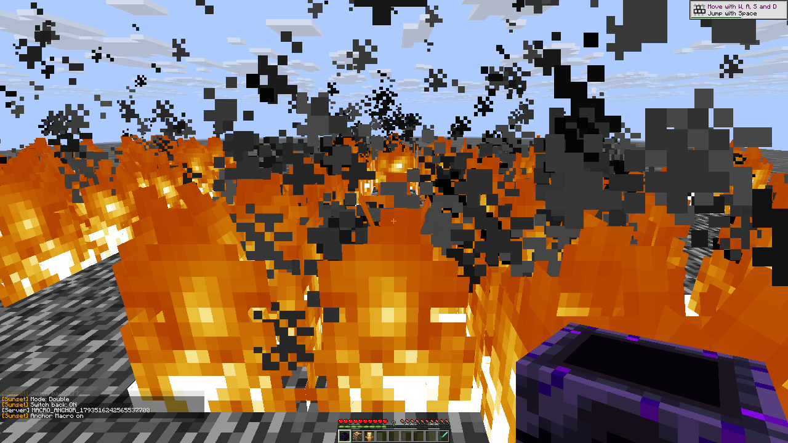
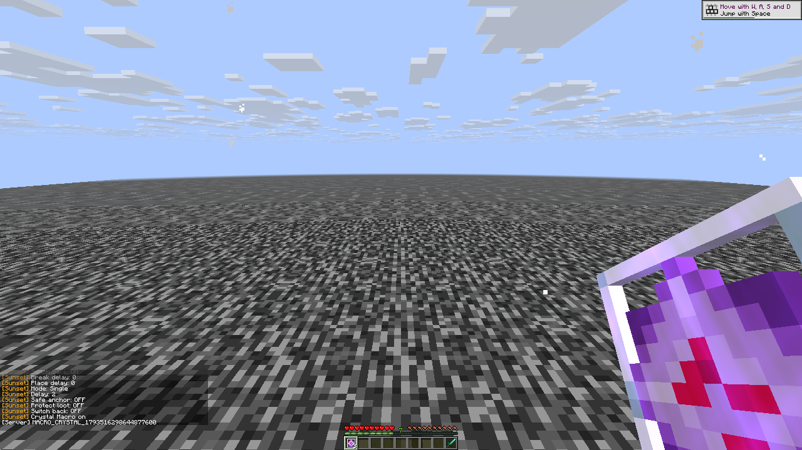

# R28 manual macro runtime evidence

Eleven of eleven scenarios passed in one completed R28 run: eight baseline controls plus three contact/crouch controls. There were no failed attempts in this run. Earlier R27 failures remain separately retained.

The client is `edef37bd867bbbd1d34bf3058c99519a2f3e31e8cec497994d19e7c4c430716f`, built from source commit `1768f7f9f6d3168ccf2a8aa719ef3ecab9b638cc`. All 141 frozen mixin fingerprints match that commit exactly or after LF/CRLF conversion only. The original closed report, raw replies, source fingerprint and cleanup handoff are identified by SHA256 in [manual-macros.json](manual-macros.json).

One quick click on the charged anchor top produced native phases `charged → air → uncharged replacement → charged → air`, two removals, and stock Java inventory consumption of exactly one anchor and one glowstone. Side contact produced one removal and consumed neither spare. The actor position and selected slot remained unchanged. These controls used delay 2, Safe anchor off, Resistance 255, and actual explosion knockback resistance 1; they do not establish default timing or guard behavior.

The crouch control removed the original native crystal ID 292 while native sneaking and `ShiftLeft` remained active. The pre-release trace contains no crystal ID; stock Java entity absence was checked afterward. The screenshot was taken after releasing crouch.

The remaining eight controls cover successful held Switch back repetition, no-Switch-back hold control, creative placement with break veto, creative entity reach beyond three blocks, creative Anchor without a totem, actual survival totem exemption, live custom block/entity attributes, and Crystal entity-inclusive versus Anchor block-only contact. Plain item counts and actual Java health/inventory receipts corroborate relevant outcomes.

Cleanup verified both actual players at 20 HP in Survival, no effects/absorption/items/carried stack/held inputs, Playing with pointer grabbed, all modules off, original macro settings/bindings/friends restored, default range/knockback attributes restored, and working native commands via a reversible OFF-module delay change. Streams were closed and the pair was explicitly released before Anchor acquired it.

The images below are byte-identical original native captures. The Double image is an aftermath with fire obscuring the view; it is supplementary to the phase and inventory receipts. No screenshot establishes exact wire timing or server ACK.

Original report SHA256: `531c5729f3a39ae14426712455c6f5bdbc0eacb719ca35ce434ca2432076dfb7`.

Raw reply SHA256: `126820f2dbff25bdd60ebf59d8e2635c8d0297cfb10154bf748ced29db686aad`.

Executed driver SHA256: `1d60afdf26398414f56877838c04f389770b509da838c899f5f70121687de190`.

Native runtime only; no broad parity, public-server, anticheat or unknown-component claim.
