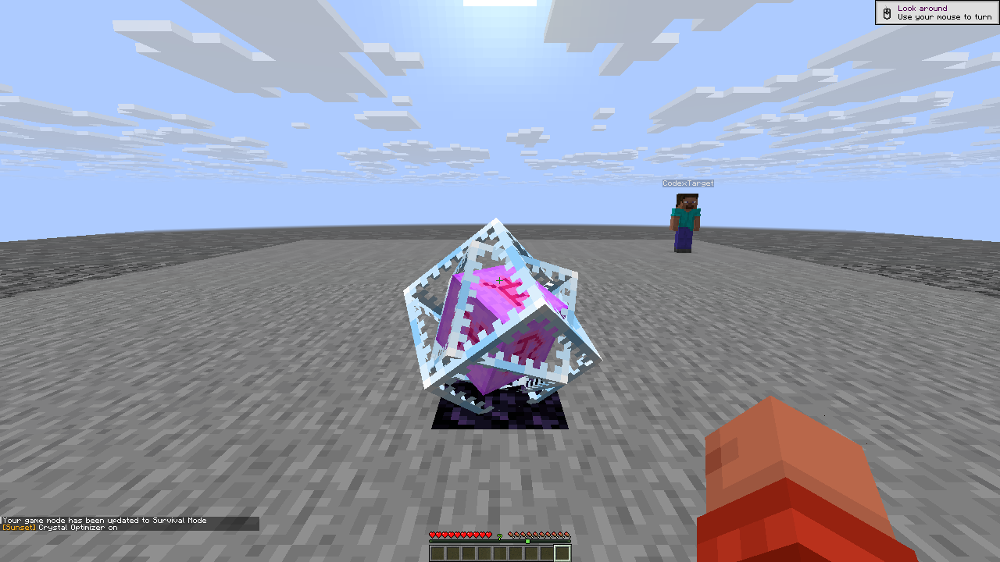
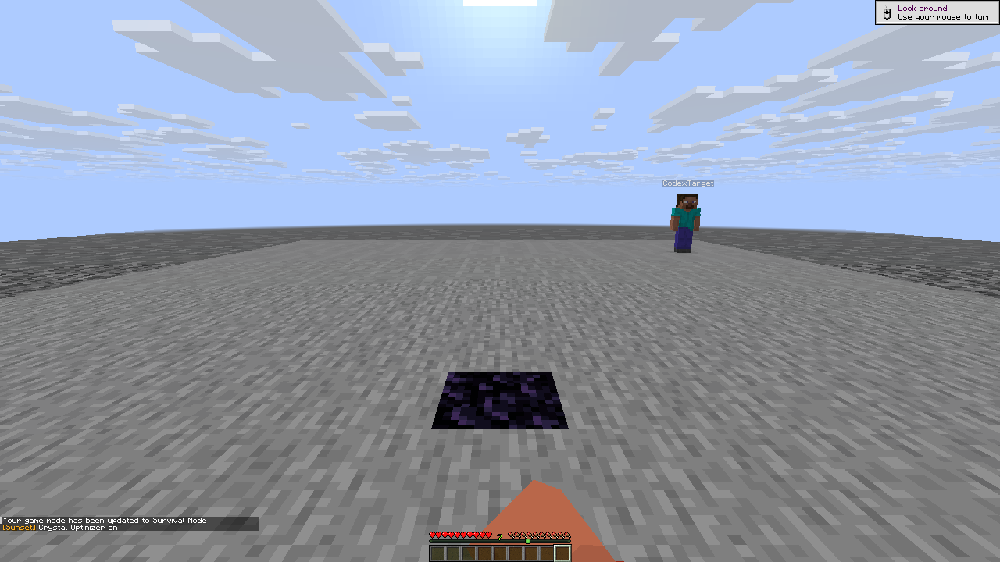
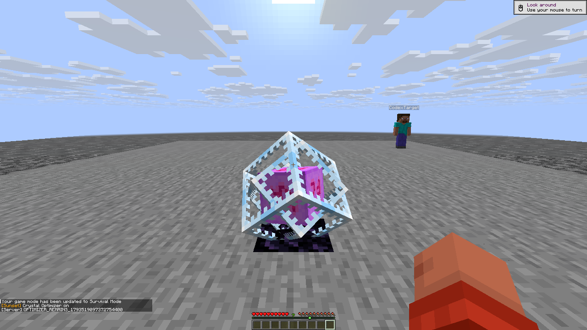

# Native R30 Optimizer: six reviewed passes

Exact native client SHA256: `82951c55e13be66a15ef345bb2384279575355da9e7b5b23dedefc29bbd131ab` (84 modules / 57 injections). Six distinct real-player outcomes passed. The two raw visual cases retain their pending statuses; a separate hashed image-review sidecar records the reviewed verdicts.

The rejected Survival hit now shows **present -> body absent/base only -> timeout restored -> repeated hit stays restored** in four unchanged 1280x720 originals. The same authoritative crystal ID remained in every sample and on the server, with no health loss. The native attack HEAD refresh fixes the cache-phase failure retained from R28. The short-range control remains visible in all four originals and now has this passing positive on the same build.

Creative actual removal, ordinary native removal/explosion health loss and Weakness refusal also passed. The extra behind-ghost A/B provides more than a counter-only hitbox check: two native clicks with Optimizer OFF leave the dirt behind the invulnerable crystal intact; ON breaks that actual server dirt and the native world reports air, while each branch retains its own original authoritative crystal ID and server entity. Original ON imagery shows the ghost absent and dirt-break particles. The tool is a real Efficiency V shovel.

The first cleanup assertion is retained: the target picked up one dirt drop from the successful mining after inventory clear. A separate recovery removed only arena item drops, cleared both inventories and verified Survival/native and server HP20, no items/carried stack/effects/absorption/held inputs, all modules off, exact profile/friend restoration and actual temporary profile deletion. Reach4.5/3 and successful native server command receipts were verified. Both control streams closed; clients/server were left open for root.

Twelve original frames, full hashes, authoritative block/entity receipts, raw report hashes and the review hash are indexed in optimizer-r30.json. This rerun preserves the earlier R28 ghost failure and two replaced fixture failures; it does not rewrite their history.

## Original framebuffer sequence

Each PNG below is the unchanged 1280×720 native framebuffer. Short public filenames
map to their original filenames and SHA-256 hashes in [published-images.json](published-images.json).

Before the rejected Survival attack:

After the attack, with the same authoritative entity retained:

After the confirmation window expires:

