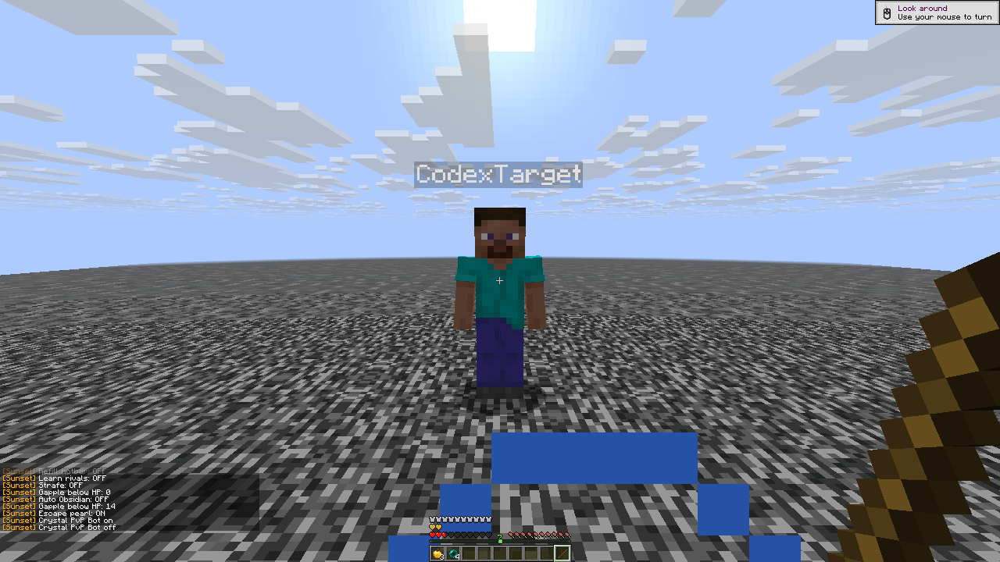

# Native combat parity: player evidence

These are two actual Horizon player clients connected to a disposable stock
Java 26.3 backend on loopback. Official `horizon-ctl` supplies input and reads
native state; the server console supplies block, entity, inventory and health
receipts. Each result keeps its original client identity and report hash.
The passing cases below are not one all-current-binary aggregate.

## Completed parity validation

The final [R30 build](parity-build-r30.json) passes official native checking,
the optimized build and **682 focused checks** (631 compiled/native adapters,
51 source contracts). Its 142 source fingerprints identify the exact input.

- **R30 pearls: three cases pass.** [Peer follow, sprint chase and Escape](pearls-parity-r30/README.md)
  use real projectiles, item consumption and actual player displacement. The
  strict peer marker confirms the actor throws while the target remains at its
  launch position and the target-owned pearl still exists. Escape uses three
  real totem rescues in each off/on arm, with actual server-used statistics.
- **R30 Optimizer: six reviewed cases pass.** [Original frames and receipts](optimizer-parity-r30/optimizer-r30.md)
  show the body disappear, restore on timeout and stay restored after rejection.
  The authoritative entity survives. An off/on control mines actual server dirt
  behind the predicted ghost only when enabled, with that entity still present.
- **R28 macros: 11/11 pass.** [Full macro proof](macros-parity-r28/manual-macros.md)
  includes the eight baseline cases, Double top/side controls and crouched Crystal
  breaking. A quick top click completes two removals and consumes exactly one
  replacement anchor and glowstone; side contact keeps the Single sequence.
- **R28 inventory and packets: four and eight behavior cases pass.**
  [Two-slot ACKs and timing receipts](packet-inventory-parity-r28/README.md)
  distinguish inventory source slot 9 from actual hotbar source slot 0. The
  occupied-offhand control sends no swap. Packet tests use real movement and
  sword knockback, action/menu/disable flushing, correction and a Nether return.
- **R28 Trap cases pass.** [The original 15-case batch](trap-optimizer-parity-r28/trap-optimizer-r28.md)
  retains its Optimizer failure separately; R30's reviewed rerun resolves it.
  Ring/head placement, target versus placement range, native prediction,
  input/use controls and the optional native roof extension have actual receipts.
- **R27 melee: 13/13 pass.** [Melee proof](melee-parity-r27/README.md) covers
  attacks, native reach limits, friends, shield/axe behavior, Lunge selection,
  real-fall Mace, W Tap/Jump Reset A/B and recent-input Aim Assist.
- **R26 Auras and City: 13 and 10 cases pass.** The exact outcomes and source
  identities remain below. R25's controller checkpoint remains separately labeled.

Tests used generated data only. Both final client pairs quit with exit 0 and
the private backend saved and stopped with exit 0; see the
[shutdown receipt](parity-final-shutdown.json). The packet profile-name postlude
failure and the dirt-pickup cleanup race remain recorded alongside their verified
recoveries. Failed or inconclusive measurements are never rewritten as passes.

Native bounds and framework differences remain in [the scope document](../../combat-parity.md).
These fixtures are not a public-server, anti-cheat or measured FPS claim.

## R26 Auras and City

[Aura outcomes](parity-auras-r26.json): **13/13 cases pass** on client
`5704cc88b03c30ba39fe7aae4717905da7c11f19cc527359279f0fb952df400f`.

- Crystal completes placement and breaking, with actual server health
  **20 → 5.041668 HP** and original-slot return.
- Anchor completes place, charge and detonate; a precharged-anchor case also
  passes. Actual server health changes **20 → 10.263782 HP**.
- Friend and zero-self-cap controls prevent the respective attacks.
- Face Place compares off/on using actual low-durability head equipment,
  high target health and cover; the off arm remains below its damage threshold.
- Auto Obsidian passes an uninterrupted cycle, hotbar and actual offhand
  materials, off, missing materials and unsupported placement. The complete
  cycle changes target health **20 → 16.176311 HP**.

Positive explosion fixtures explicitly use attacker Resistance 255 and target
Resistance IV. They verify action sequencing and server outcomes, not unknown
opponent defenses. Zero-self-cap controls remove attacker resistance.

[City outcomes](city-parity-r26/city-r26.md): **10 distinct cases pass**.
Actual ordinary and attribute-reach-six mining open the exact server cell
observed by the other native client. Off, friend, manual-input cancellation,
disable and reach-one controls preserve the walls. Emergency totem movement
and the global task timeout pass. Inventory pause returns the borrowed slot;
resuming increases progress at the same cell before the unchanged deadline.
That pause case does not claim a completed opening.

The original ten City precondition failures (a fixture confused one-based
selected slots with zero-based hotbar indices) and the overstrict menu-opening
expectation are retained in the proof index. Neither is silently relabeled.

## R25 controller checkpoint

[Selected original outcomes](parity-bots-r25.json): **10 behavior cases and one
settings-schema case pass**; the original Anchor-defense failure remains in
that record.

Sword Bot deals real player damage in both styles with Kill Aura off. Crystal
Bot passes confirmed hotbar refill, actual four-block surround, knock-up,
manual-input pause, an observed server mining opening and a chase pearl against
a genuinely sprinting target. The corrected mining case follows the actual
chosen cell rather than assuming which wall the bot should select.

Mending consumes real XP bottles and reduces server chest damage **500 → 372**.
The downward-use case observes the actual projectile below the eye and a
horizontal camera before and after. The critical-food case starts at 3 HP
without a totem, retreats beyond eating distance, consumes one real apple and
receives **4 absorption points (two hearts)** while leaving unsafe pearls unused.

The native framebuffer is 1280 x 720. This original PNG is copied unchanged;
it is behavioral evidence, not a claim of reference graphics parity. The
fixture resource set has placeholder textures for some blocks.

## R27 investigation checkpoint

[Manual macros](macros-parity-r27/manual-macros.md) have passing outcomes for
eight canonical cases across nine retained attempts: held repetition and its
Switch Back control, creative Crystal placement and breaking, creative Anchor,
the actual survival totem exemption, custom interaction ranges and entity-versus-
block cursor selection. The first repeat attempt's blast-knockback fixture
failure remains separate. These cases use Single mode; they do not prove Double.

[Melee outcomes](melee-parity-r27/README.md) pass all 13 scenarios: actual Aura
and Trigger attacks, a native reach-limit control, friends on direct and piercing
paths, Shield Breaker, Lunge selection, real-fall Mace damage, W Tap and Jump
Reset A/B, recent-input Aim Assist and a raised-shield/axe/sword server control.
These use explicit 1000-HP fixtures. The last five cases read native state health;
they do not claim separate per-hit console samples. The original single-panic
postlude mistake and separate command-path recovery remain qualified in the
receipt; the behavior cases completed before that postlude.

[Original outcomes](parity-bots-r27.json) identify client
`1a5c773a64655d3546dd15b73b2f728985f096bd95a720d525808f4a84c67e7e`.
Anchor defense now passes its off/on control: the charged anchor disappears
only in the enabled arm and the target takes real damage.

Following another player's real pearl still fails on this checkpoint. The
owner diagnostic confirms the raw owner ID resolves to the target's native
mob. The planner observes that flight, forecasts its landing and creates a
throw plan, but never reaches a successful native use. This is a retained
failure, not a positive test. Later fixes need a new immutable native build
and a distinct real-player run.

The R30 peer proof above is that distinct successful follow-up; this earlier
failure is retained unchanged.

Historical R7/R10/R14 core receipts remain in [combat-validation.md](../../combat-validation.md).
Their removed controls and older timing are not evidence of new parity behavior.

These stationary private fixtures establish neither public-server compatibility
nor anti-cheat acceptance, internet-latency behavior or measured FPS gains.
