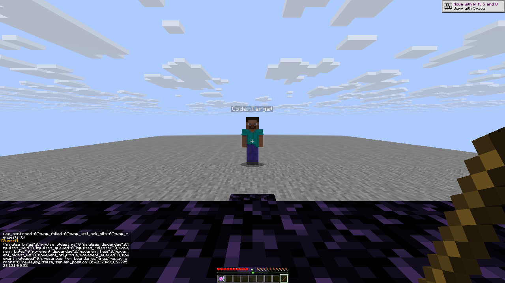
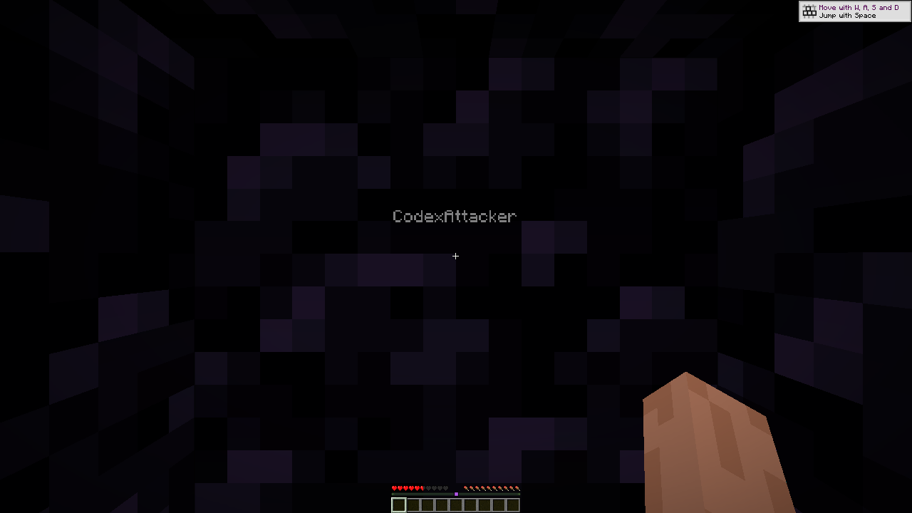
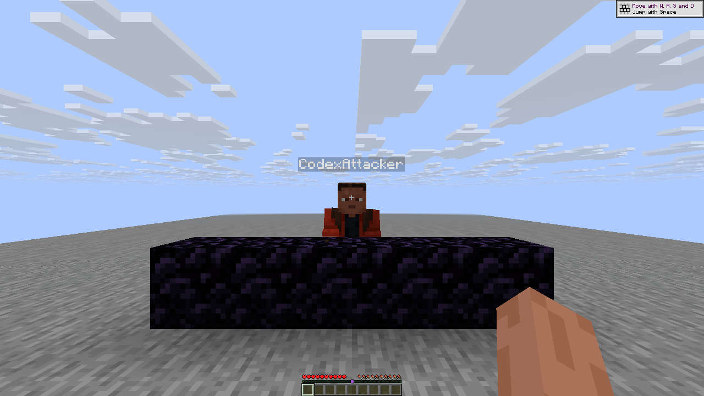

# R14 Aura checks with two real players

[Observed outcomes, exact report and native image hashes](players-r14.json)
use the [R14 client checkpoint](checkpoint-r14.json). All five checks pass:
two backend/player prerequisites and three Aura behavior checks. These are two
actual native clients, CodexAttacker and CodexTarget, on the private stock
Java26.3/protocol777 backend.

Crystal Aura places an observed real crystal, attacks that ID, removes it and
restores slot 9. Target health changes **20 → 5.041667938232422**. Adding the real
target as a friend prevents placement, item consumption and health loss.

Anchor Aura produces observed states **charges0 → charges1 → air**. Target
health changes **20 → 10.263781547546388**, with slot 9 restored and the single
anchor/glowstone consumed. The sample timestamps establish observation order;
they are not precise network timings. Health comes from the target client’s
server game state, not a damage-model prediction.

Both clients have ordinary maximum health 20 HP and Survival mode. The target receives
Resistance IV to survive a blast; the actor has Resistance 255 as a separate
fixture fail-safe. The modules explicitly retain Unmitigated self cap 16,
Anti suicide and minimum remaining health 4. Fire damage and natural regeneration
are disabled. Death zones are explicitly cleared for these baseline cases.
Crystal Break is staged after observed placement; the uninterrupted automatic
cycle has its own [Auto Obsidian proof](auto-base-r14.md).

Both players were restored to20 HP, empty inventory/carried/effects/input,
all modules off and normal playing/pointer capture before the next isolated
case. The user's worlds, accounts and personal instance were not used.

All four indexed images are byte-identical 1280×720 native captures, including
an additional actor Anchor frame. No crop, scaling, annotation or composite
was saved. This stationary fixture does not establish moving-target performance,
public-server compatibility, anticheat behavior or guaranteed self safety.
