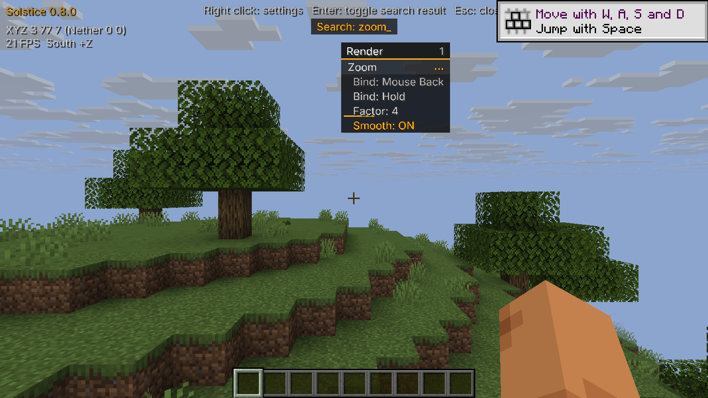

# Keyboard and mouse binds

Every module keeps its existing keyboard bind and defaults to **Bind activation: Toggle**.
Supported modules also offer **Hold** to enable them temporarily while their bind is down.
Releasing the input restores its previous manual on/off state. A manually enabled module therefore
stays enabled after a hold; turning it off in the GUI or with `.t` takes control from that hold.
Temporary activation is never written to the saved config.

Click the module's Bind row, then press a keyboard key or mouse button. Escape cancels;
Backspace or Delete clears it. A captured mouse click is consumed instead of also changing a GUI row.
The same capture works on Options > Mods > Solstice.

Chat examples:

```text
.bind zoom mouse4
.set zoom bindactivation Hold
.bind flight r
.set flight bindactivation Toggle
.bind flight none
.binds
```

Mouse names are `mouse1` (left), `mouse2` (right), `mouse3` (middle), `mouse4` (back), and
`mouse5` (forward). `lmb`, `rmb`, `mmb`, `mouseback`, `mouseforward`, and Horizon's full
`key.mouse.*` names are aliases. Higher numbered buttons use the names supplied by Horizon.
Keyboard aliases such as `r`, `rshift`, `f6`, `kp1`, and `key.keyboard.r` still work.
Mouse binds leave the button's normal in-game attack/use action intact.

Hold activation stops when a GUI/text screen opens, focus is lost, Solstice is disabled, the bind
or activation mode changes, or the player leaves the world. A new physical press is required to
activate again; a key held while closing a screen is not a fresh bind press.

Hold is available for Zoom, ESP, Tracers, Nametags, Storage ESP, Block ESP, HUD,
Trajectories, Waypoints, Breadcrumbs, Logout Spots, Hole ESP, Tunnel ESP, Void ESP, and Light Overlay.
These modules read their current active state directly. Other modules show **Toggle (Hold unavailable)**;
chat rejects setting Hold for them. This deliberately excludes camera, abilities, mesh, and persistent
engine overrides such as Flight, Step, Freecam, Free Look, Timer, No Slow, Xray, No Render and Fullbright,
whose existing native-disable cleanup has not been changed. Plugins likewise retain Toggle-only binds.
Reach also stays Toggle-only because its reach value is cached by the engine. Air Place stays Toggle-only
because its right-click callback runs before bind activation; a right-button Hold would miss that first click.
The compatible Radar module also supports Hold when installed alongside this change.

Run the host-free state tests with `python tools/test_binds.py` (or supply `--rustc PATH`).
These tests cover aliases, press/release edges, transient persistence, cancellation state, the supported module set,
and the production setting parser's error message when Hold is unavailable.
Isolated Windows checks also exercised real OS keyboard/right-mouse Toggle presses,
native-controller keyboard Hold with a raw OS release, menu cancellation, stale-held-key
blocking, GUI mouse capture, restricted modes and restart readback. The final
**Bind: Hold/Toggle** display keeps the value visible in the narrow menu; the
stored and chat setting name remains **Bind activation**.

The test backend cannot demonstrate a complete physically held key sequence or
side buttons. Focus/native-disable and Options-page capture remain live coverage
gaps. Controller `chat` bypasses native hooks on this host, so setup used the
actual key/type/Enter path. See [check details](input-binds-checks.json).



This MIT contribution was written with AI assistance. Its inputs are this repository's existing
bind/settings code and the exact pinned Horizon input hook implementations. No external client
implementation or runtime was used.
