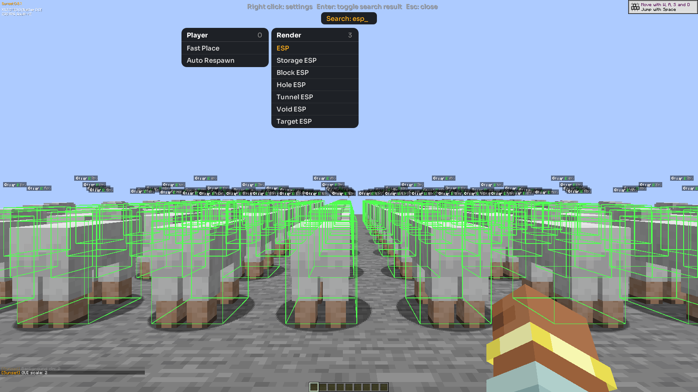
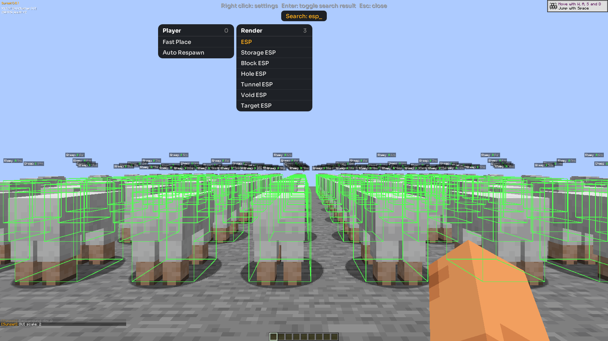

# GUI and world-label glyph scale

World labels previously selected the base font scale before the open GUI selected its larger scale. That rebuilt the shared glyph atlas repeatedly and left earlier text using replaced glyph coordinates. World labels now select the same atlas scale as the GUI; their screen positions and size remain unchanged.

## Whole-game measurement

Pinned main `380b403`, Horizon `ba6344a`, official Mixins `cb1ad23`, optimized `fast` profile, Ryzen 5 4600H / GTX 1650 Ti, Vulkan, native 1600أ—900 framebuffer. These local offscreen results include game simulation, terrain and entities. Results depend on the machine and scene.

Each side starts a fresh generated singleplayer world with identical settings: render distance 2, VSync off, uncapped FPS, 96 stationary sheep, ESP + Nametags + HUD, mob labels enabled, GUI scale 2 with search `esp` and dim 0. Time, weather and spawning are frozen. No compiler runs during timing. Three 10-second native bench samples per launch are cross-checked against full-game frame and uptime counters.

- Pair 1 (after/before): 206.90 → 243.07 FPS (+17.49%); 1% low 105.75 → 102.42 FPS.
- Pair 2 (before/after): 200.73 → 243.44 FPS (+21.28%); 1% low 106.08 → 140.13 FPS.
- Pair 3 (after/before): 202.80 → 240.80 FPS (+18.74%); 1% low 115.81 → 122.61 FPS.

All three pairs improved average FPS. Median paired gain: **18.74%**, with **+5.88%** median paired 1% low. GPU power-state changes make individual lows noisy; the first pair's low regressed slightly. The empty-scene control is included in the receipt and varies between launches. One incomplete disconnected repeat was excluded and retried, not counted as a success.

[Concise receipt](performance-glyph-scale.json) contains every retained sample, counters, normal exits and exact source/package/binary hashes. The long raw control histories remain outside the PR diff.

## Native screenshots

Both originals below are from the second confirmation pair, at the same 1600أ—900 framebuffer. The earlier image has corrupted sheep labels; the later one has legible labels.

## Validation

- Official Mixins staging, native compile check, optimized client build and normal `.hnmod` packaging passed.
- Six completed confirmation launches exited normally; actual terrain draw calls and continuing simulation were required for every sample.
- Four additional open/close cycles at supported scales 1, 1.5, 2 and 1 passed with readable labels and continuing play; normal exit 0. A dedicated menu key was used because the socket Escape shortcut also opens the vanilla pause menu.

This slice changes only glyph-atlas scale selection. Other #15 changes and existing combat behavior are outside it.
