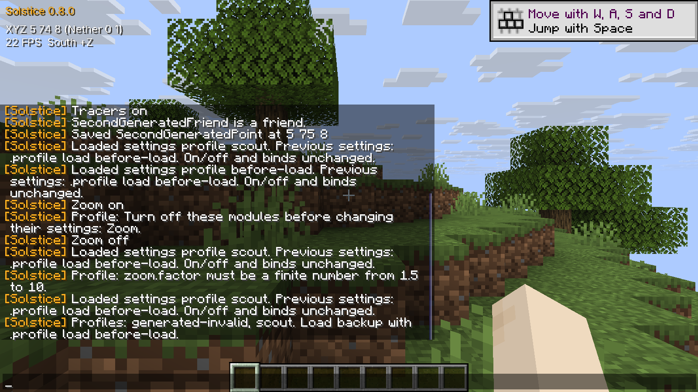

# Local settings profiles

Profiles save the **settings of currently registered modules** under a name. They leave module on/off
states, module and menu key binds, friends, waypoints, panel positions, and Horizon settings unchanged.
They do not select profiles by server, use a network service, or activate modules.

```
.profile save mining
.profile list
.profile load mining
.profile delete mining
```

Saving the same name again replaces that profile. Names are case insensitive and stored lowercase:
1–32 ASCII letters, digits, `-` or `_`, starting with a letter or digit. Windows device names are refused.
At most 128 named profiles are supported. `.help` includes the commands, and an incomplete command shows usage.

Before loading settings that differ on an enabled module, turn that module off and let its normal
tick cleanup run. The load command reports enabled modules whose settings would change and refuses
the whole load. Unchanged settings on enabled modules are allowed. Solstice does not yet provide a
uniform disable/cleanup/reactivate lifecycle for every module; profiles therefore preserve enabled
states and never try to reset gameplay, cameras, inventories, or plugin transient state themselves.

Every valid load first writes two backups:

- `profiles/before-load.profile`: previous module settings, loadable with `.profile load before-load`.
- `profiles/before-load.config`: the full previous Solstice config, for manual recovery while the game is closed.

`before-load` is reserved; it cannot be saved or deleted through the command. Loading it exchanges
the previous settings with the current settings. The same enabled-module guard applies. A failed load
may refresh a backup but leaves live settings and the current config unchanged.

Files live only beneath Horizon's `native_data_dir("solstice")`: named snapshots in `profiles/`, and
the normal `config` beside that folder. This follows the host's chosen game home, including a scratch
home used for testing. This pinned Horizon version exposes `native_data_dir`, `native_setting` and
`native_set_setting`; its setting writer does not report I/O failures. The profile helper consequently
provides checked reads and writes within that native directory, without finding or hardcoding a home path.

The entire profile is parsed and checked before backups or configuration change. Duplicate and unknown
settings, unsupported versions, mismatched types, invalid choices, nonfinite or out-of-range numbers,
control characters and text longer than 4096 bytes are errors. Leading/trailing text whitespace is also
refused because the normal config trims it on startup. Files are limited to 1 MiB, including
bounded reads of externally edited files. A missing module/setting is left unchanged; a profile that
names a plugin setting requires that plugin to be registered before loading. Pending config for plugins
that have not registered yet is carried forward in the normal config.

Profiles have a deterministic, sorted UTF-8 format. Numbers retain full `f64` precision in both profiles
and the normal config (the chat/menu display still rounds numbers for readability). Example:

```
solstice-settings-profile=1
flight.antikick=bool:true
flight.mode=pick:Velocity
flight.speed=num:10
```

Files use same-directory exclusive scratch files, flush their contents, and replace their destination
with a rename. Write or rename failure leaves the old destination intact. Backups and config are separate
replacements; both backups must succeed before config is replaced, and config must succeed before the
single locked in-memory update. This does not promise a multi-file transaction or recovery from every
power-loss scenario. Symbolic links, Windows junctions and other reparse points are refused at the native
root, profile directory and destination file. Trusted host-provided ancestors and no adversarial concurrent
filesystem edits are assumed. A process crash can leave an ignored `.solstice-profile-*.tmp` file.

Host-free validation, without starting Horizon or using player data:

```
python tools/test_profiles.py --rustc <path-to-rustc>
```

This compiles the production profile helper, production model/serialization methods and profile command
against a minimal game-storage/chat fixture. It exercises parsing, precision, scope preservation, recovery,
failed writes, Windows replacement and junction handling. It is not an in-game verification.

## Isolated client check

On Windows, the exact pinned host was staged with Mixins 0.5.0, compile-checked
with Rust 1.99.1, linked and run in a fresh generated singleplayer home. Save,
list, load, delete and backup recovery worked. Loading restored Zoom's factor
while retaining a changed F6 bind, enabled Tracers, two generated friends and
two waypoints. A changed setting on enabled Zoom was refused. A generated NaN
profile left the current config byte-identical. A fresh-process restart and
command readback confirmed settings and preserved data. Both processes quit
normally; frozen inputs stayed unchanged.

The 15 host-free tests cover additional parser, precision and file-failure
cases. This live check does not establish other platforms, multiplayer behavior
or recovery from every power-loss scenario. See [check details](profiles-checks.json).


