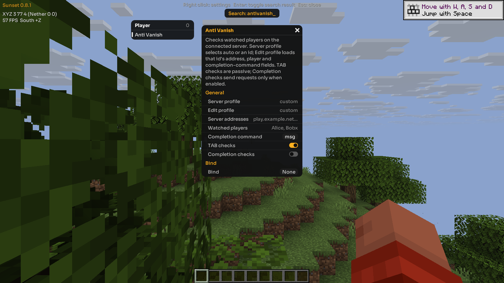
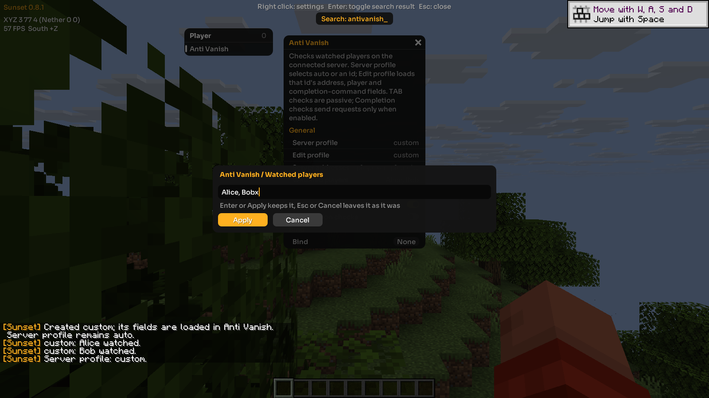

# Server watchlists (Anti Vanish)

Anti Vanish watches accounts you choose on a saved server profile. It is off by
default. Completion checks are a separate opt-in setting and send command
suggestion requests to the connected server. Alerts describe the evidence the
client received; none establishes that somebody enabled a particular vanish plugin.

## Set up a server

Create a profile and add the Java player names you want to watch:

```text
.watch create survival play.example.net
.watch add survival PlayerOne
.watch add survival PlayerTwo
.watch auto
.t antivanish
```

Open Anti Vanish's settings in the click menu. **Server profile** accepts `auto`
or a saved profile id such as `survival`. Auto selects a profile by the exact
connected hostname/IP and effective port. It does not infer staff membership
from the server brand or fetch player lists from a service.

**Edit profile** selects which profile's saved fields you are editing; it does
not change the monitored server. The `create` and `edit` commands load that
profile into the editor. Click **Watched players** to edit its comma-separated
names with the existing Apply/Cancel text editor. **Server addresses** accepts
comma-separated aliases. Addresses normalize case, a trailing hostname dot, IP
notation, and the default port 25565; different explicit ports stay distinct.
An address cannot belong to two profiles. IPv6 with a custom port uses
`[address]:port`.

The `donutsmp` preset starts with `donutsmp.net:25565` and an empty watchlist.
Add the accounts you want to watch and any alternate addresses you use. The
preset is editable and does not claim to contain a current staff roster.

Choose **Completion command** (`msg`, `tell`, or `w`) for that profile before
enabling **Completion checks**. The server must expose names through that
command's suggestions for the check to return useful evidence.

Other commands:

```text
.watch list
.watch edit survival
.watch remove survival PlayerTwo
.watch use survival
.watch status
.watch delete survival
.watch help
```

`use` explicitly selects a profile even if its addresses do not match the
current connection. `auto` returns to address matching. `.watch status` shows
the active profile/connection, check switches and first four account states. Creating additional profiles
uses the command; existing profiles and their lists are editable in the menu.

## What alerts mean

- **Hidden from TAB:** a watched account was listed for at least 1.5 seconds
  before the server marked its retained player-list entry unlisted.
- **TAB disappearance; unconfirmed:** a previously stable account was removed
  from the roster and remained absent for one second. A normal logout can do
  this too. Rejoining during the grace period cancels it. This first version
  does not parse server-specific departure messages.
- **Possibly online: suggested while off TAB:** the server returned the exact
  watched name for this module's current completion request while the latest
  roster did not list it. Suggestions may span a proxy network or include
  cached/offline names, so this is not proof of proximity or live presence.
- **Nearby entity while off TAB:** an actually loaded player entity with the
  account's resolved UUID is within 64 blocks in three-dimensional distance.
  Generic sounds and particles do not create named proximity evidence.

UUIDs are bound from the current connection's player roster, rather than looked
up through an account service. Once bound, an account is followed by UUID for
that connection; another UUID taking the same name does not inherit its evidence.
Enabling the module establishes a baseline instead of reporting everyone
already missing as a disappearance. Transfers, dimension changes, disconnection,
profile changes and disabling clear pending evidence and requests.

## Limits and saved data

F1 keeps an open Sunset menu, settings window or text editor visible. Outside
the menu, it retains its normal hide-HUD behavior. Opening the menu while the
HUD is hidden makes it visible. Menu cleanup runs independently of HUD drawing,
so leaving a screen/world cannot leave invisible menu input ownership behind.

There are at most 32 profiles, eight addresses per profile and 128 Java names
per list. Names use 1–16 ASCII letters, digits or underscores; special Bedrock
name formats are not included. The editor limit is 4096 UTF-8 bytes.

Completion checks allow one outstanding request, at most one request per
second globally and one per watched account per ten seconds while monitoring an
unchanged profile, with a five-second
timeout. They pause while a screen/menu is open or the window lacks focus, and
do not run in the integrated singleplayer world. Reserved, nonreused negative
request ids keep their responses separate from the pinned host's ordinary
positive-id chat completion requests. Wrong, expired, malformed, oversized and
stale replies cannot produce completion evidence. Matching replies refresh the
roster before deciding whether a name is off TAB.

Evidence and cooldowns belong to each account; signals from different accounts
are never added into a combined score. Evidence expires after 60 seconds.
Repeated alerts for that account/evidence have a 60-second cooldown; stronger
evidence can be announced sooner. Same-frame evidence is coalesced per account.
Alerts are local chat output; this module performs no automatic player actions.

Lists are stored separately in `watchlists-v1` inside Sunset's existing data
directory. Checked writes replace that fixed file only on success. Invalid
edits restore the saved fields and display an error. An unreadable or malformed
file is preserved and blocks editing/detection; repair it and restart the client.
Ordinary `.profile load` and `.reset antivanish` preserve the saved watchlists.

## Development checks

The standalone suites execute production configuration and evidence code:

```text
python tools/test_watch_config.py
python tools/test_watch_state.py
python tools/test_watch_ui.py
python tools/test_gui_visibility.py
```

Set `SUNSET_TEST_RUSTC` to the compiler used for the pinned host build. The
adapter suite also needs that build's dependency directory:

```text
python tools/test_watch_runtime.py --deps <staged-host-target>/fast/deps
```

It uses the real protocol Reader/Writer and packet type, actual production
adapter code and extracted UI settings conversion. Game/UI/network boundaries
are fixture providers, with no server connection. Compile-check and run the
native menu separately against the pinned Horizon/Mixins versions. Live behavior
on any particular multiplayer server remains server-dependent.

## Research credit

Anubis Client by Horus and 4ldenz was a behavior-research reference for the earlier discussion
of TAB, completion and local-entity signals. These modules were independently
implemented in Rust from functional requirements. They contain no translated
Anubis implementation or assets. Research credit belongs in source/docs and
does not change the runtime client name or existing project licence.

## Verified client snapshot

The exact pinned Windows client passes all 65 offline tests, official Mixins
plan/apply, full compile check and linked build, with no compiler warnings.
A ctl-only offscreen regression reproduces the old F1 hidden-menu state and
checks the fixed settings/editor, native Apply, pause/resume, normal F1, reopening
with a hidden HUD, Escape/Back to Game, and leave-to-title cleanup. The clean
fixed process saved and exited normally. Earlier generated-file checks verified
independent lists, ordinary profile-load isolation, validation rollback and
restart persistence. No multiplayer server was used. See
[checks and limitations](server-watchlists-checks.json).




