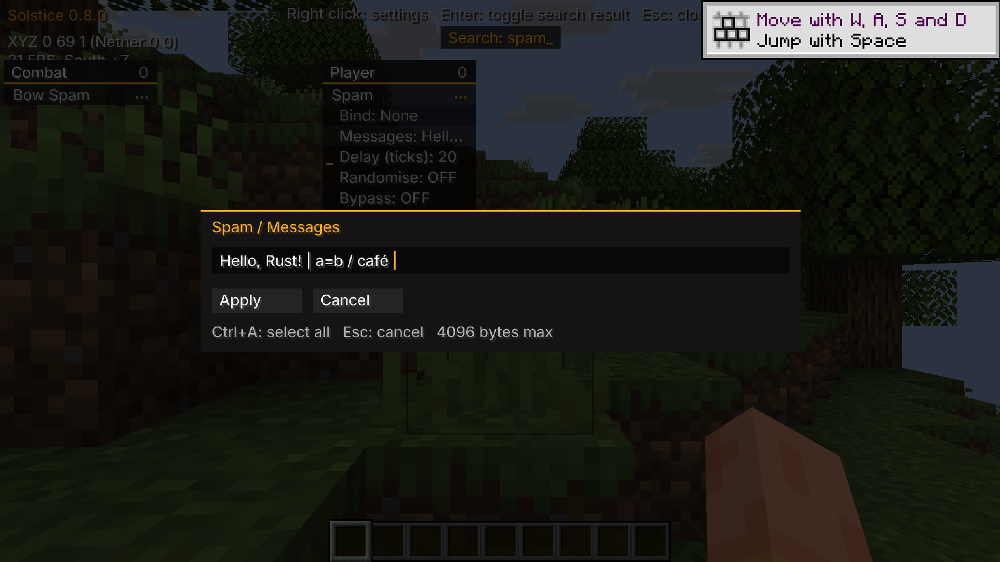

# Text settings editor

Click a text setting in the menu to open an isolated single-line draft. Apply
saves it verbatim; Cancel or Escape discards it. The module stays in its current
on/off state. The draft accepts at most 4096 UTF-8 bytes and rejects controls.

Native Winit keyboard text supplies characters. Home, End, arrows and deletion
follow logical navigation keys, including keypad navigation with NumLock off.
Ctrl+A selects the draft. Movement/deletion use Unicode scalar boundaries;
combining marks remain separate. IME composition, clipboard shortcuts and mouse
caret positioning are outside this change. Existing host window shortcuts and
font glyph coverage remain in effect. Losing focus cancels a draft.

The normal config loader preserves text exactly, including empty/all-space
values, leading/trailing spaces, commas, pipes and equals signs. Non-text config
values and `.set` retain their existing parsing rules.

## Validation

Seven tests use the production draft and extracted production settings/serializer/
loader/navigation code. The exact pinned Horizon was staged with Mixins 0.5.0,
compile-checked with Rust 1.99.1 and linked. In isolated Windows singleplayer,
real OS Home/End/Left/Backspace/Escape input worked. Apply saved a padded Unicode
and punctuation fixture without enabling Spam; Escape discarded a later deletion.
A fresh-process restart followed by an unrelated setting save retained that exact
text. Both client processes exited normally and frozen inputs stayed unchanged.

The Unicode fixture was initialized through the game controller; raw Unicode/
AltGr entry and focus loss were not exercised. See [check details](text-editor-checks.json).

