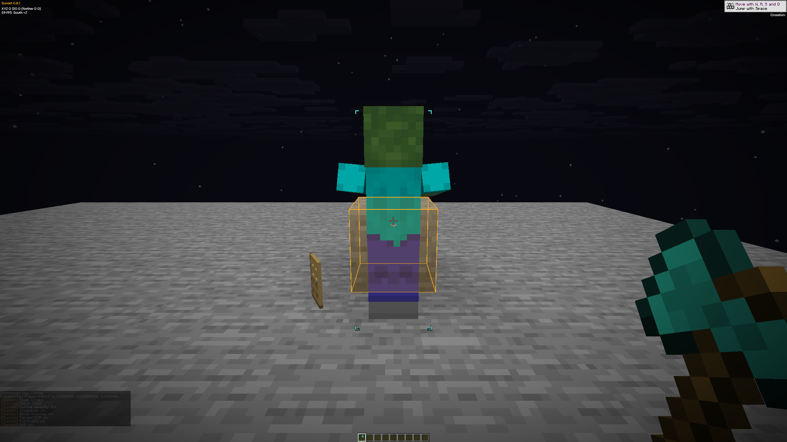
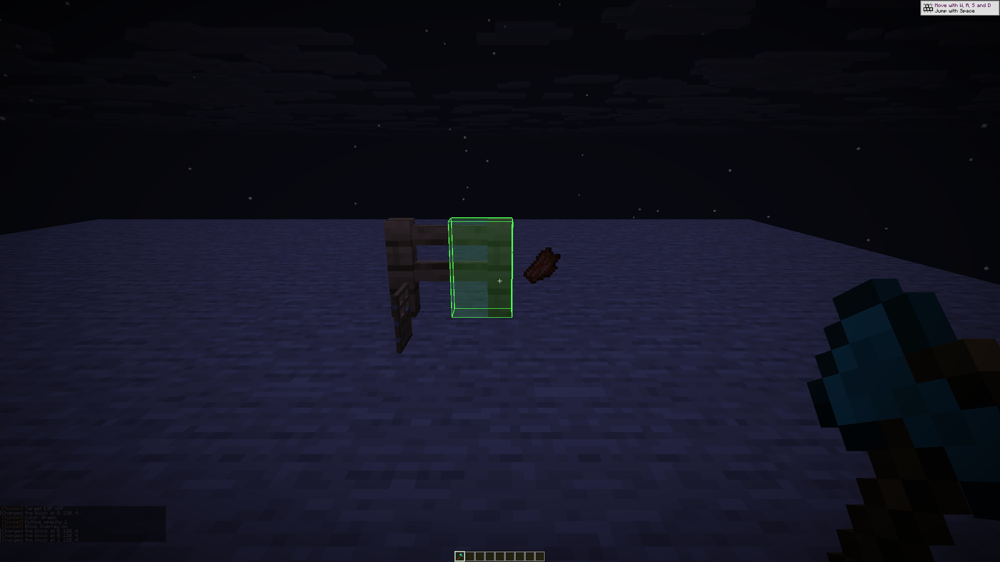

# Native visual validation

Validated 2026-10-31 on code commit `ac35428`, based on Sunset main `fa174f3`.
Horizon `ba6344a`, Mixins `0d6b103` and Rust 1.99.1 are pinned. The complete
plan, apply, compile check and linked fast-profile client/control build passed
with no compiler warnings. Package source was fingerprinted before and after.

## Focused tests

All 32 Rust tests pass: ten crosshair geometry, four production bridge,
twelve block geometry/visibility/frame-publication and six target geometry,
eligibility and bounded sight-ray tests. Fixtures import the production helpers.
Compile each file in `tools/*_tests.rs` for these visuals with
`rustc --edition=2024 --test -D warnings`, then run its test executable.

## Actual game checks

A fresh, generated, offscreen singleplayer world completed **62 automatic checks**
and exited normally. No real accounts, saved worlds or multiplayer servers were
used. The client, control executable, package, extracted source and driver were
hash-pinned; inputs remained unchanged.

- Cross and Dot retain physical size at GUI scales 1 and 3. The Dot occupies
  exactly four pixels in a 2 by 2 rectangle. F1, F3, third-person views and
  disabling restore the appropriate ordinary drawing path.
- The actual display scale was **1.25**. Screenshots are the original
  **2000 by 1125** framebuffer PNGs, copied byte-for-byte without resizing.
- The full vanilla attack indicator remains visible with the custom crosshair.
  Its source-defined 16 by 16 pixel region is byte-identical in the native
  before/after captures, with mean channel error zero.
- A stationary zombie exercises target selection, players-only and range
  filters, full-cube/slab/closed-door occlusion, Through walls, F1, the menu,
  live disable/re-enable and removal after `/kill`.
- Real cube, bottom slab and connected fence shapes exercise Block Overlay,
  target changes, no target, F1 and disabling. The outline fixture uses opacity
  one so its foreground color can be measured directly.

Two earlier harness attempts are retained locally: an unfocused-window mouse
capture assertion, and an unsupported Health data-merge fixture. Both games
exited normally. The completed fresh run fixes those assumptions; earlier
partial observations are not added to its check count.

## Practical limits

The runtime checks use horizon-ctl input. Raw physical keyboard handling,
multiplayer player tracking, natural death and independent despawn are not
established by this run. There is no FPS improvement or frame-time benchmark
claim. Projected block fills and target-center visibility have the limitations
described in [visual settings](visuals.md).

Exact hashes, counts, pixel bounds and timings are in [visual-checks.json](visual-checks.json).

